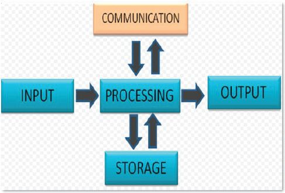
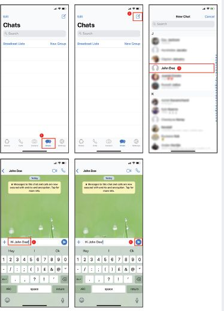
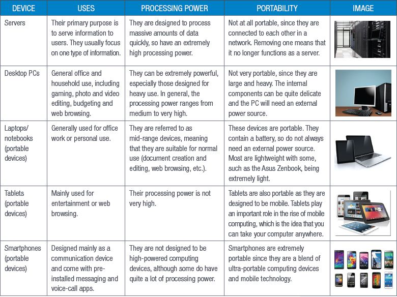
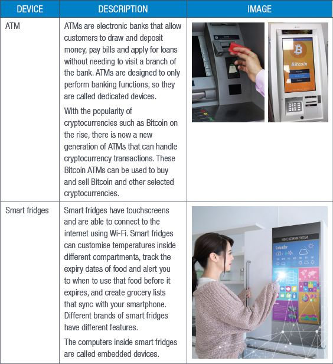
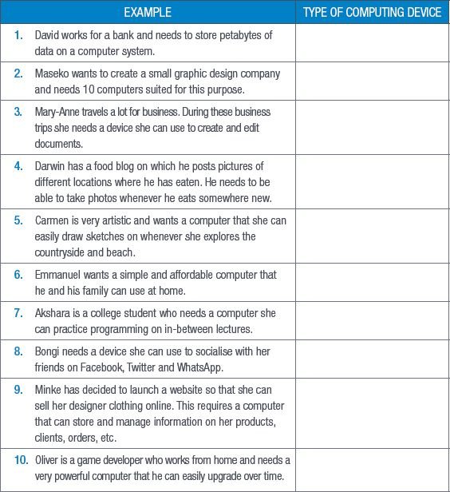

## UNIT 1.1 Information processing cycle

Before you can start to learn about the different types of computers that you will come across, you need to understand the basics of how computers work. All computers, whether they are the smartphone in your hand or large, powerful servers, operate on the same five basic principles. These are input, processing, storage, output and communication. Each component of a computer performs one of these functions, but they all work together to make the computer work.

**Figure 1.1:** *The stages of the information processing cycle*

In this section we will look at each of these stages and how they work together. We will also look at how these processes can get one computer to communicate with users and other computers. The five main steps are input, processing, storage, output and communication.

### INPUT

In the input stage, the data is entered into the computer. There are many ways to do this. In fact, there are as many ways to input data as there are input devices. You would have learned about input devices in Grade 10 but just to refresh your memory, input devices are things such as keyboards, touchscreens and microphones. The user inputs the data (for example, by typing on a keyboard or speaking into a microphone) into the computer. The device takes this data and converts it into a series of 1s and 0s (this is called **binary code**).

### PROCESSING

The central processing unit (CPU) inside the computer then takes that binary code and does the calculations needed to get that data to display in a way that makes sense to the user. The CPU works with the computer’s memory to get instructions on how to display the information from the input device and stores it as pixels in the computer’s memory. This information is sent to the output device to be translated and displayed in a way that is useful. All of this takes a fraction of a second to do.

### STORAGE

Storage is where the computer takes the input and stores it in its memory banks. There are many ways to store the data, but the basic process is as follows:

**1.**The CPU writes the data to the computer’s temporary storage, or random access memory (RAM).

**2.**The computer then waits for the user’s command to move the data from the RAM to more permanent storage. If that command is given, the computer writes the data to the disk drive.

**3.**Lastly, the computer saves the data in a location on the drive, either the default storage location or a location set by the user. The user can then recall this stored information at any time.

You can also store information using external storage devices (for example USB drives or external hard drives).

### OUTPUT

Output is where the computer takes the pixels from the processing stage and displays them in a way that the user can see them. There are many kinds of output devices, such as printers, screens, video and audio devices.

These devices make the raw data usable and visible, allowing human users to interpret the data, turning it into information. This could be the sound waves of a song or the letters in a document.

### COMMUNICATION

Communication is linked to the other stages in the information processing cycle. Each part of the cycle happens because one of the other steps came before it, meaning that they are linked. This link is the communication aspect of the information processing cycle. The most visible aspect of this is the relationship between input and output. Input and output happen almost immediately (for example typing a letter on a keyboard makes it appear almost immediately on a screen). This is communication between the user and the computer.

Communication can then further be sent across a network to other computers. Think about browsing the internet. The internet is basically a huge network of computers linked across the world. Opening your browser connects you to those other computers and these computers communicate with each other to give you what you are looking for. Computers that are linked in a network also communicate with each other. Examples of this are computers linked on a company’s **intranet** or those linked to a server.

SENDING A WHATSAPP MESSAGE

To see how this works, think about sending a WhatsApp message from your smartphone. To start the process, you open WhatsApp and use the touch keyboard to enter your message (this is input, output and communication). Once you press SEND, your WhatsApp application communicates with the servers to send the message and displays it in the current conversation (this is communication, processing and output). The app keeps a record of the conversation on your phone, your friend’s phone and the WhatsApp server (this is storage).

**Figure 1.2:** *How sending a WhatsApp message works*

HOW COMPUTERS WORK

[https://www.youtube.com/watch?v=OAx6-wdslM](https://www.youtube.com/watch?v=OAx6-wdslM)

As you can see, these processes are interlinked at every step of the way.

 Activity 1.1

Do the following activity on your own.

**1.**Usually Mpumi uses the computers in her school’s computer lab to do her homework. Mpumi’s parents recently decided to get her a computer so that she can do more of her work at home.

**a.**What kind of computer should Mpumi use? Give two reasons for your answer.

**b.**List two types of input devices she would need.

**c.**List two types of output devices she would need.

**d.**List two types of storage devices she would need.

**e.**Mpumi wants to save a Microsoft Word document on her computer as “Geography.docx”. Explain the basic process of how she will create and save this file on her computer. NOTE: Consider what happens during each stage of the information processing cycle.

## UNIT 1.2 Computer features and classification

Now that we understand how computers work, we can look at what types of computers there are and their typical components. Computers can be broadly separated into three categories, namely:

**1.****Non-portable:** server, desktop

**2.****Portable**: laptop, tablets, smartphones

**3.****Dedicated devices:** ATM, smart fridge

These devices are classified according to how portable they are, what their processing power is and what they are used for.

This unit will look at these types of computers and their typical components, as well as look at how each type of computer can be classified.

### COMPUTER CLASSIFICATION

Table 1.1 lists the different kinds of computers, what they are used for and their processing power.

**Table 1.1:** *Computing device classification*

### DEDICATED DEVICES

Computers are everywhere around you, even in places that you least expect. It might surprise you to learn that computers are in **ATMs**, point-of-sale devices (that is, tills and card machines) and even fridges and air-conditioners.

These computers are called dedicated or embedded devices and their components will differ depending on what they are installed in, but they will most often consist of a display of some kind (either a screen or **light emitting diode (LED)** display) and some form of input device (such as a keypad or remote control).

They are usually limited in what they can and cannot do, as they are designed to perform very specific functions.

In recent years, so-called “smart devices” have become more popular and available. These devices are designed to interact with each other and the internet to make life easier for their users.

Table 1.2 lists different examples of dedicated and embedded devices.

**Table 1.2:** *Dedicated and embedded devices*

Activity 1.2

Do the following activity on your own.

**1.**Briefly describe what a dedicated device is.

**2.**Give five examples of a dedicated device.

**3.**Place the following devices in order of most portable to least portable.

**A.**Mainframe

**B.**Smartphone

**C.**Laptop computer

**D.**Desktop computer

**4.**Place the following devices in order of most processing power to least processing power.

**A.**Mainframe

**B.**Smartphone

**C.**Laptop computer

**D.**Desktop computer

**E.**Server

**5.**Determine which of the following computing devices are used in the following examples:

**•**Desktop PC

**•**Laptop

**•**Tablet

**•**Smartphone

**•**Server

