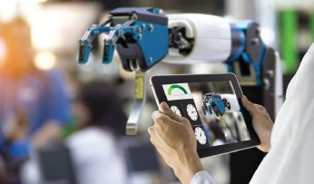

## UNIT 1.3 The role of ICTs in the workplace

COMPUTERS REPLACING HUMANS IN THE WORKPLACE?

ICT is changing the workplace in South Africa:

[https://www.youtube.com/watch?v=iULC9wHu1qc](https://www.youtube.com/watch?v=iULC9wHu1qc)

As you learned in Grade 10, **information and communications technologies (ICTs)** have an impact on every aspect of what people do at home, at school or at work. By looking at what you have learned so far in this chapter, you can see how ICTs have become a major component of daily life. This section will look at the role that ICTs play in the workplace.

The main reason ICTs are used in the workplace is that they allow humans to do their work faster, more efficiently and with fewer wasted resources. Companies no longer need staff to handle physical mail as email is faster and more effective than an employee sorting through post and delivering it to the correct people.

### HOW ICTS IMPACT THE WORKPLACE

ICTs have also changed how workplaces are organised. ICTs allow employees to be more flexible in where, when and how they work, giving rise to the concept of mobile or virtual offices. Mobile offices are usually built for temporary purposes, usually within moveable, temporary buildings (such as an old shipping container). They can be completely virtual, with employees using mobile computing devices (such as laptops, tablets and smartphones) to create an office space outside of the business environment. Virtual offices can also be rented spaces that give businesses a physical address and office-related services (such as a telephone exchange) without the business needing to sign business leases or hire administration staff.

**Figure 1.3:** *ICTs connect staff working in different locations and aid communication between them*

Virtual offices are especially popular with new businesses, as there are lower starting and administrative costs, and a higher degree of flexibility and efficiency, since staff members do not have to handle day-to-day administrative tasks.

This has led to a change in how companies employ staff. The rise in flexi-time schedules (where staff work hours that suit them and not according to rigid timetables) and mobile offices has led to something called the decentralisation of labour. In the past, employees all worked at a central location according to a fixed time schedule (for example, at an office from 9 am to 5 pm). Now, employees can be scattered across the globe, all working at different times (that may or may not overlap with others) and in different places. Employers and employees are able to keep in touch using the internet and various software programs (such as Skype or email).

ICTs have also led to the rise of office automation. In some companies, ICTs have completely replaced the need for reception staff to answer telephones and take messages, due to messaging services and cellular technology.

OFFICES THEN AND NOW

A job that is slowly being phased out of existence due to ICTs is the receptionist or switchboard operator. Their job was to take calls and direct those calls to the correct department or person in a company. This is now handled by automated responses, like those used by large service providers such as MTN or Vodacom. When you dial their customer support number from your smartphone, an automated message plays, asking you to select a number to be put through to the correct department to help you with your query. In some cases, you might not even need to speak to a person, since there may be a computer on the other side of the line that is programmed to answer your questions with a series of automated responses.

Another change that ICTs have brought to the workplace has been the rise of **bring your own device (BYOD)** policies. As smartphones and tablets have become more cost-effective to buy, there has been a rise in the number of companies adopting a BYOD policy. BYOD means that businesses can avoid the costs of purchasing computing equipment for new staff members, as staff are encouraged to bring their own computers. Staff can also tailor their computers to their needs. However, BYOD is mostly only cost-effective for small to medium businesses, as larger businesses have the buying power to make arrangements with ICT providers to get the best devices for their staff.

BYOD polices also allow staff to take their devices home, meaning that businesses have a lower insurance risk as they do not need to keep expensive technology on their premises.

WANT A JOB IN 2020?

[https://www.youtube.com/watch?v=Y9FOyoS3Fag](https://www.youtube.com/watch?v=Y9FOyoS3Fag)

Activity 1.3

Do the following activity on your own.

**1.**As technology is always changing and improving, people are finding more ways to use technology to make certain processes in the workplace more efficient.

**a.**What are ICTs and why are they used in the workplace?

**b.**In the workplace, how are ICTs used to improve the way employees are paid?

**c.**In the workplace, how are ICTs used to improve the way employees communicate with each other? Also mention TWO software programs that employees can communicate with.

**2.**Give TWO examples of how ICTs can be used to improve a school environment.

**3.**Name TWO jobs, which currently exist, that you think will be replaced by ICTs in the future. Give a reason for each of your answers.

