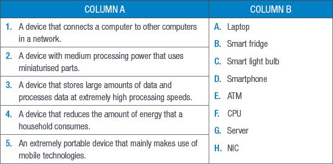
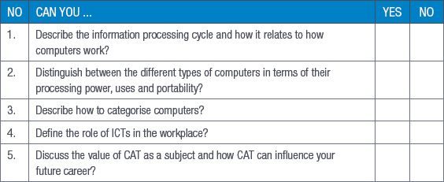

## UNIT 1.4 The value of CAT

We are living in the information age so it is important for people to understand the value of computers and how to use them. This is where CAT as a subject comes in. By understanding computers and their basic components, programs and applications, you will be able to adapt to new developments in computing quickly, easily and with less training. CAT teaches you the basic skills you will need to prosper in any career, even those that use specialised software and equipment.

COMPUTER LITERACY AND EMPLOYMENT

Apart from using your computer to finish your schoolwork or do research for projects, knowing how to use a computer is a requirement for almost any job today. From obvious jobs, such as computer programmers and graphic designers, to less obvious jobs, such as truck drivers and carpenters, each person entering the job market must know how to use a computer with some degree of skill.

With computers and the internet becoming more accessible, an entirely new workspace has opened up, where digitally savvy people are using computers and computing technology to advertise, promote and build businesses online. Online marketing (or digital marketing) is one of the fastest growing job sectors in the world and skilled digital marketers are in high demand.

It is not only people who will be working in ICT-related fields who will need to be computer literate. In 2017, a News Corp Australia article found that by 2020, about 90% of the Australian workforce would need to have basic computer skills to communicate with others and to find information about their tasks and daily duties.

CAT is also an incredibly powerful tool when it comes to managing information. By knowing how you can use a computer to manage large amounts of data and information, you will be able to work quickly and more efficiently in your future career. CAT teaches you how to use programs and systems to manage data and information.

### CAREER OPTIONS AND THE IMPACT ON CAREERS AND FIELDS OF STUDY

Taking CAT at school level opens the door to many possibilities and career options once you have completed your schooling. Almost all careers available to you use computers in some part of their daily operations. From fashion, web and graphic design to accounting, law and medicine, having CAT as a subject will allow you to use the technologies associated with these careers. A good understanding of computer applications technologies also opens up Information Technology and Management to you as a field of study and work.

Studying CAT will also give you insight into how the internet and the World Wide Web function and how they can be used to enhance your knowledge and life.

Activity 1.4

Do the following activity on your own.

**1.**Bernes is a learner who dreams of becoming a doctor when he grows up. Bernes has decided that he does not need to take CAT because it is not relevant to his dream job.

**a.**What job would you like to do in the future? Mention three ways in which CAT can prepare you for this job.

**b.**Name three ways in which CAT could improve Bernes’ study life as a university medical student.

**c.**Do you think that people in the medical field need to know how to work with computers? Give a reason for your answer.

**d.**While taking a tour of one of the best medical universities, Bernes discovers that a lot of the medical equipment makes use of computers.

**i.** What type of computer is used in medical equipment such as heart rate monitors?

**ii.**Give two reasons why you think a lot of medical equipment makes use of computers.

**2.**Do you know of a job that cannot benefit from CAT? If yes, mention it and give a reason for your answer. If no, explain your answer.

REVISION ACTIVITY

QUESTION 1: MULTIPLE CHOICE

**1.1**Which of the following is not part of the information processing cycle? (1)

**A.**Communication

**B.**Output

**C.**Storage

**D.**Memory

**1.2**Which of the following can be used for storage? (1)

**A.**CPU

**B.**HDD

**C.**GPU

**D.**ICT

**1.3**Which of the following computers is not portable? (1)

**A.**Laptop

**B.**Tablet

**C.**Smartphone

**D.**Server

**1.4**Which of the following computers can be used to process large amounts of data quickly? (1)

**A.**Mainframe

**B.**Workstation

**C.**Tablet

**D.**Notebook

**1.5**Which of the following is not a “smart device”? (1)

**A.**ATM

**B.**Smart light bulb

**C.**Calculator

**D.**Xbox 360

QUESTION 2: TRUE OR FALSE?

Choose the answer and write True or False next to the question number. Correct the statement if it is FALSE. Change the underlined word(s) to make the statement TRUE. (You may not simply use the word NOT to change the statement.)

**a.**Taking CAT at university level opens up many career possibilities. (1)

**b.**New businesses can lower their administrative costs by using a centralised office. (1)

**c.**Printed statements have been mostly replaced by electronic statements sent via email. (1)

**d.**CAT as a subject teaches us how to use computers so that we can become digitally savvy. (1)

**e.**Networking is part of the communication stage. (1)

QUESTION 3: MATCHING ITEMS

Choose a concept from Column B that matches a description in Column A. Write only the letter next to the question number (e.g. 1J). (5)

QUESTION 4: SHORT AND MEDIUM QUESTIONS

**4.1**Briefly explain what happens during the following stages of the information processing cycle.

**a.**Processing stage (2)

**b.**Storage stage (2)

**4.2**Compare the functions of input and output devices. (4)

**4.3**Name a device that can be used to electronically transfer money. (1)

**4.4**What is the relationship between CAT and ICTs? (2)

**4.5**Give the name of a non-portable device that is suitable for creating documents and web browsing. (1)

QUESTION 5: SCENARIO-BASED QUESTIONS

Adam and his family have decided to open a sweet shop called the Sweet Company. As his shop starts to grow, he decides to open a second Sweet Company at a different location. In order to keep track of both shops, he decides to start integrating ICTs and computers into his business.

**a.**Name TWO computing devices Adam and his employees can use to better run and manage his shops. Give a reason for each of your answers. (4)

**b.**Mention THREE ways in which ICTs can improve the way that Adam’s sweet shop is run. (3)

**c.**Mention TWO instances where CAT skills can be used to improve the running of Adam’s sweet shops. (2)

**d.**Give TWO reasons why Adam should consider purchasing a UPS for both shops. (2)

**e.**Adam can now work on a flexi-time schedule. Explain what it means to work flexi time. (2)

**TOTAL: [40]**

AT THE END OF THE CHAPTER

