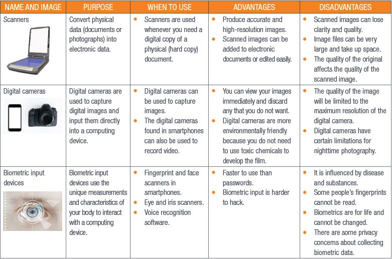
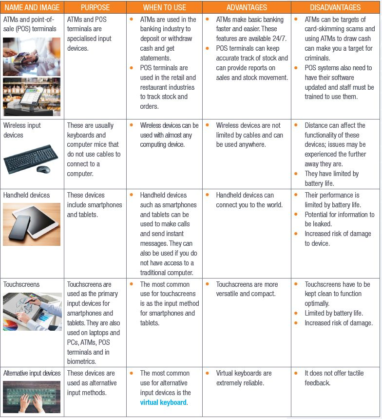
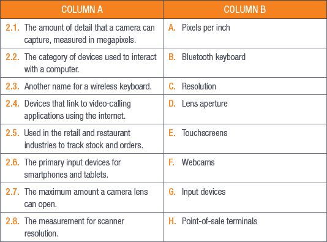

## UNIT 2.1 Input devices

As you learned in Chapter 1, a computer works using the information processing cycle. Input devices are the key components of the first stage of the cycle, the input stage. Input devices are what we use to interact with a computer. These can be things such as keyboards and computer mice, touchpads and scanners. The combination of keyboard and mouse used to be the most common input device, but the rise of the smartphone has made the touchscreen the most popular and common input device in the modern age.

There has also been a rise in the use of alternative input devices, such as fingerprint and face recognition to unlock your smartphone, and speech-to-type devices that are used by people with physical challenges.

This unit focuses on input devices other than the mouse and the keyboard as they were covered in Grade 10.

### VARIOUS INPUT DEVICES

There are a number of input devices that you can use with computers. Table 2.1 lists these devices, their uses, and their advantages and disadvantages.

**Table 2.1:** *Input devices*

### WHAT DETERMINES THE QUALITY OF THE IMAGE TAKEN BY A SCANNER OR CAMERA?

There are three main factors that determine the quality of the image taken by a scanner. These are:

**1.** Colour depth

**2.** **Resolution**

**3.** Dynamic range

*Colour depth* is also known as **bit** depth and refers to the number of bits used to indicate the colours of a single pixel. The higher the bit number, the better the colour depth. You can see this in Figure 2.1.

**Figure 2.1:** *32-bit (left) versus 8-bit (right) colour depth.*

The image on the left is in 32-bit colour while the image on the right is in 8-bit colour. In the image on the left, the details in the background are sharper and the colour of the leaf is deeper and more vibrant compared to the image on the right.

*Resolution* is the amount of detail an image can hold and it is measured in **pixels per inch (ppi)** or **dots per inch (dpi)**. These measurements show you how many dots or pixels are in a one-inch square (an inch is about 2,5 cm). The higher the ppi or dpi, the more information there is in the square. This means that the image will be of higher quality.

The final quality factor is the *dynamic range*. This measures the range of light the scanner can read and use to produce a range of **tones** and colours.

Camera quality is determined by three factors:

**1.** Resolution

**2.** Lens aperture

**3.** Focal length

*Resolution* is the amount of detail that a camera can capture. In digital cameras, resolution is measured in **megapixels**.

The *lens aperture* is the maximum amount that the lens can open. The wider it opens, the more light it can take in, which means that you need less light to take a good picture.

How much a camera can zoom is determined by its *focal length*. The focal length is shown by a number and the times symbol (×). A zoom of 3× means that the longest focal length is 3× the distance of the shortest focal length.

 Activity 2.1

**1.**Multiple choice:

**a.**Which of the following does NOT determine the quality of a digital camera?

**A.**Resolution

**B.**Focal length

**C.**Price

**D.**Lens aperture

**b.**Which of the following is NOT an example of biometric input devices?

**A.**Voice recognition

**B.**DNA tester

**C.**Fingerprint scanner

**D.**Facial recognition

**c.**Which device CANNOT be used when you need to convert a physical copy of a document into a digital copy?

**A.**Digital camera

**B.**Scanner

**C.**Smartphone

**D.**Laser keyboard

**2.**Match Column B with Column A:

**3.**Write True or False next to the question number. Correct the statement if it is FALSE. Change the underlined word(s) to make the statement TRUE. (You may not simply use the word NOT to change the statement.)

**a.**It is good practice to regularly back up your files.

**b.**A POS system does not need to be maintained after installation.

**c.**Touchscreens can be used for biometric scanning.

**d.**Resolution is the amount of colour an image can show.

**e.**Dynamic range measures the range of light a scanner can read.

**4.**Answer the following questions in your own words:

**a.**What factor determines how much a camera can zoom?

**b.**Give three advantages and three disadvantages of scanners as input devices.

**c.**Briefly describe the factors that determine a scanner’s quality.

**d.**Why would a Nikon Coolpix B500 or a Canon 4000D camera not be considered an input device?

**e.**Describe why digital cameras in smartphones become outdated very quickly.

**f.**Describe the factors that determine a camera’s quality.

**g.**How would you use fingerprint scanners at a school?

**h.**Describe why a criminal might clone your fingerprints.

**i.**What are the advantages of POS systems and ATMs?

**j.**Why are touchscreens becoming more common?

**k.**Give two types of wireless input devices.

**l.**Give one disadvantage of laser keyboards.
