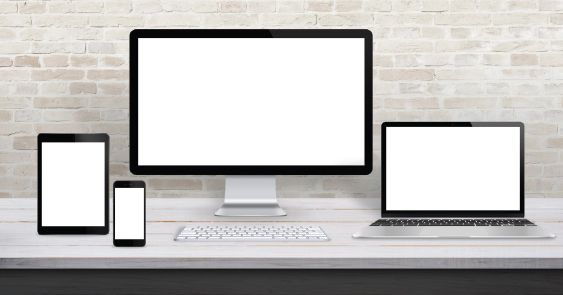
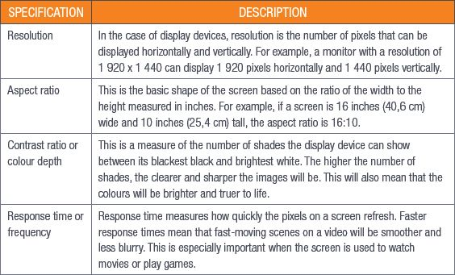
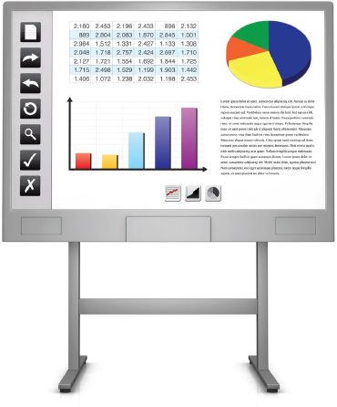
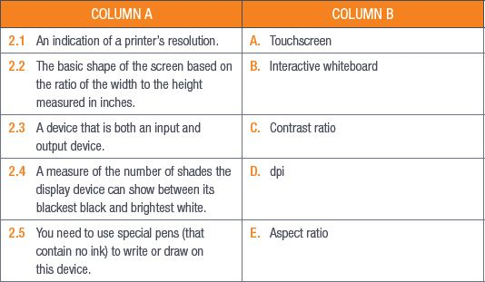

## UNIT 2.2 Output devices

Output devices form the last stage of the information processing cycle. These are devices that translate the information from the internal processing components of the computer and display them in a way that makes sense to a human user. This could be text, images, sounds or videos.

There are as many output devices as there are input devices and there will certainly be more in the future as the way we interact with computers changes. When you think about output devices, you no doubt think about screens and displays, printers (including 3D printers), speakers and headphones. But interactive whiteboards, data projectors and GPS devices are also output devices.

In this unit you will focus on interactive whiteboards and displays and the advantages, disadvantages and limitations of each of them. You will also learn about the factors determining the quality of display devices and printers, as well as the wireless technology needed for these devices to operate correctly.

### DISPLAY DEVICES

Display devices are a broad category of output devices that includes monitors (computer screens), smartphone screens and data projectors.

**Figure 2.2:** *Examples of display devices*

The main function of a display device is to display the input you have given the computer to allow you to make choices and interact with programs and the operating system.

There are some display devices that act as both input and output devices; touchscreens and interactive whiteboards are examples of these types of devices.

Display devices have several advantages, for example:

- The user gets immediate feedback about what is being processed.
- The interaction between the user and the computer is easier.
- Content can be displayed and changed quickly (think of switching between applications on a smartphone or programs on a computer).
- Displays can be customised to suit the user (for example, making the text size larger or lowering the brightness to make things easier to read).

Display devices also have several key disadvantages:

- The content that is displayed is not private. Anyone behind you can see what you are doing on your computer. This is less of a problem with smartphones, as the screens are easier to hide.
- Displayed output is not permanent and you would need to print or save the data to have a permanent record of what you see.
- Display devices are the one component that consumes the most power. Screens are usually the biggest drain on a smartphone, tablet or laptop’s battery.
- They are usually the most expensive item to replace when they break.

WHAT DETERMINES A DISPLAY DEVICE’S QUALITY?

Several factors determine a display device’s quality. These include resolution, aspect and contrast ratios and response time, as well as other factors. Less expensive devices usually have very high specifications in one area and low specifications in another. Devices that have a good balance of specifications are usually more expensive.

Table 2.2 lists the quality specifications you should look for when buying a new display device and gives a brief explanation of each specification.

**Table 2.2:** *Quality specifications for display devices*

PRINTER QUALITY

There are many factors that can affect the quality of the prints that come out of a printer. The most important factor is the resolution, which is measured in dots per inch (dpi). As you learned in the section on scanners, dpi measures how many dots there are in a square inch of an image and the higher the dpi is, the better the image quality will be.

In printers, dpi measures how well the printer can match the pixels per inch (ppi) of a digital image or text. If the printer can match the ppi exactly, the image will come out crisp and clear and will look the same when it is printed and when it is on screen. The problem comes in when the printer cannot match the ppi, so the image quality goes down.

How quickly a printer can print is another indicator of the quality of a printer. This is measured in pages per minute (or ppm) and the higher the ppm, the faster the printer prints. Laser printers will always have a higher ppm than inkjet printers because of the different ways that they print.

Lastly, the duty cycle also shows the printer’s quality. The monthly duty cycle indicates the maximum number of pages a printer can print in a month without it failing. A typical home printer will have a duty cycle of around 5 000 pages, while large business printers will have a duty cycle of around 200 000 pages per month.

Something to know

A printer’s dpi is usually shown just like a screen’s resolution is shown, since it is a measure of how many dots can be made horizontally and vertically. For example, a printer’s dpi may be shown as 1 600 × 2 000.

INTERACTIVE WHITEBOARDS

At first glance, interactive whiteboards look exactly the same as normal whiteboards. But looking closer reveals that they are unique and an exciting tool to use in the classroom and in business. Interactive whiteboards can be seen as input and output devices.

**Figure 2.3:** *Example of an interactive whiteboard*

HOW PRINTERS WORK

Ink printer:

[https://www.youtube.com/watch?v=9yeZSaigBj4&t=10s](https://www.youtube.com/watch?v=9yeZSaigBj4&t=10s)

Laser printer:

[https://www.youtube.com/watch?v=WB0HnXcW8qQ](https://www.youtube.com/watch?v=WB0HnXcW8qQ)

Interactive whiteboards can be used like traditional whiteboards but you need to use special pens (that contain no ink) to write or draw on them. What makes interactive whiteboards so special is that they can be linked directly to a computer and can display what is on the computer. The clue to what sets these apart from normal data projectors is given in the name.

Interactive whiteboards allow users to interact with the data that is displayed. By using a mouse or even your finger, you can drag, click and copy items. You can use your finger or the special pens to write notes, highlight sections or make comments. Anything that is done on the whiteboard can then be saved and shared.

Interactive whiteboards are an incredible tool for teaching and have three key advantages when used in a classroom:

**1.**Interactive whiteboards allow teachers to combine visual and **auditory** learning styles into one. This allows learners to absorb information in multiple formats.

**2.**Because the notes made on the whiteboard can be saved and shared, learners do not need to take notes during a lesson. This allows them to focus more on participation during the lesson.

**3.**Interactive whiteboards allow learners to become part of the learning process by making them active participants in their lessons.

Some of the notable disadvantages of interactive whiteboards include the cost, training and time requirements. Most interactive whiteboards are incredibly expensive (in 2018, an interactive whiteboard cost about R6 100) and they need special equipment to work correctly.

Teachers and other users also need to be trained in how to use interactive whiteboards correctly and teachers may have to spend extra time preparing proper interactive lessons to get the most out of them.

Something to know

A normal non-magnetic whiteboard (2 000 mm × 1 200 mm) cost about R1 750 in 2018. This is one of the biggest whiteboards available.

WIRELESS TECHNOLOGY

Wireless output devices use Wi-Fi, **Bluetooth** or **near-field communication (NFC)** to communicate with the computer. Wireless devices reduce the number of cables you need to connect them to each other. Some examples of wireless output devices are wireless printers and wireless headphones or speakers.

Wireless printers can be connected to multiple devices on the same wireless network, meaning that all the people in a specific area have access to the printer. Wireless printers can also connect to smartphones and tablets, so users can connect to them directly. However, since anyone can access a wireless printer, there are some safety and privacy concerns surrounding them.

Wireless audio devices, such as speakers and headphones, use Bluetooth to connect to the computer. These output devices give users more freedom of movement as they are not physically attached to their computers.

 Activity 2.2

**1.**Multiple choice:

**a.**Which of the following cannot be a wireless output device?

**A.**Monitors

**B.**Printers

**C.**Headphones

**D.**Speakers

**b.**Which of the following is NOT a wireless communication medium?

**A.**Wi-Fi

**B.**Bluetooth

**C.**NFC

**D.****RSS**

**c.**Which of the following is the duty cycle of a home printer?

**A.**Around 500 pages

**B.**Around 5 000 pages

**C.**Around 10 000 pages

**D.**Around 1 000 pages

**2.**Match Column B with Column A:

**3.**Write True or False next to the question number. Correct the statement if it is FALSE. Change the underlined word(s) to make the statement TRUE. (You may not simply use the word NOT to change the statement.)

**a.**Most wireless audio devices, such as speakers and headphones, use Bluetooth to connect to the computer.

**b.**A printer’s dpi can be shown in the same way a screen’s resolution is shown.

**c.**Interactive whiteboards allow teachers to combine different visual learning styles into one.

**d.**Interactive whiteboards are the same as traditional whiteboards.

**4.**Answer the following questions in your own words:

**a.**What would the aspect ratio be of a monitor that is 20 inches wide and 15 inches tall?

**b.**Name two extra features that determine the quality of a display device.

**c.**What are the three key advantages of interactive whiteboards in the classroom?

**d.**Explain why every school in South Africa does not have interactive whiteboards.

**e.**Give two advantages of wireless printers.
