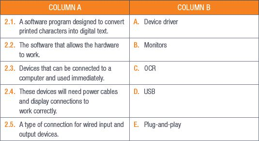
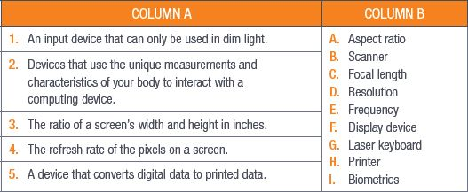
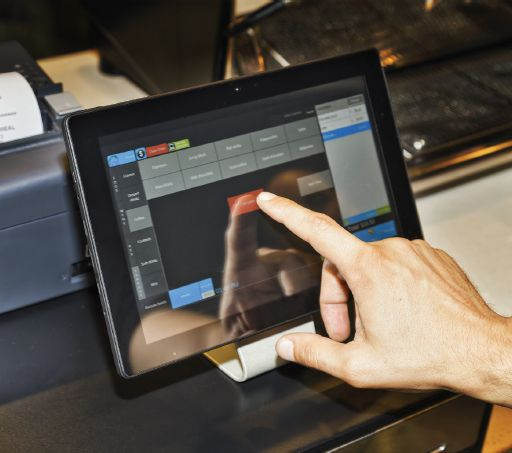
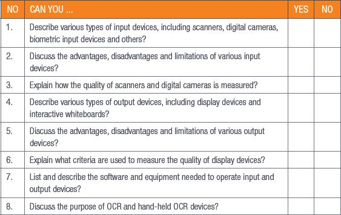

## UNIT 2.3 Devices, software and equipment

Often you will need additional software or hardware to make sure that your input and output devices can communicate with your computer. In most cases, your hardware will require a device driver to make sure that the commands it sends to and receives from your computer will be interpreted correctly.

In this unit, you will learn more about device drivers that you need to install yourself and **plug-and-play devices**. You will also look at the physical ways devices connect to your computer. Lastly, you will look at what OCR is and where it is used.

### DEVICE DRIVERS

Device drivers are software programs that are separate from the device. They are either given on a disk or downloaded from the manufacturers’ websites. Your OS will use a device’s driver to communicate with the device. The driver will help the OS understand the information you give it through an input device or translate the information the computer sends to an output device so that it can display the information correctly.

Most operating systems also have a set of standard device drivers installed for things such as computer mice, keyboards and hard drives (internal and external). These devices are often referred to as plug-and-play devices.

### PLUG-AND-PLAY

Plug-and-play devices are usually external devices but can also be some internal components of the computer (such as graphics cards). Examples of plug-and-play devices are headphones and speakers, computer mice, keyboards and USB storage devices.

### OTHER EQUIPMENT

Most input and output devices need to be connected to the computer in some way for them to work. Keyboards and computer mice need to be connected either with a wireless USB dongle or a wired USB connector. Monitors will need power cables as well as display connectors (such as HDMI or VGA cables). Printers and projectors can be connected to the computer with cables, USB dongles or Bluetooth connections.

### OCR

OCR stands for optical character recognition and it is a software program designed to convert printed characters (such as those on a hard copy document) into digital text. This means that you can edit and search in a scanned document in a word-processing program. OCR is most commonly found in specialised scanners used for archiving or document management. You can also get handheld OCR scanners that allow you to quickly scan printed text into a digital format. OCR enhances traditional scanning, since it saves the documents as text and not as an image.

OCR can also be used to improve accessibility for physically challenged users. OCR scanners can work alongside text-to-speech devices to read printed text aloud. OCR scanners are also used in handheld barcode scanners.

 Activity 2.3

**1.**Multiple choice:

**a.**Which of the following is not a plug-and-play device?

**A.**Speakers

**B.**Keyboard

**C.**Motherboard

**D.**Headphones

**b.**Which of the following is not a connection method for a monitor?

**A.**HDMI

**B.**Bluetooth

**C.**VGA

**D.**Power cable

**2.**Match Column B with Column A:

**3**Answer the following questions in your own words:

**a.**Where can you get device drivers?

**b.**Explain how device drivers work.

**c.**How can OCR be used to improve accessibility for physically challenged users?

REVISION ACTIVITY

QUESTION 1: MULTIPLE CHOICE

**1.1**Which of the following is a disadvantage of biometrics? (1)

**A.**It cannot be changed.

**B.**It is expensive to implement.

**C.**It is easy to use and requires little training.

**D.**It is difficult to lose.

**1.2**Colour depth is ______. (1)

**A.**The number of bits used to indicate the colours of a pixel.

**B.**The amount of detail an image can hold.

**C.**The range of light that can be read and used to produce a range of tones and colours.

**D.**The number of pixels used in a 1-inch square.

**1.3**Which of the following does not use device drivers? (1)

**A.**Mouse

**B.**Touchscreen

**C.**Windows Defender

**D.**Printer

**1.4**Which of the following is NOT usually a plug-and-play device? (1)

**A.**Mouse

**B.**Speaker

**C.**Keyboard

**D.**Graphics card

**1.5**The signals from wireless devices cannot be interrupted by _____? (1)

**A.**Bluetooth

**B.**Radio waves

**C.**Microwaves

**D.**Fridges

QUESTION 2: TRUE OR FALSE

Write True or False next to the question number. Correct the statement if it is FALSE. Change the underlined word(s) to make the statement TRUE. (You may not simply use the word NOT to change the statement.)

**a.**Voice recognition can be used to help people with hearing disabilities. (1)

**b.**Fingerprint scanners use biometrics to identify people. (1)

**c.**Scanners use OCR to convert digital text to printed text. (1)

**d.**Printed images can become corrupted so you will need to back them up regularly. (1)

**e.**A POS system is not an example of an output device. (1)

QUESTION 3: MATCHING ITEMS

Choose a term/concept from Column B that matches a description in Column A. Write only the letter next to the question number (e.g. 1–J). (5)

QUESTION 4: SHORT AND MEDIUM QUESTIONS

**4.1**Look at the following image and answer the questions that follow.

**a.**What type of input device does the image show? (1)

**b.**Name two other types of input devices that make use this type of device. (2)

**c.**Mention one disadvantage of this device. (1)

**d.**Give two reasons why this input method is the most natural way of interacting with a computer. (2)

**4.2**Provide two advantages of display devices. (2)

**4.3**Mention two jobs that can benefit from using interactive whiteboards. Give an explanation for each of your answers. (4)

QUESTION 5: SCENARIO-BASED QUESTIONS

Thomas is a high-school teacher who teaches a small class of 15 learners. Some of Thomas’s learners have physical challenges that would make it difficult for them to interact with a traditional computer. Thomas therefore has to think of what types of extra input and output devices he will need to make this class project work.

**5.1**Name two input devices that Thomas can use for a learner who cannot use their hands. (2)

**5.2**List two output devices that Thomas’s learners can use for their class projects. Also mention what equipment Thomas would need to connect each of these devices to a computer. (4)

**5.3**Explain one way in which physically challenged learners can benefit from OCR technology. Also mention what type of input and output device will be used. NOTE: Mention the benefit and the related physical challenge. (4)

**5.4**Thomas needs to order a printer. He wants to use it to print out pictures of his class and the best class projects.

**a.**What kind of printer should he order? (1)

**b.**What specifications should he look for to get good quality prints. (2)

**TOTAL: [40]**

AT THE END OF THE CHAPTER

