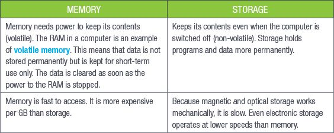
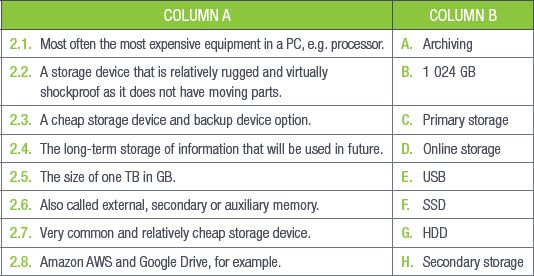

## UNIT 3.1 Storage devices

Storage media have come such a long way since the early days of computing, and the size of data has grown so much that it is impossible to imagine that all it took to get humans to the moon was about 600 MB of data.

Something to know

One gigabyte (GB) is equal to 1 024 megabytes (MB), and one terabyte (TB) is equal to 1 024 GB.

### PRIMARY STORAGE

Primary storage is also called the main or internal memory of the computer. This storage is accessed directly by the CPU and is where the main instructions for the computer’s operations are stored. The CPU can access these instructions and execute them as they are needed.

Primary storage is most often the RAM and the ROM, which will be discussed later in this chapter. The main function of the primary storage devices is to hold data for a short period of time while the computer is running and power is going to the devices. This data is removed once the power is stopped (like when the computer is shut down).

### SECONDARY STORAGE

Secondary storage is also called external, secondary or auxiliary memory. This type of storage holds data for the long term. Data stored on secondary storage devices can only be removed by deleting it. Secondary memory is where the operating system, hardware drivers and data created by the user is kept and stored permanently.

This means that, in the case of power failures, secondary storage will preserve the information that is saved to it, even if the power to the computer is lost, while the data on the primary storage devices will be lost.

The most common example of secondary storage is the hard drive inside a computer. Other examples include solid-state drives (SSDs), USB flash drives and secure digital (SD) cards.

**Table 3.1:** *Comparison: Memory versus storage*

### STORAGE MEDIA FOR BACKUP

One purpose of storage devices is to back up or **archive** your important data. In the business world, there is a need to store data permanently and in a way that does not get destroyed, corrupted or damaged easily. Different types of storage media can be used for backing up or archiving.

Backups are records of important information that is used often. Backups are kept for a relatively short period of time. Table 3.1 lists the advantages and disadvantages of different types of storage media used for backups.

BACKUP DEVICES

**Backup** refers to the process of making copies of data or data files to use in the event the original data or data files are lost or destroyed or storing the copies in a different place from where you keep your computer.

The most popular backup media to use are:

- **External hard drives (HDD):** These are quite fast and generally reliable. However, if an external hard drive is used often, the mechanical stress can shorten its lifespan. External hard drives are fragile.
- **External SSDs:** SSDs have no moving parts. SSDs are more expensive that hard drives and the storage space is limited due to the cost (the more space you get, the more expensive the SSD becomes).
- **USB flash drives:** USB flash drives are cheap and relatively easy to use. There are no moving parts, so they are an excellent way to move data around. However, they can be slow and unreliable.
- **Tapes:** Tape backup is copying data from a primary storage device to a tape cartridge so the data can be recovered if there is a hard disk crash or failure. Tape backups can be done manually or be programmed to happen automatically with appropriate software.
- **CDs and DVDs:** CDs and DVDs are still occasionally used but writing a CD or DVD is much slower and less convenient than using other media. They have a lower capacity than most flash drives and much lower capacity than portable hard drives.
- **Online storage/backup services:** Online data storage is virtually unlimited in size. This means that there is plenty of space for you to back up your entire hard drive, including all of your purchased programs, music, photos, and files. Saving to the cloud means that you are saving to hard drives in a remote location. You must keep your username and password safe in order to protect your data because if someone knows (or even guesses) your credentials, it may result in loss of data.

Archiving, on the other hand, is the long-term storage of information that will be used in future. Archived data is data that is not actively used and is original data that has been removed from its original location. There are several different storage media that can be used for archiving.

Magnetic tape has a very large storage capacity (up to 180 TB), but can be destroyed very easily and the data can be lost.

Online storage is an option and online storage providers (such as Amazon AWS) have relatively inexpensive packages available for storage and archiving.

The data stored in a backup is a copy of the current and active operational data in use by a business. This includes files which are currently being accessed and changed on a regular basis. The files stored on an archive are generally no longer in use, not changing frequently and not required on a regular basis.

 Activity 3.1

**1.**Multiple choice:

**a.**Which of the following cannot be used to back up files?

**A.**External HDD

**B.**USB drive

**C.**Optical disc

**D.**RAM

**b.**Which of the following is the most expensive storage?

**A.**RAM

**B.**HDD

**C.**SSD

**D.**iCloud

**c.**Which of the following is secondary storage?

**A.**RAM

**B.**CPU

**C.**HDD

**D.**ROM

**2.**Match Column B with Column A:

**3.**Write True or False next to the question number. Correct the statement if it is FALSE. Change the underlined word(s) to make the statement TRUE. (You may not simply use the word NOT to change the statement.)

**a.**Primary storage is accessed by the motherboard.

**b.**Magnetic tape has a very large storage capacity but can be easily destroyed and the data can be lost.

**c.**Online storage has limited space and you must pay to get more space.

**d.**The main purpose of primary storage is to store data for a long period of time.

**e.**Archiving is the short-term storage of information.

**4.**Answer the following:

**a.**What is the main purpose of primary storage?

**b.**Briefly describe the difference between primary and secondary storage.

**c.**What is the difference between backing up and archiving data?

**d.**What storage devices would you recommend to someone who needs to store data on a server and someone who wants to store copies of their digital photographs? Motivate your answer.
