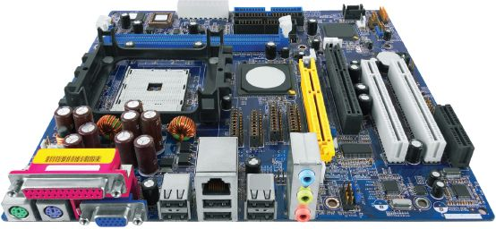
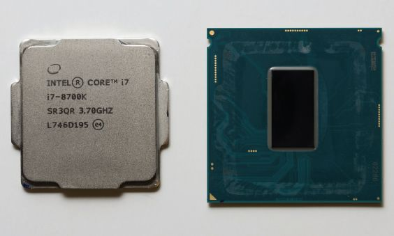
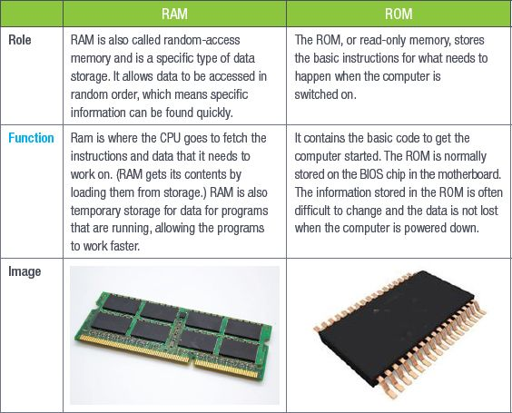
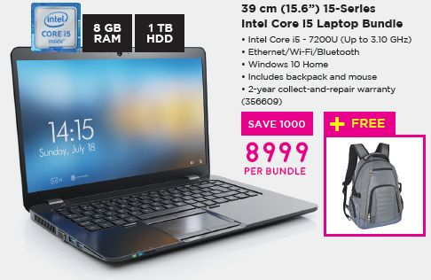
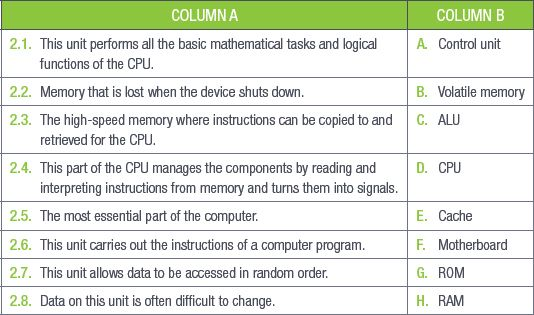

## UNIT 3.2 Processing devices

Processing is the second stage of the information processing cycle you learned about in Chapter 1. Processing mainly uses the system components of the computer, such as the motherboard, CPU and RAM, for its tasks. In this unit, you will learn more about the role of each component of a computer system, how they work and what they do.

### MOTHERBOARD

The motherboard is one of the most essential parts of a computer. It holds many of the components that allow a computer to function, such as the CPU, RAM and the connectors for input and output devices.

**Figure 3.1:** *Computer motherboard with components*

The motherboard is made of a thin piece of rigid, **non-conductive** material. A thin layer of copper or aluminium foil is printed onto the sheet. These circuits are called traces. They are very narrow and form the connections between the various components housed in the motherboard.

The role of the motherboard is to:

- Provide a place for other devices or interfaces to be installed (such as more memory or another **graphics card**).
- Distribute power to the various components.
- Act as a communication hub as the components send and receive information through the motherboard.

### CENTRAL PROCESSING UNIT (CPU)

The CPU, which is also called the processor, carries out the instructions of a computer program. It is, basically, the “brain” of the computer and does the **arithmetical**, logical and input/output operations of a computer program. The speed of the CPU tells you how much data it can process in a specific time. The speed is measured in **gigahertz** (GHz).

**Figure 3.2:** *Intel Core i7 CPU*

HOW A CPU WORKS

[https://www.youtube.com/watch?v=cNNtTXABUA](https://www.youtube.com/watch?v=cNNtTXABUA)

All instructions, whether they have been generated by the system or the user, go through the CPU. This could be anything from the operating system executing a task to the user typing letters in a document.

WHAT ARE CORES IN A CPU?

A core is usually the basic computing unit of the CPU. A single core can run a single program, problem or context. A CPU may have one or more cores to perform tasks at any single time. Original CPUs had single cores, but manufacturers began adding more cores to increase the performance of the CPU. A CPU with two cores can split the task into two tasks and thereby complete it faster. This speeds up the computer because it is, essentially, able to multitask.

A dual-core processor has two cores, so it looks like two CPUs to the operating system. A **quad-core** CPU has four cores, an **octa-core** CPU has eight cores, and so on. These cores also make sure that the CPU is still small enough to fit into a single socket, taking up less space on the motherboard.

### RANDOM-ACCESS MEMORY (RAM) AND READ-ONLY MEMORY (ROM)

While **RAM** and **ROM** are both types of memory, they perform different functions. Table 3.2 compares and contrasts the roles and functions of RAM and ROM.

**Table 3.2:** *Roles and functions of RAM and ROM*

### INTERPRET COMPUTER ADVERTISEMENTS

When you want to buy a new computer or storage device, there are several key factors to consider. By using what you know about these components, you will be able to interpret the information in advertisements for computers.

**Figure 3.3:** *A computer advertisement*

Using what you have learned so far in this chapter, you will be able to interpret any advertisement by looking at the following key pieces of information:

- How fast is the CPU in the computer? Remember that the faster the CPU works, the faster your computer will be able to process data. So, a 3 GHz processor is twice as fast as a 1,5 GHz one. In this example, the CPU speed is up to 3.10 GHz.
- How big is the memory? The more RAM you have, the more programs and applications you can run at once. Most computers come with 4 GB of RAM, which is good for users who do not need to do much more than check emails or create some documents. Users who need their computer to do slightly more can look at getting 8 GB of RAM, while 16 GB is good for those who will often be using more memory-intensive programs on their computers (such as games and videos and photo-editing software). In this example, the memory is 8 GB RAM.
- How much storage capacity does it have? Most computers come with a fairly large hard drive (about 500 GB). You can also buy external hard drives that can store terabytes of data. Make sure you get one that will suit your needs. In this example, the storage capacity is 1 TB.
- Which operating system does the computer use? The latest operating system will be more compatible with new programs, and will be more secure and able to support the drivers for your hardware. In this example, Windows 10 Home is used.

 Activity 3.2

**1.**Multiple choice:

**a.**The start-up process is stored on which hardware component?

**A.**BIOS

**B.**RAM

**C.**ROM

**D.**CPU

**b.**The speed of a CPU is measured in?

**A.**GHz

**B.**MHz

**C.**Hz

**D.**Calculations per second

**c.**The various components of a motherboard are connected by which metal?

**A.**Sulphur

**B.**Copper

**C.**Silica

**D.**Silver

**2.**Match Column B with Column A:

**3.**Write True or False next to the question number. Correct the statement if it is FALSE. Change the underlined word(s) to make the statement TRUE. (You may not simply use the word NOT to change the statement.)

**a.**The motherboard distributes power to the computer.

**b.**The RAM is stored on the BIOS chip.

**c.**The motherboard is the brain of the computing operation.

**d.**Temporary files are stored on the CPU.

**e.**Data stored on the RAM is permanent.

**4.**Answer the following:

**a.**Briefly describe the role and function of the motherboard and CPU.

**b.**Explain RAM.

**c.**Describe ROM.

**d.**Which questions should you ask yourself when looking at an advertisement for a computer?
