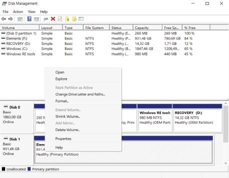
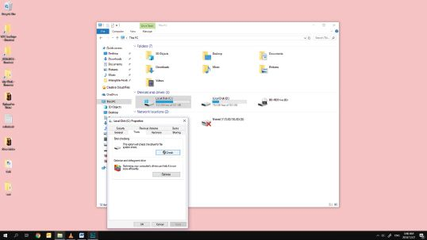
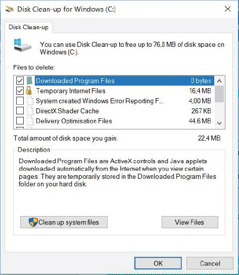
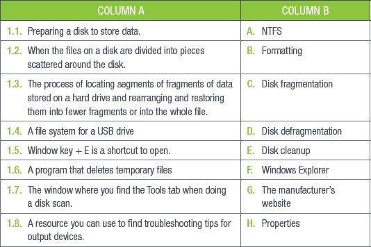
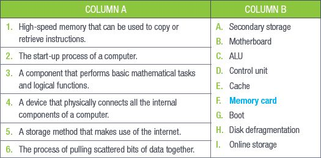
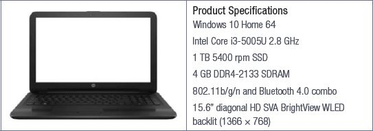
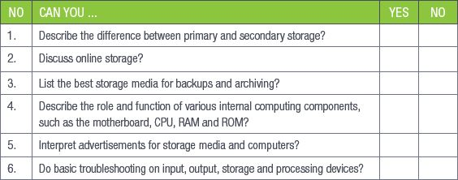

## UNIT 3.3 Basic troubleshooting

It is important for you to know how to do basic troubleshooting on your storage devices, especially if those devices contain very important information. This unit will look at some basic troubleshooting for storage media.

### STORAGE AND PROCESSING DEVICES

Most of the basic troubleshooting guidelines for external storage devices can apply to internal storage and processing devices as well, although there are some specific scenarios where advice for storage media will not solve problems with RAM or ROM modules.

FORMATTING

Formatting means preparing a disk to store data. Some disks, such as flash disks or hard drives, may need to be reformatted from time to time. Formatting will erase any data that is on the disk, so you will need to back up the data up before you **format**.

Windows 10 has a built-in disk management tool to make formatting a disk easier.

FORMATTING A DISK

To format a disk, you must do the following:

**Step 1:**Click on the *Search* icon on the bottom left corner of your screen.

**Step 2:** Type in *format*.

**Step 3:** Select *Create and format hard drive partitions*.

**Step 4:** This opens the *Disk Management* dialogue box.

**Step 5:** Right-click on the disk you want to format and click on *Format*.

**Step 6:** Choose *NTFS* (new technology file system) as the file system and select *Default* as the *Allocation Unit Size*.

**Step 7:** Click *OK* to format the drive. **BE VERY CAREFUL AS THIS ACTION WILL DELETE ALL DATA ON THE DRIVE.**

DISK SCANS

Disk scans can help detect and fix errors in USB flash drives, hard drives and SSDs. There is a disk scanner built into Windows 10.

USING A DISK SCANNER

To use the disk scanner, do the following:

**Step 1:** Click on the *Search* icon on the bottom left corner of your screen.

**Step 2:** Type in *Explorer* to open Windows Explorer (or press the Windows key + E).

**Step 3:** In the *File Explorer* window, click on *This PC* in the left navigation pane.

**Step 4:** A list of drives will be shown in the right window. Right-click on the drive you want to scan and select *Properties*.

**Step 5:** In the *Properties* window, click the *Tools* tab.

**Step 6:** Click the *Check* button in the *Error Checking* section.

**Step 7:** Run the scan without any interruptions.

**Step 8:** You may need to restart your computer if the scan detects any problems.

DISK DEFRAGMENTATION

Over time, the files on your computer’s hard drive become scattered, making your computer slower. This is called **disk fragmentation**. **Defragmenting** your hard drive pulls these scattered bits of data back together. Windows 10 automatically defragments your hard drive once a week.

The process of defragmentation moves the data blocks on the hard drive around to bring all the parts of a file together. Defragmentation reduces file system fragmentation, increasing the efficiency of data retrieval and thereby improving the overall performance of the computer. At the same time, it cleans the storage and provides additional storage capacity.

DISK CLEANUP

While you are using your computer, you generate many types of files. These files take up space on your computer, making it slower. In Grade 10, you learned how to zip and unzip files, but this may not be enough to speed up your system.

Windows 10 also has a built-in disk cleanup tool that will delete the following:

- Temporary files from the internet.
- Deleted files and folders in the recycle bin.
- Temporary files created by the operating system.
- The component of the operating system you are not using.
- Applications or programs that you do not use.

**Figure 3.4:** *Disk cleanup helps with freeing up space on your computer*

 Activity 3.3

**1.**Match Column B with Column A:

**2.**Write True or False next to the question number. Correct the statement if it is FALSE. Change the underlined word(s) to make the statement TRUE. (You may not simply use the word NOT to change the statement.)

**a.**Microsoft Windows 10 needs disk scanning software.

**b.**Formatting your device deletes program files.

**c.**You must make sure Num Lock is on if your Page Up/Page Down keys are not working.

**3.**Answer the following questions in your own words:

**a.**Describe how you would format a disk.

**b.**What is the purpose of a disk scan?

**c.**Explain how you would manually defragment your disks.

**d.**What does the Windows 10 disk cleanup tool do?

REVISION ACTIVITY

QUESTION 1: MULTIPLE CHOICE

**1.1**Which of the following is an example of primary storage?(1)

**A.**Motherboard

**B.**ROM

**C.**CPU

**D.**USB

**1.2**Which of the following types of storage is volatile? (1)

**A.**ROM

**B.**Internal HDD

**C.**RAM

**D.**Internal SSD

**1.3**Which of the following is involved in the start-up of a computer? (1)

**A.**CPU, ROM

**B.**RAM, ROM

**C.**RAM, CPU

**D.**HDD, ROM

**1.4**When you look at a computer advertisement, what are the most important things to look at? (1)

**A.**Storage, operating system, brand

**B.**Memory, processing speed, external hardware

**C.**Software, operating system, memory

**D.**Processing speed, storage, memory

**1.5**Formatting means ______ a disk to store data. (1)

**A.**Priming

**B.**Preparing

**C.**Saving

**D.**Processing

QUESTION 2: TRUE OR FALSE

Write True or False next to the question number. Correct the statement if it is FALSE. Change the underlined word(s) to make the statement TRUE. (You may not simply use the word NOT to change the statement.)

**a.**Data that is being processed is stored in memory. (1)

**b.**The more cores a CPU has, the slower it operates. (1)

**c.**RAM is related to storage, while the CPU is related to speed. (1)

**d.**Before you format an SD card you must erase the information on it. (1)

QUESTION 3: MATCHING ITEMS

Choose a term/concept from Column B that matches a description in Column A. Write only the letter next to the question number (e.g. 1-M). (6)

QUESTION 4: FILL IN THE MISSING WORD(S)

Fill in the missing word(s) in the following statements. Provide only one word for each space.

**a.**If you want to delete all the temporary files created by the operating system use i)______ ______. (1)

**b.**Components on a motherboard are connected with ii)______. (1)

**c.**The speed of the iii)______ ______ ______ ______, which is measured in GHz, determines how much data your computer can process in a specific time. (1)

**d.**The CPU fetches instructions from the hardware that need to be iv)______. Then the CPU translates the instructions to v) ______ ______. (2)

QUESTION 5: MEDIUM QUESTIONS

Look closely at the advert below and answer the following questions.

**5.1**What is the speed of the CPU in the computer? (1)

**5.2**How big is the volatile memory? (1)

**5.3**How much storage capacity does the computer have? (1)

**5.4**Which operating system does the computer use? (1)

**5.5**What does the 15.6” specification in the advert refer to? (1)

**5.6**What does the 1366 × 768 specification refer to? (1)

**5.7**What does the SSD acronym stand for? (1)

**5.8**Give TWO reasons why users would prefer an SSD instead of an HDD? (2)

**5.9**Suggest ONE way you can use to transfer data from this computer. (1)

QUESTION 6: SCENARIO-BASED QUESTIONS

Ronaldo has recently bought a new external hard drive for his laptop computer, since his laptop has started running out of space. Ronaldo’s laptop has an SSD with a storage capacity of 500 MB, while his new external hard drive has a storage capacity of 1 GB.

**6.1**Which of Ronaldo’s storage devices has the longest lifespan? Give one reason for your answer. (2)

**6.2**When Ronaldo connects his external hard drive to his laptop, his laptop detects it but cannot read it. What should Ronaldo do to work out what is wrong with the external hard drive? (1)

**6.3**Ronaldo finds out that he should format his new external hard disk. Why should he do this? (1)

**6.4**Over the past three years, Ronaldo’s laptop has become slower. Mention three things that might be causing this. Also provide a possible solution to each problem. (6)

**TOTAL: [40]**

AT THE END OF THE CHAPTER

