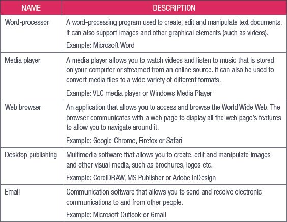

## UNIT 4.1 The role of application software

As you learned, application software (also called an app or application for short) is a computer program or group of computer programs designed for users. It makes using a computer easier. In the past, users would need to enter commands into a text field but now doing anything on your computer is as easy as clicking a button or tapping on an icon.

There are different types of application software. Table 4.1 has a list of some of these types and descriptions of what they do. This list is by no means a full list of application software, since there is software for everything you do on your computer and there are many different variations of the same type of software.

**Table 4.1:** *Types of application software*

