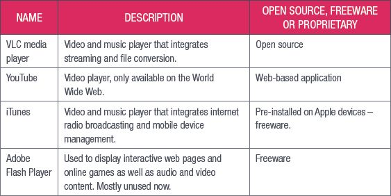
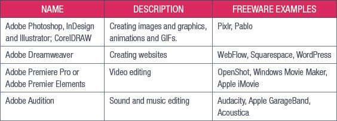
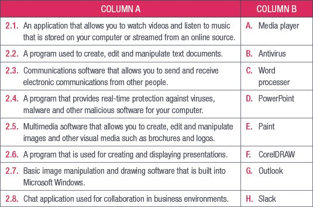

## UNIT 4.2 Collaboration and communication software

Multimedia and communications applications are some of the most common applications in use today.

### MULTIMEDIA SOFTWARE

Multimedia refers to integrating multiple forms of media into a single, often digital, product. This could be a PowerPoint presentation that includes videos and audio clips, a Word document with animations and images, or a web page with interactive elements.

Although images and text are different types of media, multimedia is usually used to refer to things that incorporate video, audio, animated images (such as GIFs) and text.

Multimedia software refers to the programs you use to create and interact with multimedia. There are two broad categories of multimedia software: media players and media creators. Media players are software applications that allow you to play back multimedia files, including audio and video files. Media players can also be used to view still images (such as photographs or illustrations). Some examples of media players are shown in Table 4.2.

**Table 4.2:** *Examples of media players*

Multimedia software is also used to create multimedia content, which is any content that uses a combination of text, audio, images, animations, video and interactive elements. There are several different types of multimedia software available, depending on what you would like to create. Table 4.3 shows examples of multimedia software and what they are mainly used to create.

**Table 4.3:** *Examples of multimedia software*

Something to know

You may have noticed that in the examples given above, the name Adobe pops up quite often. Adobe Systems was founded by John Warnock and Charles Geschke in 1982, after they left the Xerox company to open a new company to sell their product PostScript.

PostScript was a powerful computer language that described the layout of a page to a printer, allowing the printer to reproduce in hard copy exactly what was on the digital page.

PostScript allowed laser printing to become a reality, since the program could guide the lasers to draw the digital page on the printer’s drum correctly. Soon, PostScript became a staple in the advertising industry, since it allowed advertisement creators to quickly print out a copy of their advert to see what it would look like on a page.

Their next revolution was the Type 1 typefaces, which provided digital fonts that could be printed at any resolution. This was ground-breaking, because at the time more elaborate fonts would have to be lettered by hand and could only be printed at higher resolutions or they would lose their detail. The Type library soon became the largest collection of typefaces for personal computers in the world.

The introduction of Adobe Illustrator brought the ability to create detailed and high-quality digital drawings, which changed the face of advertising and marketing forever. Images could be created, manipulated, edited and updated quickly and more easily than traditional by-hand drawings.

Each new version of Adobe’s products and each new product they bring out makes creating high-quality multimedia content easier and faster and their products remain some of the most popular multimedia software available.

### COMMUNICATION SOFTWARE

Communication software is the group of applications that allow users to share files, text and video or audio messages over an internet connection. It is more than just email; communication software includes **Voice over Internet Protocol (VoIP)** systems and chat programs. Some examples of communication software are:

- Email clients such as Outlook.
- VoIP software such as Skype and RingCentral.
- Chat applications such as Slack and WhatsApp.

Communication software makes it easier for people to communicate and it is often more cost-effective to install and implement than traditional communications methods (such as telephone lines).

Most communication software doubles as collaboration software. This means that it can be used by multiple people to work on the same thing or to share work online. For example, Skype allows you to make video calls and to share your screen with the people on the call with you, allowing them to see what you are working on.

 Activity 4.1

**1.**Multiple choice:

**a.**Which of the following video players is only available on the World Wide Web?

**A.**VLC media player

**B.**YouTube

**C.**Windows Media Player

**D.**iTunes

**b.**Which of the following is not antivirus software?

**A.**NOD32

**B.**Avast

**C.**AVG

**D.**AMG

**c.**What is the file extension for animated images?

**A.***.jpeg

**B.***.mp3

**C.***.gif

**D.***.mp4

**2.**Match column B with column A:

**3.**Answer the following questions in your own words:

**a.**Explain what antivirus software is used for.

**b.**List two examples of multimedia software and describe what they are specifically used for.

**c.**Define communications software.

**d.**Why does communications software make it easier for people to communicate?
