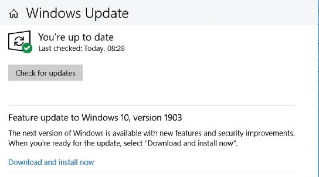

## UNIT 4.3 Compatibility issues

The huge variety of application software available and all the versions of the same software mean there are bound to be compatibility issues, even when people are using the same kind of software. Compatibility issues come up when users are using the same type of software for a task, such as word processors, that cannot communicate with each other. This could be due to a difference in their versions or because they are made by different companies.

Compatibility issues can be small, for example certain features not working properly in older versions of the same software, but they can also be problematic, such as when a newer version of the software cannot open a document created in an older version.

In Microsoft Word for example, documents created in Word 2016 or 2013 can be opened in Word 2010 or 2007, but some of the newer features (such as collapsed headings or **embedded videos**) will not work in the older versions.

If someone using Word 2016 opens a document created in Word 2010, the document will open in Compatibility Mode. Microsoft Office does this to make sure that documents created in older versions still work properly.

**Figure 4.1:** *Microsoft Word Compatibility Mode*

The feature in Figure 4.1 is an example of something called backwards compatibility, which is the ability of newer software to interact with files (or programs or systems) made with older versions of that software. It is usually built into the software and is a way to avoid compatibility issues. Another way to avoid this is to update your software.

### UPDATING SOFTWARE

More and more software providers are offering subscription services for their software. An example of this is Microsoft’s Office 365, which gives you the full range of Microsoft Office products and access to Microsoft’s online productivity tools, such as OneDrive (their cloud storage service). Since Office 365 is a subscription service, you never truly own the software and will need to renew your subscription every year, but the software is updated once a month to make sure that you have access to the latest features.

Making sure that your software is up to date is important as you will be able to get the newest fixes for **bugs** in the software, the most recent virus and malware fixes and the latest features. This is especially important for software such as your antivirus programs and your operating system. Microsoft Windows 10 will let you know when a new version of any of your software becomes available so that you can update it. Some software also has the option to check for and install updates automatically, so you do not need to remember to do so.

TO UPDATE YOUR SOFTWARE

Whenever your computer asks to update a program, allow it to update as soon as possible. If it is not possible to install the update immediately, schedule a time that evening to install the update.

**Figure 4.2:** *Microsoft Windows automatically installs updates*

If the application informs you that an update is available with a link, download the newest version and install the downloaded program. This will update the program to the newest version without changing your settings.

If a program you use often does not inform you about an update, search the internet once or twice a year to see if a new version has been released. If it has, download this version and install it to update your software.

PATCHES AND SERVICE PACKS

A patch is a program that makes changes to software installed on a computer. Software companies issue patches to fix bugs or security problems in their programs or add new functions to the software. Microsoft refers to their patches as hotfixes.

A service pack (SP) is a collection of updates and fixes for an operating system or a software program. SPs are usually made up of patches. Many of these patches are often released before a larger SP, but the SP allows for an easy, single installation.

An installed SP also usually updates the version number for Windows. This is the actual version number, not the common name, such as Windows 10.

SPs often include new features as well as fixes. This is why one version of a program or operating system can be very different to another on a different computer.

Most, if not all, operating systems and software programs provide SPs free of charge as either a manual update from the developer’s website, or through an auto-update feature within the program or operating system.

Something to know

Since releasing Windows 10, Microsoft has moved away from SPs and instead releases regular major features updates.

Activity 4.2

**1.**Write True or False next to the question number. Correct the statement if it is FALSE. Change the underlined word(s) to make the statement TRUE. (You may not simply use the word NOT to change the statement.)

**a.**Microsoft Office 2016 is an example of a subscription service.

**b.**Microsoft refers to their patches as hotfixes.

**c.**An installed service pack (SP) also usually updates the version number for Microsoft Office.

**d.**Most SPs are provided for a fee.

**2.**Answer the following questions in your own words:

**a.**Explain what a compatibility issue is.

**b.**Describe what backwards compatibility is.

**c.**Why are more software companies offering subscription services for their products?

**d.**Elaborate on the main difference between buying software and using a subscription service.
