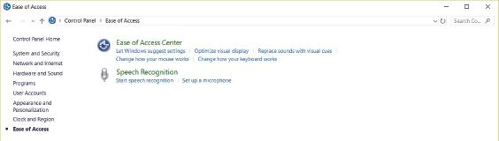
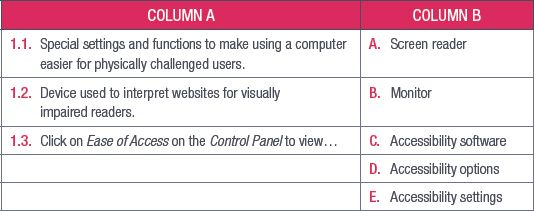

## UNIT 4.4 Software for physically challenged users

In this unit, we will take a closer look at the software incorporated into most software for able-bodied users that makes it easier for physically challenged users to use.

Each assistive technology input and output device comes with specialised software to interpret the input correctly to give the correct output. For example, text-to-speech software converts text on a page to speech, allowing visually impaired users to “read” the page. Some of the more complex input and output devices, such as gesture-controllers and sipand-puff devices, need specific software to work correctly. This software is usually included with the devices.

More recently, the developers of operating systems for smartphones and computers have begun to include accessibility software in their operating systems. Microsoft’s Windows 8 and 10, Apple’s OSX and Google’s Android operating systems all have settings and built-in applications designed for physically challenged users.

While alternative input and output devices and accessibility software are important components in giving physically challenged users the opportunity and ability to use computers, these devices cannot work properly if the information they are interacting with has not been put together with accessibility in mind.

This is especially important when it comes to accessing the internet. Screen readers can struggle with interpreting websites that have not been designed for visually impaired readers. Since websites and web pages are mostly designed as a visual experience, users who cannot see these visual elements struggle to interact with the sites.

There are, however, ways that designers and developers can make their websites more accessible to visually impaired or blind users, for example:

- Giving links and buttons descriptive labels (saying “click here to sign up” instead of just “click here”)
- Giving images and graphics good descriptions and *Alt Text*.
- Using headings to organise the content on a website’s pages.
- Using descriptive titles for pages.
- Closed captions, which describe all the audio elements of a video and not just the dialogue, can also help deaf and hearing-impaired users watch videos and learn from them.

Almost all modern operating systems contain a series of special settings and functions to make using a computer easier for physically challenged users. These are usually referred to as accessibility settings and can include things such as:

- Colour settings for colour blind people to make browsing the web easier.
- Magnifying the screen to make it easier to read for partially blind users.
- Text-to-speech software to read the typed text out loud to blind users.
- Displaying visual notifications instead of having a notification sound to alert users who are hard of hearing to potential problems or updates for their computer.
- Speech recognition software to allow users to control their computers using their voices.

USING A SCREEN READER

[https://youtu.be/7Rs3YpsnfoI](https://youtu.be/7Rs3YpsnfoI)

You can see what range of accessibility options your computer has by clicking on the Windows icon, searching for *Control Panel* and clicking on *Ease of Access*.

**Figure 4.3:** *Ease of Access menu in Windows 10*

 Activity 4.3

**1.**Match Column B with Column A:

**2.**Write True or False next to the question number. Correct the statement if it is FALSE. Change the underlined word(s) to make the statement TRUE. (You may not simply use the word NOT to change the statement.)

**a.**To find accessibility options, you need to click on *Ease of Use*.

**b.**Speech recognition software reads text aloud for blind users.

**c.**Closed captions can help deaf and hearing-impaired users watch videos.

**3.**Answer the following questions in your own words:

**a.**What are accessibility settings? Give two examples.

**b.**How do you access the accessibility features in Windows 10?

**c.**Give one example of software for physically challenged users.

**d.**Why is it important to design websites with accessibility in mind?

**e.**List four ways in which website developers can make their websites more accessible.
