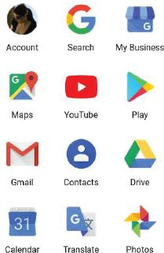
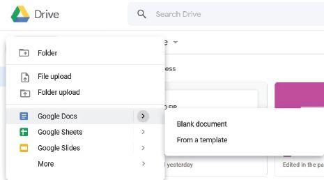
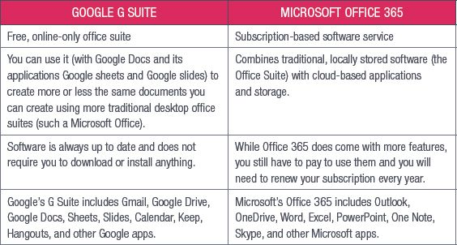
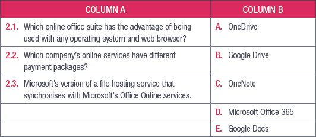

## UNIT 4.5 Cloud-based applications

With the rise in internet access and smartphone use, more people are turning to online or cloud-based applications to get their work done, since they can access these programs wherever they are as long as they have an internet connection. Cloud-based applications are any applications that are accessed using an internet connection instead of being stored in a device’s memory.

Gmail, Google’s online email client, was more popular in 2018 than Microsoft’s Outlook. Online service providers are also offering cloud-based applications to businesses.

In this unit we will look at two web-based applications, namely Google’s G Suite and Microsoft Office 365. We will discuss the advantages and disadvantages of each and how you can use them.

### GOOGLE G SUITE

Google’s G Suite is a free, online-only office suite. You can use it (with Google Docs and its companion applications Google Sheets and Google Slides) to create more or less the same documents you can create using more traditional desktop office suites (such as Microsoft Office). Google G Suite is offered with Google Drive, Google’s cloud storage platform, and Gmail.

Google Docs has several advantages, for example:

- It is easier to share and work with others in real time and multiple people can work on the same document at the same time.
- While Google Docs does have an offline editing option, it will only save your changes once you are connected to the internet again.
- The software is always up to date and does not require you to download or install anything.
- You can access your documents anywhere you have internet access and access to your Google account.
- Your documents do not take up space on your computer’s storage. Instead, they are saved on the cloud.
- Because the documents are saved online, your documents are backed up automatically.

However, Google Docs also has its disadvantages, such as:

- It does not have the full range of word-processing features, e.g. you are limited to a set number of styles and formatting. This means that you cannot customise your documents as much as you can with other cloud-based applications.
- As with anything stored on the internet, your documents are vulnerable to attack and you do not have full control over the security of your documents.

ACCESSING GOOGLE DOCS

To access Google Docs, you will need to go to Google Drive. You can do this by clicking on this icon in your Gmail account, followed by clicking on *Google Drive*. You need to set up a Gmail account to get access to Google Docs.

Alternatively, you can visit [https://drive.google.com](https://drive.google.com).

Once you are in your Google Drive account, click on *New*.

Click on *Google Docs* and choose *Blank document* or *From a template* to get started.

### MICROSOFT OFFICE 365

Microsoft Office 365 is a subscription-based software service that combines traditional, locally stored software (the Office Suite) with cloud-based applications and storage. As part of your Office 365 subscription, you get access to Microsoft’s OneDrive and online versions of Microsoft’s word-processing, presentation, spreadsheet and database-management software.

You are also able to share this software across multiple devices you own, for example a laptop, smartphone and tablet.

The advantages and disadvantages of Microsoft Office 365 are very similar to the advantages and disadvantages of Google Docs. While Office 365 does come with more features, you still have to pay to use them and you will need to renew your subscription every year.

Table 4.4 shows how Google G Suite compares to Microsoft Office 365.

**Table 4.4:** *Comparison between G Suite and Microsoft 365*

 Activity 4.4

**1.**Multiple choice:

**a.**Which of the following is Google’s online storage service?

**A.**Google Drive

**B.**Google Docs

**C.**Chrome

**D.**OneDrive

**b.**Which of the following is NOT part of the Microsoft Office 365 package?

**A.**Outlook

**B.**OneNote

**C.**PowerPoint

**D.**Notepad

**c.**Which application does not need an internet connection to work?

**A.**Notepad

**B.**Google Docs

**C.**Office 365

**D.**Google Maps

**2.**Match Column B with Column A:

**3.**Write True or False next to the question number. Correct the statement if it is FALSE. Change the underlined word(s) to make the statement TRUE. (You may not simply use the word NOT to change the statement.)

**a.**You have access to a full range of formatting options in Google Docs.

**b.**Microsoft Office 365 is a free service.

**c.**You can use Office 365 on multiple devices.

**d.**Google Docs is a free, online-only office suite but you pay for extra storage.

**e.**Google Drive is separate from your Gmail account.

**4.**Answer the following questions in your own words:

**a.**Explain what a cloud-based application is.

**b.**List the steps taken to access Google Drive and open a spreadsheet.

**c.**List two advantages Google Docs has over Microsoft Word.
