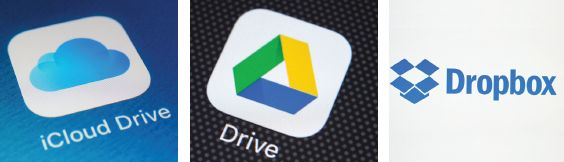
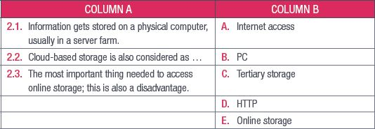
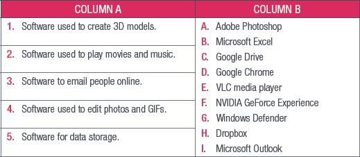
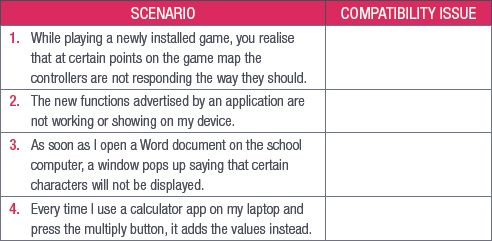
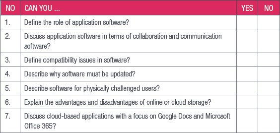

## UNIT 4.6 Online storage

Online storage is becoming more popular as access to the internet grows. Online storage is also called **tertiary storage** or cloud storage and uses websites and online portals to store information on the World Wide Web. Examples of online storage include services such as Google Drive, Dropbox and Apple iCloud.

While storing information online seems like you are sending your information into the cloud, you must remember that this information does get stored on a physical computer somewhere, usually on a server in a server farm.

**Figure 4.4:** *Online storage services include Apple iCloud, Google Drive and Dropbox*

Online storage has several advantages and disadvantages.

Some of the advantages of online storage are:

- Allows you to access your information anywhere.
- Frees up physical storage space on storage devices.
- A reliable way to back up important or critical information.
- Data stored online can be shared more easily

A number of disadvantages of online storage:

- It is vulnerable to attacks (hacking) and distribution.
- May have **bandwidth** or storage limits.

 Activity 4.5

**1.**Multiple choice:

**a.**Which of the following is not an example of online storage?

**A.**iCloud

**B.**Google Drive

**C.**Google Docs

**D.**Dropbox

**b.**Which of the following has potentially the largest storage space?

**A.**Primary storage

**B.**Cloud-based storage

**C.**External HDD

**D.**SSD

**2.**Match Column B with Column A:

**3.**Write True or False next to the question number. Correct the statement if it is FALSE. Change the underlined word(s) to make the statement TRUE. (You may not simply use the word NOT to change the statement.)

**a.**Online storage has limited free space and you pay to get more space.

**b.**Dropbox is only compatible with the Microsoft Windows operating system.

**c.**Spotify songs are stored on a cloud-based storage system.

**4.**Answer the following:

**a.**Explain how your data can potentially be lost when using cloud storage.

**b.**List THREE advantages of cloud-based storage.

REVISION ACTIVITY

QUESTION 1: MULTIPLE CHOICE

**1.1.**What is the definition of software? (1)

**A.**Programs that allow you to perform specific tasks on the computer.

**B.**Programs that control and manage the operations of the computer.

**C.**Programs that contain the instructions you use to tell the computer what you want it to do.

**D.**Programs that allow different applications to communicate with each other.

**1.2**Which of the following is NOT an example of application software? (1)

**A.**Microsoft Excel

**B.**Norton Antivirus

**C.**Windows XP

**D.**Mozilla Firefox

**1.3**Which of the following is multimedia software? (1)

**A.**Microsoft Paint

**B.**Microsoft Access

**C.**Microsoft Edge

**D.**Notepad

**1.4**Which of the following is an example of system software? (1)

**A.**WordPad

**B.**Windows Defender

**C.**Google Chrome

**D.**Windows Media Player

**1.5**Hotfixes are also known as ______. (1)

**A.**Traces

**B.**Hotspots

**C.**Patches

**D.**Service packs

QUESTION 2: TRUE OR FALSE

Write True or False next to the question number. Correct the statement if it is FALSE. Change the underlined word(s) to make the statement TRUE. (You may not simply use the word NOT to change the statement.)

**a.**You can own subscription software as long as you pay for it. (1)

**b.**Subscription software can update itself automatically. (1)

**c.**Service packs are updates for system software. (1)

**d.**Google Docs has all the features that Microsoft Word has. (1)

**e.**Multimedia software refers to the plans you use to create and make multimedia. (1)

QUESTION 3: MATCHING ITEMS

Choose a term/concept from Column B that matches a description in Column A. Write only the letter next to the question number (e.g. 1J). (5)

QUESTION 4: MEDIUM AND LONG QUESTIONS

**4.1**Describe what backwards compatibility is. (2)

**4.2**Explain briefly what accessibility settings are. (2)

**4.3**Give two examples of accessibility settings. Mention which physical challenge could benefit from this setting. (4)

**4.4**Identify the compatibility issue for the following scenarios. (4)

**4.5**Your teacher has asked you to create a presentation that includes at least one video, some audio clips and an animation. Which three software programs will you use to make these multimedia items and why? (6)

**4.6**Describe the difference between a service pack and a patch. (4)

**4.7**Provide two reasons why it is important to update your software regularly. (2)

**4.8**Give one advantage Microsoft Word has over Google Docs. (1)

**TOTAL: [40]**

AT THE END OF THE CHAPTER

