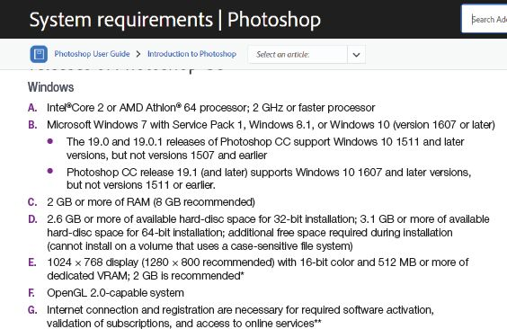
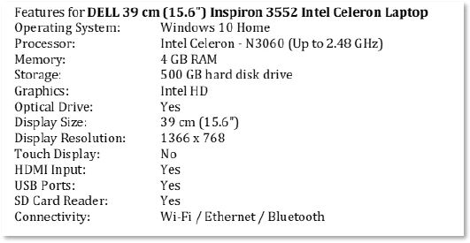
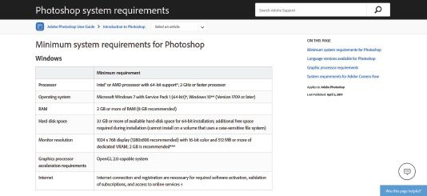

## UNIT 5.1 Basic system requirements

System requirements are the minimum necessary specifications that you will need to make sure that the software runs smoothly and does not overwork the hardware on your computer. It is basically a list of what you need to make sure that a game or program runs properly.

If your computer does not meet these requirements, you may not be able to install the software or, if you can install the software, it may run slowly. The system requirements for software are usually printed on the package that the software comes in or are listed on the software’s website.

Figure 5.1 below shows the list of system requirements for installing Photoshop.

**Figure 5.1:** *Adobe Photoshop system requirements*

As you can see, the software makes several recommendations, including:

**A.**The type of CPU you will need (Intel® Core 2 or AMD Athlon® 64 processor operating at 2 GHz or faster).

**B.**The operating system you should be using (Microsoft Windows 7, 8.1 or 10).

**C.**How much RAM your system should have (a minimum of 2 GB but 8 GB is recommended).

**D.**How much space should be on your hard drive.

**E.**The size of your display (or screen).

**F.**Whether or not you will need an internet connection.

Knowing what the system requirements are for the software you will be using most often will help you decide what computer to buy when you are shopping for one. Most of the information you will need will be on a label on the computer or will be listed in an advertisement for the computer.

System requirements will also let you know if you need to purchase any additional hardware (such as microphones when using audio recording software). Hardware items, such as printers, also come with system requirements. For example, a printer may only be compatible with Windows 8.1 and 10 or Apple’s macOS and cannot be connected to a computer running Windows 7.

For your computer to be able to run all the newest gaming software, you would need to look at the graphics card. A GPU is a programmable logic chip to render images, animations and video for the computer’s screen. GPUs can be located in plug-in cards, in a chipset on the motherboard or in the same chip as the CPU. The gaming software’s system requirements will recommend the size of the additional GPU.

If your computer does not meet all the requirements to run specific software or communicate with a specific device, you will not necessarily have to buy a whole new computer. It is possible to upgrade your RAM, GPU or CPU. You can, for example, upgrade your operating system or you can install the latest device drivers to make sure that your computer and hardware can communicate with each other.

 Activity 5.1

**1.**Answer the following questions pertaining to the advertisements below:

**a.**Does the DELL laptop have the minimum requirements for Windows 10? How can you be sure without looking at the minimum hardware needed for Windows 10?

**b.**What does OS mean in the *Call of Duty: Modern Warfare 2* game requirements?

**c.**What does *display resolution 1366 × 768* mean?

**d.**Describe what is meant by *Touch Display*.

**e.**Explain what 32-bit means.

**f.**Decide if the *Call of Duty: Modern Warfare 2* and Photoshop in Figure 5.1 can be installed on the laptop and add relevant comments.

**g.**What does VRAM stand for?

**h.**State which component of the computer will be the easiest and cheapest to upgrade.

**i.**List the different processors’ names in the adverts and sort them from fastest to slowest.

**2.**Write True or False next to the question number. Correct the statement if it is FALSE. (You may not simply use the word NOT to change the statement.)

**a.**If your hardware does not meet the system requirements, it means that the software will not work.

**b.**Certain programs can run even if you have no RAM.

**c.**Certain programs cannot work if you do not have the right operating system.

**d.**The motherboard is the core component in a computer that brings all the different aspects of the computer together.
