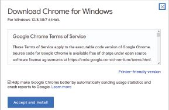
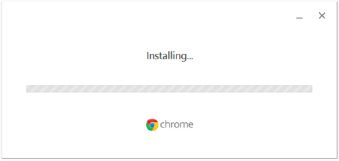
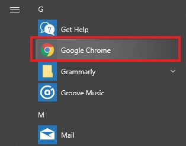
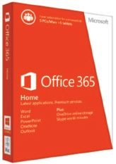
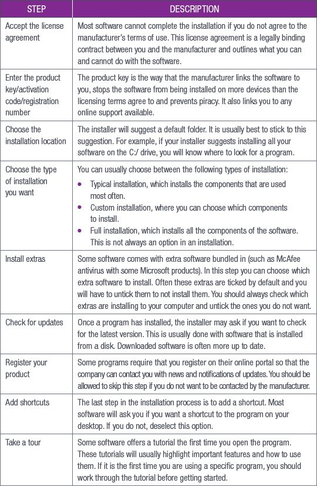
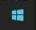
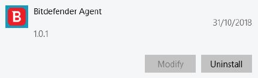
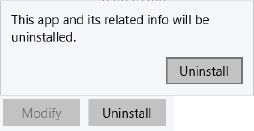

## UNIT 5.2 Software installation

Once you have worked out what requirements you need to install software, you will need to begin the installation process. Before installing the software, you need to:

**1.**Download the software files from a website; or

**2.**Purchase a CD or DVD from a store.

After downloading the installation software, you can install it. Usually this installation software is an **installation wizard** to assist you with the installation process.

### ONLINE DOWNLOAD

The most common way to get new software is to download it from the internet. To do this, you must go to the website where the software is available and download the files. Make sure that you download software from trusted publishers or verified retailers only. This ensures that you are getting the software you want and that you do not accidentally download malware or a virus.

You will usually use a credit card to buy the software to download. Once you have purchased the software, you will click on the download link to begin the process.

You can also buy software from app stores, such as Google’s Play Store, Apple’s App Store or the Windows Store. The software you are looking for is usually sorted according to its category, for example, gaming, word processing or design.

DOWNLOADING CHROME

To download software from the internet, do the following:

**1.**Go to [https://www.google.com/chrome/](https://www.google.com/chrome/) (or the site where the software is available to download).

**2.**Click on the *Download* button. A dialog box will appear. Accept the *Terms of Service* and make sure that you are downloading the correct version for your computer.

**3.**Follow the instructions to install the software.

**4.**Open the application from the *Start* menu.

### PORTABLE STORAGE MEDIUM INSTALLATION

Some software can be installed using the files found on a CD or DVD. This includes software such as the operating system, Microsoft Office (not Microsoft Office 365) and some games.

**Figure 5.2:** *An example of software on a portable storage medium*

To get this software, you will need to go to a store and buy the product and bring it home with you to install. You do this by inserting the disk into your computer’s optical disk drive (its CD or DVD player). The installation program will usually start automatically but you can also look for the setup program to start the installation.

HOW TO INSTALL SOFTWARE

Once you have downloaded the software or inserted the disk, the installation wizard will guide you through what to do. While the installation wizard does not handle all the aspects of the installation, since these may be different from one program to the next, the process is very similar for all software.

SOFTWARE STEPS FOR INSTALLATION

You will usually start by either clicking on the downloaded file or inserting the disk and then letting the program setup file run (usually called *Setup.exe* or *Install.exe*).

HOW TO UNINSTALL SOFTWARE

Uninstalling software is when you remove the program and all its files from your computer.

UNINSTALL A PROGRAM

To uninstall a program in Windows 10:

**Step 1:**Click on the *Windows* icon.

**Step 2:**Click on *Settings*.

**Step 3:**Click on *Apps*.

**Step 4:**Click on *Apps & Features* in the left pane. A list of all installed apps will appear.

**Step 5:**Click on the one you want to uninstall and then click on the *Uninstall* button (if this button is greyed out, it is a system app and cannot be uninstalled).

**Step 6:**Click on *Uninstall* in the pop-up window that appears and wait for the system to uninstall the app.

 Activity 5.2

**1.**Write True or False next to the question number. Correct the statement if it is FALSE. (You may not simply use the word NOT to change the statement.)

**a.**You completely eradicate the associated files and folders when you uninstall a program.

**b.**Some installation software files are sold on a flash disk.

**c.**The installation wizard will guide you through what to do when installing software.

**d.**Most hardware is already installed on the Microsoft operating system, thus most hardware are plug-and-play devices.

**e.**Most primary hard drives are saved with the drive location of E:\.
