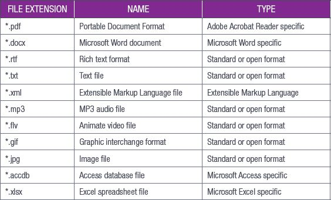

## UNIT 5.3 File management

When you are setting up a file management system, there are several key things you need to look out for. You will need to know what types of files you are creating and how big those files are (so that you know how much of your computer’s resources they are using).

It also helps you to understand certain attributes that files have, such as hidden and read-only, and how to import/export files and how to search folders and drives for a specific file. This section will look at these aspects of files.

### FILE TYPES

In Grade 10, you learned about file extensions and how they give you an idea of what content is likely to be in the file. File extensions usually link to a specific file type. For example, seeing a file that ends in .docx will let you know that it is a Microsoft Word document. File types indicate the specific characteristics of a document and will let the operating system know which program to use to open that file.

If you were to try and open an Adobe Photoshop document using Microsoft Excel, it would not work. Some file types are associated with specific programs, while others are standard file types that can be opened by a range of programs that support that file type. File types are not file formats, however. The file format usually describes the structure of the file and what it contains. Table 5.1 shows a list of file types and if they are program specific or standard.

**Table 5.1:** *File types*

Something to know

You can find a complete list of all file types at [FileInfo.com](http://FileInfo.com) ([https://fileinfo.com/](https://fileinfo.com/)).

When you are organising files, you can either organise them by file type or by subject.
