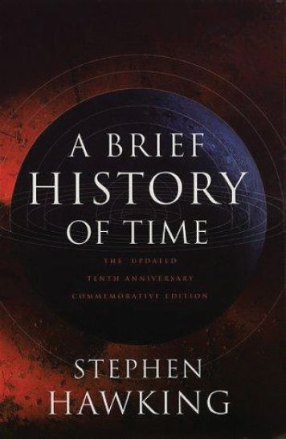
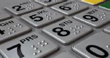
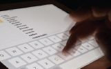
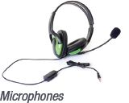
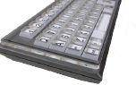
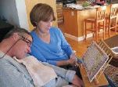
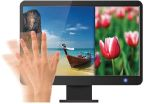
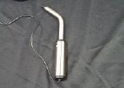
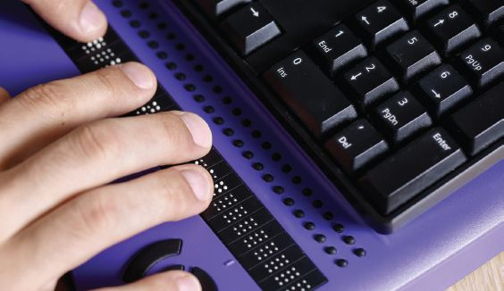
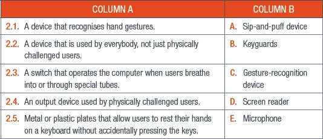

## UNIT 6.1 Input and output devices for physically challenged users

### INPUT DEVICES

The author of *A Brief History of Time*, famous scientist Stephen Hawking, was diagnosed with a disease called amyotrophic lateral sclerosis (ALS) in 1963 and given only two years to live. He would go on to live for 55 more years (until his death in 2018), but the ALS would cause him to lose the ability to control his muscle movements. An operation done in 1985 to save his life left him unable to speak.

**Figure 6.1:** *A Brief History of Time by Stephen Hawking*

*A Brief History of Time* was written using two things, a piece of software called Equalizer that took Professor Hawking’s eye movements and translated them into words, and a sensor in his glasses that could track those eye movements. With the help of this technology, a person who would not have been able to use normal computer equipment was able to create ground-breaking work.

There are a variety of alternative input devices available to physically challenged users. These range from fairly common and easy-to-implement adaptations to traditional input devices, to more specialised devices. Next, some of these devices and their advantages and disadvantages are discussed.

INPUT DEVICES FOR PHYSICALLY CHALLENGED USERS

Many options are available to help people who are physically challenged when using ICT. These are just a few devices that could be used.

- **Braille keyboard and Braille display device:** These are keyboards with Braille lettering, that can be used by blind or visually impaired users.
- **On-screen or virtual keyboards:** The keyboard is displayed on a user’s screen and used with gesture-controlled pointers or joysticks.
- **Microphones:** Are used with speech recognition software, allowing the user to dictate their input to the computer.
- **Keyguards:** Metal or plastic plates that allow a user to rest his/her hands on a keyboard without accidentally pressing the keys.
- **Head-mounted pointers:** These are controlled by switches to simulate the function of a mouse. The switches can be in hand or foot pads, or pedals or sensors that detect eye movement or facial expressions.
- **Gesture-recognition devices:** The device recognises hand gestures, head or eye movements, or read lips or sign language to input information into a computer.
- **Sip-and-puff devices:** A switch that operates the computer when users breathe into (puffing) or through (sipping) special tubes. Special software is used to interpret the sips and puffs and turn them into data that the computer can use.
- **Magnification devices:** Enlarges the information displayed on the computer screen in a range of magnifications and a variety of fonts. The magnifier may have the ability to create a large, scrolling virtual screen, or may only magnify the portion of the display near the mouse pointer.
- **Large-key keyboards:** The print on the number and letter keys of the keyboard are three times larger than those on standard keyboards. The bright white printing on the large black keys increases visibility and the contrast makes it easier to read. These features are helpful to those with vision impairment and for those who wear reading glasses or bifocals, or work in low-lit areas.
- **Braille printers:** These printers operate by embossing raised braille dots onto Braille paper. Pins are pressed into one side of the paper in order to create raised dots on the other side. This is only output.

*Braille keyboard*

*On-screen or virtual keyboards*

*Microphones*

*Keyguards*

*Head-mounted pointers*

*Gesture-recognition devices*

*Sip-and-puff devices*

Keyboard and mouse settings can also be customised to make input easier for physically challenged users. Sticky keys allow users to use common keyboard shortcuts without needing to hold down all the keys at the same time, for example, when using the *Paste* command, users do not need to hold down the *Ctrl* and *V* keys at the same time. They can instead press the keys one at a time.

You can turn sticky keys on in one of two ways.

**1.**You can press the *Shift* key five times to turn sticky keys on and off.

**2.**If this does not work, you can click on the *Windows* key or press the *Windows* key on your keyboard, click on the *Settings* icon and then click on *Ease of Access*. You can then scroll down to the keyboard settings and tick or untick the *Sticky Keys* box.

### OUTPUT DEVICES

Physically challenged users can also use a variety of output devices to access information on their computers. Headphones and speakers can, for example, be used with various types of screen-reading software, such as screen-magnifying programs or physical magnifiers mounted onto their screens, to make sections of the screens easier to read.

Braille interfaces work by raising metal or plastic pins on a surface, allowing blind users to read what is on their screens. These devices can only read basic text documents.

**Figure 6.2:** *Computer with Braille display*

Braille printers can be used to aid visually impaired users by printing the raised **patterns** of dots on special paper, thereby allowing them to read the text with their fingers.

 Activity 6.1

**1.**Multiple choice:

**a.**Stephen Hawking was diagnosed with?

**A.**ALS

**B.**ADHD

**C.**CTS

**D.**Parkinson’s disease

**b.**Which of the following is NOT a device for the physically challenged?

**A.**Microphones

**B.**On-screen or virtual keyboards

**C.**Monitor

**D.**Keyguards

**2.**Match Column B with Column A:

**3.**Write True or False next to the question number. Correct the statement if it is FALSE. Change the underlined word(s) to make the statement TRUE. (You may not simply use the word NOT to change the statement.)

**a.**Braille interfaces are for deaf people.

**b.**The *Paste* keyboard shortcut uses the *Ctrl + P* keys.

**c.**Sighted users may not be able to use screen readers.

**4.**List the advantages and disadvantage of the following devices:

**a.**On-screen or virtual keyboards

**b.**Braille keyboards

**c.**Head-mounted pointers

**d.**Gesture-recognition devices

**e.**Sip-and-puff devices
