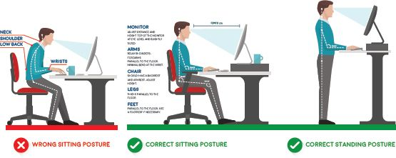

## UNIT 6.2 Health issues due to input and output devices

With more and more people using computers in their daily lives, certain health issues surrounding computer use have come up in recent years. Some of these have to do with the impact that using a computer has on your body, for example, **repetitive strain injuries (RSIs)** to wrists and back and eye strain from bad posture and lighting.

This section looks at how to prevent these health issues to make sure that you stay healthy.

### ERGONOMICS

**Ergonomics** is concerned with how to design/arrange furniture and equipment in a way that will make people more comfortable and efficient in their work. It also looks at how people interact with their input and output devices to minimise the amount of physical strain placed on their bodies. Therefore, ergonomically designed computer mice, keyboards, desks and chairs have been developed to reduce RSIs, **carpal tunnel syndrome** and back strain.

Ergonomics also determine how people should sit (their posture), how they should look at a screen and how often they should get up.

**Figure 6.3:** *Good ergonomics*

When you want to reduce the amount of strain on your body, remember to do the following:

- Make sure that your desk, chair and screen are all at a comfortable height.
- Sit properly and do not slouch or hunch your shoulders. This could cause backache and neck pain.
- Stand up and move around at least once an hour. Try using a standing desk (if possible) for some of the time you are working.
- Never bend your neck to look at your screen. Always make sure that your chin is parallel to your desktop.
- Make sure your shoulders are relaxed when you are typing (not raised or hunched), your knees are at a 90° angle and your feet are flat. If you are too short for your feet to touch the floor and have your arms at a comfortable angle, find a footrest to put your feet on.
- Make sure your back and hips are in contact with the back of the chair you are sitting on and that the chair has good back support.

COMPUTER ERGONOMICS

[https://www.youtube.com/watch?v=bLBKUbnLYTs](https://www.youtube.com/watch?v=bLBKUbnLYTs)

Computer and smartphone screens can be set to have less blue light, lessening the glare and reducing eye strain. They can also be tilted until you find a comfortable viewing angle.

 Activity 6.2

**1.**Multiple choice:

**a.**Which of the following equipment does not carry a lot of germs?

**A.**Smartphones

**B.**Computer mice

**C.**Keyboards

**D.**Monitors

**b.**Which one of the following is not an effect of sitting for too long in front of a computer?

**A.**Obesity

**B.**Increased blood pressure

**C.**Hair loss

**D.**High blood sugar

**c.**Which of the following is not an injury due to improper ergonomics?

**A.**Repetitive strain injury

**B.**Computer vision syndrome

**C.**Repetitive strain injury

**D.**Back strain

**2.**Write True or False next to the question number. Correct the statement if it is FALSE. Change the underlined word(s) to make the statement TRUE. (You may not simply use the word NOT to change the statement.)

**a.**Repetitive strain injuries and eye strain are examples of health issues due to input and output devices.

**b.**Hardware needs to be protected from theft and damage.

**c.**Computer and smartphone screens can be set to have less red light, lessening the glare and reducing eye strain.

**d.**You will have good back support when you place your hips and back on the back of the chair.

**3.**Answer the following questions in your own words:

**a.**Define ergonomics.

**b.**List two ways that you can keep your hardware clean and hygienic.

**c.**List three ways that you can reduce the amount of strain on your body.
