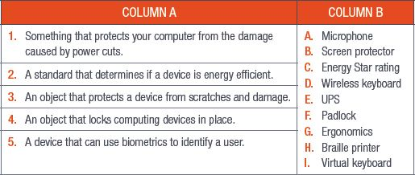
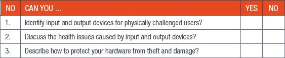

## UNIT 6.4 Power supply and settings

Each piece of hardware you use will need to draw on some kind of power to operate, whether it is plugged directly into a power supply (such as monitors and desktop computers), operates with batteries (such as most wireless devices and smartphones, tablets and laptops), or draws power from the computer it is plugged into (such as wired keyboards and mice).

Computers and their associated hardware are some of the largest consumers of power in the home and workplace. By learning how to set these devices so that they use the minimum amount of power needed to operate effectively, and by purchasing devices that have a low energy consumption, you can reduce the amount of power your computer consumes.

Most displays and touchscreens can be adjusted to consume less power. You can do this by adjusting the brightness of your display until it is at a comfortable level. Most screens have a button on the bottom right-hand corner to turn the brightness up or down. Laptops usually have brightness keys on the keyboard and smartphones and tablets can be adjusted by going into the display settings.

You should adjust your screen brightness to suit the area, time of day and lighting. Even lowering the brightness by a small amount can save power and limit the strain you put on your eyes.

When you buy new hardware, you should look for devices that have an **Energy Star rating**. Devices with an Energy Star rating are usually more energy efficient, meaning they use less energy to perform the same tasks as devices that are not rated.

### HOW TO PROTECT YOUR DEVICES FROM POWER FAILURES

Uninterruptible power supplies (UPSs) can protect your devices from unexpected power failures and even power surges. UPSs are plugged directly into the main power supply to charge their batteries and will immediately start providing power to the computers connected to them in the case of a power failure.

 Activity 6.4

**1.**Write True or False next to the question number. Correct the statement if it is FALSE. Change the underlined word(s) to make the statement TRUE. (You may not simply use the word NOT to change the statement.)

**a.**Devices with an Energy Star rating are usually more energy efficient.

**b.**All the data on your hard drive will be lost in case of a power failure.

**c.**Your display should never be brighter or darker than the area you are using it in.

**2.**Answer the following questions in your own words:

**a.**Describe a UPS.

**b.**Explain how you would protect your device from power failure.

REVISION ACTIVITY

QUESTION 1: MULTIPLE CHOICE

**1.1**Which of the following is an output device for physically challenged computer users? (1)

**A.**Gesture-recognition software

**B.**Braille interfaces

**C.**Sip-and-puff devices

**D.**Braille keyboards

**1.2**What is an advantage of a keyguard? (1)

**A.**It reduces the number of typing errors.

**B.**It does have a universal standard for its keyboard.

**C.**It can be operated with multiple input devices.

**D.**It can be used with speech-recognition software.

**1.3**Text-to-speech software can be used by which of the following output devices? (1)

**A.**Monitor

**B.**Keyboard

**C.**Printer

**D.**Speaker

**1.4**Ergonomics does not involve ________. (1)

**A.**Making sure people are in a comfortable position

**B.**Arranging furniture and equipment

**C.**Reducing strain on the human body

**D.**Adjusting the lighting of an area

**1.5**Which of the following will not reduce your computer’s power usage? (1)

**A.**Unplugging your computer when you are not using it

**B.**Reducing the brightness of your display

**C.**Buying hardware with an Energy Star rating

**D.**Reducing your CPU’s speed

QUESTION 2: TRUE OR FALSE

Write True or False next to the question number. Correct the statement if it is FALSE. Change the underlined word(s) to make the statement TRUE. (You may not simply use the word NOT to change the statement.)

**a.**An eye-motion sensor is activated when a user breathes into its special tubes. (1)

**b.**A foot-operated mouse can be used by people who are blind. (1)

**c.**Text-to-speech software uses microphones. (1)

**d.**The interaction between the human body and computing hardware refers to economics. (1)

**e.**Looking at a computer monitor for a long time can damage your sight. (1)

QUESTION 3: MATCHING ITEMS

**3.1**Choose a term/concept from Column B that matches a description in Column A. Write only the letter next to the question number (e.g. 1J). (5)

QUESTION 4: SCENARIO-BASED QUESTIONS

Mr Riaad is a primary school teacher who teaches eight and nine-year-olds. He wants to teach them how to use computers safely. Since they will be using the computers a lot, he is also concerned about their eyesight.

**4.1**Mention two devices that Mr Riaad’s learners can use to improve their interaction with computers. Give a reason for each of your answers. (4)

**4.2**Mention one way his learners may not benefit from using each of these devices. (2)

**4.3**Mention three things Mr Riaad`s learners can do to reduce the strain on their eyes. (3)

**4.4**One of his learners has been struggling to see the letters on her keyboard. Suggest two alternative input methods that she could use. (2)

**4.5**A head-mounted pointer is an input device for phisically challenged users.

**a.**Explain how a head-mounted pointer is operated. (2)

**b.**Give two disadvantages of using a head-mounted pointer. (2)

**4.6**Mr Riaad must travel a lot. Name three things he can do to protect his smartphone and laptop while travelling. (3)

**4.7**Mr Riaad often uses trains to travel from one place to another. During this time, he uses his laptop to complete some of his work. Provide four tips he can use to reduce the strain on his body. (4)

**4.8**List three ways that Mr Riaad can teach his learners to save energy. (3)

**TOTAL: [40]**

AT THE END OF THE CHAPTER

