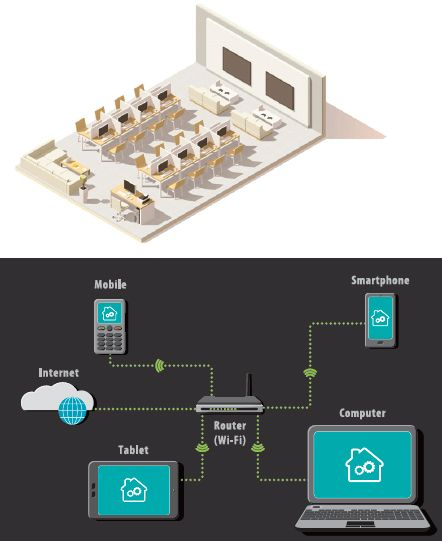
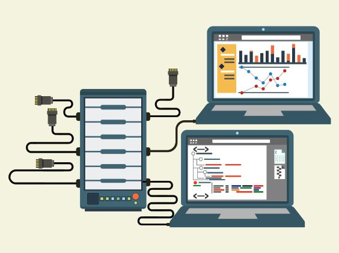
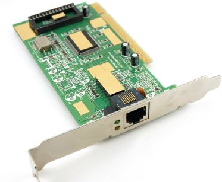
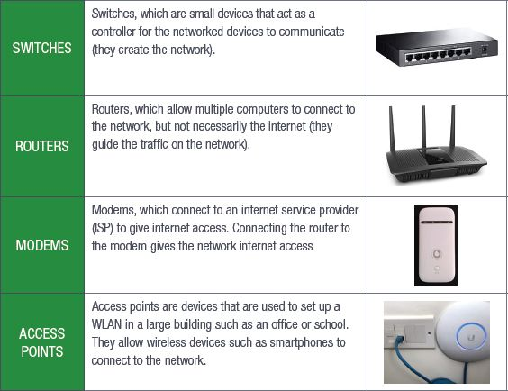
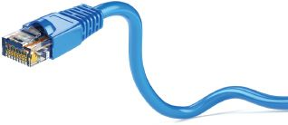
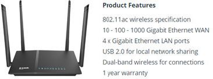
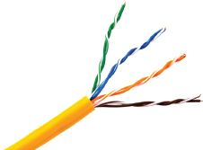
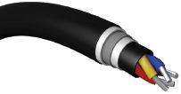

## UNIT 7.1 Networks

In this unit, you will be focusing on:

- LANs and WLANs
- Basic network components
- Network software
- Network connections
- Network communication

### TYPES OF NETWORKS

LOCAL AREA NETWORKS

A **local area network (LAN)** is a small network of computers covering a small area, such as an office building or school. A **wireless local area network (WLAN)** is the same as a LAN but it has the ability to connect wireless devices such as smartphones, laptops and tablets to the LAN.

LANs may serve only one or two users (for example in a home) or they can serve hundreds of users (in an office building or on a school campus). No matter how many users LANs serve, they are all designed to share resources such as internet connections, printers or server connections. Most LANs use either wireless or wired connections or a combination of the two to connect devices. For example, desktop computers and laptops can be connected to the network with cables while the printer and mobile devices are connected using wireless connections.

**Figure 7.1:** *A LAN in which computers are connected in the same room*

LANs have several advantages and disadvantages.

Some of the advantages of LAN are:

- Software (and licenses), files and hardware can be shared easily with the devices connected to the network.
- Files and other data can be shared faster if they remain on the network and do not need to be uploaded to the internet or emailed.
- Networks can be centrally controlled, making it easier to make changes, monitor users, update software, troubleshoot hardware and software issues and maintain resources.

Some of the disadvantages of LAN are:

- The initial setup costs for creating a network can be high, especially in a school or office environment, as you need to make sure that you have enough resources for the number of computers.
- There is a risk of privacy and data violations. **Network administrators** may have access to all the files created by each user.
- If a network is not secured properly, one infected computer can infect the entire network.

WIRELESS LAN (WLAN)

A wireless LAN (WLAN) is a wireless computer network that links two or more devices using wireless communication to form a local area network (LAN) within a limited area such as a home, school, computer laboratory, campus, office building etc. This gives users the ability to move around within the area and yet still be connected to the network. A WLAN allows users to move around the coverage area, often a home or small office, while maintaining a network connection.

### BASIC COMPONENTS OF A NETWORK

A network consists of the following basic components:

- Workstation and servers
- NIC
- Network devices
- Communication media
- Network software

WORKSTATIONS, CLIENTS AND SERVERS

Workstations and servers are usually part of a network. Workstations are the computers connected to the network. They are used by people to carry out tasks, for example the accountant who creates spreadsheets or the designer who designs websites.

Workstations will have input and output devices because they are designed to be used by humans. Some workstations, such as those designed to run **computer-aided design (CAD)** applications, will be more powerful than the computers you can buy to use at home.

**Figure 7.2:** *Workstations in a computer laboratory*

Servers are designed to manage network resources and hardly ever carry out tasks beyond their server tasks (for example, you would not use a server to design an advertisement).

**Figure 7.3:** *A computer server connected to laptops*

The main function of a server is to serve the information stored on it to other computers that are connected to it by a network. A server will usually have more RAM than a normal computer so that it can process data faster and it will use special operating systems, such as Linux and Windows Server, to carry out its tasks. Servers also usually have faster CPUs and larger hard drives, and they are often connected to UPSs.

Servers are usually only used for one type of task, for example:

- Email servers send and receive emails and store each user’s email information (their email address, username and password). Email servers can be local, such as those used by businesses, or global, such as Gmail. You interact with email servers through an email client, such as Microsoft Outlook or Gmail.
- Web servers are where the World Wide Web is. You will use a web browser, such as Google Chrome or Internet Explorer, to interact with a web server. Web servers deliver web pages to you when you request them, but they are also where you can upload data to cloud storage systems or your own website.
- Database servers are usually local servers that cannot be accessed by users outside the network they are connected to. Users can access database servers using specialised software (such as Microsoft **SQL**) to interact with them.
- A file server is a computer responsible for the central storage and management of data files so that other computers on the same network can access the files.

Some networks have a dedicated server which serves workstation (called clients). This is known as a client-server network. Other networks have workstations (called nodes) which act as both server and client. This is known as a peer-to-peer network.

NETWORK INTERFACE CARDS

Network interface cards (NICs) are pieces of hardware that allow a computer to connect to a network. Most modern computers have this device integrated into their motherboards, but NICs can also be purchased separately.

**Figure 7.4:** *A network interface card*

Network interface cards are also called network interface controllers or network cards. An NIC connects using **ethernet** cables, while a wireless NIC (WNIC) uses an antenna to connect to a wireless network. Smartphones use WNICs to connect to data signals and Wi-Fi hotspots. Laptops and desktops can use both NICs and WNICs to connect to a network.

Something to know

Network cards that plug into a computer or laptop using a USB cable are not NICs. They are called network adapters.

CONNECTION DEVICES

For a network to function, it needs some of the following:

Most modern routers combine the modem and the switches. A modem is a communication device. Modems are hardware devices that connect a computer or router to a broadband internet network. They work by converting the digital data sent by the computer into the **analogue signal** used by telephone lines. Modems are classified by how much data they can send (in bits per second) and how they connect.

Early modems used a dial-up connection to communicate but now they use digital connections (digital subscriber line, or DSL), fibre or wireless.

### NETWORK SOFTWARE

Network software refers to a range of software aimed at the design, implementation and operation of computer networks. It exposes the inner workings of the network to the network administrators, assisting them in managing and monitoring the network. It also allows multiple devices such as desktops, laptops, tablets, mobile phones and other systems to connect to each other as well as to other networks.

It is important that you understand the difference between network software and software applications. Network software is mostly used by network administrators, while software applications allow users who are working within a network to do their work.

If your network has a server, that server will need a server operating system. You can choose between different types of server operating systems to suit your needs. Device management software will allow you to manage all the devices connected to a network.

The functions of network software can be summarised as follows.

- Its main function is to set up and install computer networks.
- It allows network administrators to add or remove users from a network.
- It helps administrators to protect the network from data breaches, unauthorised access and attacks on a network through the use of a security tool.
- It helps administrators to define locations of data storage and allows users to access that data.

### COMMUNICATION MEDIA

Network connections can be wired or wireless. Wired network connections use ethernet cables to connect all the devices in a network, such as the computers, routers and switches. Ethernet cables are made up of several twisted pairs of wires inside a plastic casing and have a connector on either end called an RJ45 connector, which plugs into network ports on the various devices.

**Figure 7.5:** *An ethernet cable with RJ45 connector*

ETHERNET VS WI-FI

[https://www.youtube.com/watch?v=I6wfN4Y7dOU](https://www.youtube.com/watch?v=I6wfN4Y7dOU)

Wireless networks use radio signals to connect all the devices in a network (such as the computers, routers and printers). When you connect to a Wi-Fi hotspot in a restaurant or hotel, you are connecting to a wireless network.

HOW FAST IS MY NETWORK?

Wired and wireless networks can only transfer data as fast as their connections allow. The speed at which a network can transfer data is based on its components.

WIRED SPEEDS

For wired networks, the speed of the network is determined by the rated speed of the cables you use. The most common cable speed is **1 Gb (gigabit)**, these cables can transfer 1 000 Mb data per second.

WIRELESS SPEEDS

The speed of wireless networks depends on the standards they use. Wi-Fi standards are certified by the Institute of Electrical and Electronics Engineers (IEEE). The main IEEE standard for wireless networks is 802.11 and there are a number of specifications under this banner.

The 802.11 standards are different in terms of speed, transmission ranges and the frequency they use, but there are only a few of these standards that you will need to know. These standards make it easy for you to know what speeds you can expect from a given **wireless access point** (WAP).

LOOKING AT ADVERTISEMENTS FOR NETWORK DEVICES

Now that you have a better understanding of what a LAN is and how they are created, you will be able to take what you have learned and use it to interpret advertisements for network devices. There are several key pieces of information you will need to look out for when it comes to deciding which networking devices you want to buy.

Look at the rated speed for NICs and cables and match them to make sure that your data is transferred as quickly as possible. Make sure that WNICs are using the newest wireless standard (802.11ac).

On routers, check the number of ports, whether it is able to handle wireless connections, how many networks it can connect and whether or not it has a built-in modem.

Lastly, look at how well these devices meet your requirements and how suitable a connection type is to the space available (work out if a wired or wireless connection would be better).

Something to know

Remember: The frequency of the bandwidth determines how much data can be carried through a specific network at any given time. A one GHz connection is equal to a 1 000 MHz connection.

### NETWORK COMMUNICATION

Now that you understand how networks are connected, you need to understand how the different components of a network communicate with each other. Wired and wireless networks use very different communication media to connect the various components.

WIRED COMMUNICATION

There are two types of cables that connect modern wired networks to each other, namely unshielded twisted pair (UTP) cables and fibre optic cables. UTP cables are commonly used to connect LANs and telephone networks as they are easy to make and set up and are relatively cost-effective.

They are made up of two cables that are twisted together (the twisted pair) to cancel out electromagnetic interference from outside sources. They are called unshielded because no extra interference shields, such as metal meshes or aluminium foil, are added to the cables.

**Figure 7.6:** *UTP cable with different twist rates*

The wires are then connected to a connector (such as the RJ45 connector of an ethernet cable).

Fibre optic cables, on the other hand, are made of thousands of very thin strands of pure glass, called optical fibres, inside an insulating jacket. Instead of using electrical signals, fibre optic cables use light to transmit data very quickly.

**Figure 7.7:** *A multi-fibre cable*

Fibre optic cables are largely replacing metal cables since they are more flexible and lighter and can transmit data over longer distances with lower rates of data loss. The most common application for fibre optic cables is in internet connections.

COPPER VS FIBRE

[https://www.youtube.com/watch?v=Bw2NFBDxR8](https://www.youtube.com/watch?v=Bw2NFBDxR8)

WIRELESS COMMUNICATION

As you know, wireless connections allow you to transfer data over a distance without using cables, wires or physical connectors. Most common wireless communication uses radio waves to send data from one point to another.

A transmitter on the sending end turns the signal into an electromagnetic radio wave. The antenna picks up the radio wave and the receiver turns the electrical signal back into data.

 Activity 7.1

Answer the following questions:

**1.**Briefly describe the difference between a workstation and a server.

**2.**List two functions of network software.

**3.**How do wireless networks connect devices in a network?

**4.**Provide two advantages of using fibre optic cable to connect to a network.
