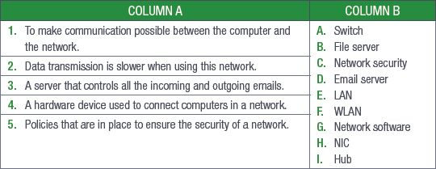
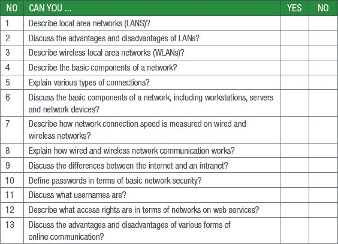

## UNIT 7.3 Basic network security

In our modern age, more and more of our important and personal data is being stored digitally and hackers and other criminals want to get hold of that information. That is why it is extremely important that the networks we use daily are secured and protected.

In this unit, you will learn about the basics of passwords, usernames and access rights, and how those three factors combine to secure a network.

### PASSWORDS

Passwords are the most basic form of network security. Passwords, at their core, are a secret string of letters, numbers and symbols created by users or generated by a computer to limit or restrict access to a system.

More often than not, you will need to pick your own password to make sure that it is something you can remember.

### USERNAMES

Usernames are a unique identifier given to any person who uses a secure computer network. Usernames are also called an account name, login ID or user ID. Usernames are most commonly used with passwords and can be used on computers or websites.

### ACCESS RIGHTS

On a computer, for example, a user may only have access to a personal folder where they can open, read, write, create and delete files and folders. A user with administrative rights can access all the files and folders on a computer and can make changes that will affect all users.

 Activity 7.3

Answer the following in your own words.

**1.**Read the following case study and answer the questions which follow:

Cyber-attacks: Protecting universities and solving cyber security issues

Oxford, Warwick, and Greenwich Universities are among many of the higher education institutes to have fallen victim to attacks in recent years, with hackers attempting to steal research data and documents. The problem has become acute enough to warrant the publication of cybersecurity guidance for universities and colleges by the UK Government’s National Cyber Security Centre (NCSC) recently.

No organisation today is immune from the threat of cyber-attacks. While we most often hear about breaches suffered by retailers, financial institutions and, since the infamous WannaCry ransomware attack in 2017, healthcare providers, many other types of organisations are becoming appealing targets for cybercriminals.

**a.**Define what a “hacker” is and distinguish between a “hacker” and a “cracker”.

**b.**Give THREE ways to secure information on a network.

**c.**Why would it be valuable for hackers to steal research data and documents?

**d.**What are the consequences of being a victim of a ransomware attack?

REVISION ACTIVITY

QUESTION 1: MULTIPLE CHOICE

**1.1**A private network that is only available to the organisation`s employees. (1)

**A.**Internet

**B.**WLAN

**C.**Intranet

**D.**LAN

**1.2**A network of computers covering a small area such as a school or office building. (1)

**A.**WAN

**B.**LAN

**C.**GAN

**D.**PAN

**1.3**All the computers that are connected to the network. (1)

**A.**Work stations

**B.**Servers

**C.**Input devices

**D.**Network software

**1.4**A network that uses radio waves to communicate rather than cable. (1)

**A.**WAN

**B.**LAN

**C.**GAN

**D.**WLAN

**1.5**A computer that provides shared resources, such as files and printers. (1)

**A.**NIC

**B.**Server

**C.**Workstation

**D.**Network security

QUESTION 2: TRUE OR FALSE

Choose the answer and write True or False next to the question number. Correct the statement if it is FALSE. Change the underlined word(s) to make the statement TRUE. (You may not simply use the word NOT to change the statement.)

**a.**If a network is not secured properly, the entire network will be infected should there be one infected computer. (1)

**b.**A PAN (personal area network) is designed to connect networks across large distances, for instance a province. (1)

**c.**In a LAN, networks are globally controlled, for easy changes and updates. (1)

**d.**An NIC (network interface card) allows a computer to communicate with a network. (1)

**e.**The main function of a workstation is to serve the information stored on it to the other connected computers. (1)

QUESTION 3: MATCHING ITEMS

Choose a term/concept from COLUMN B that matches a description in COLUMN A. Write only the letter next to the question number (e.g. 1-J). (5)

QUESTION 4: MEDIUM QUESTIONS

**4.1**Besides computers, name one other hardware device you might find connected to a network. (1)

**4.2**Give two reasons why a wireless network (WLAN) is better than a cabled network. (2)

**4.3**List two possible disadvantages of using a WLAN. (2)

**4.4**Provide two examples of servers that can be used in a network. (2)

**4.5**Briefly explain the following communication devices:

**a.**Modem (2)

**b.**Router (2)

QUESTION 5: SCENARIO-BASED QUESTIONS

Choco`s Chocolate Company sells chocolates to distributors as well as directly to the public. The company`s head office is in Cape Town with branches in Port Elizabeth, Durban and Johannesburg. Each branch has its own LAN, which communicates with head office.

**5.1**The company uses a LAN in all its branches.

**a.**Briefly explain what a LAN is. (2)

**b.**Give two advantages of using a LAN. (2)

**c.**Give two disadvantages of using a LAN. (2)

**5.2**Some of the employees have decided to communicate with their clients using IM.

**a.**Explain how IM works. (2)

**b.**Provide two reasons why the employees should be careful when using IM. (2)

**5.3**The company uses **FTP** for the electronic sharing of documents larger than 6 GB.

**a.**Why is it a good idea that the company uses FTP? (2)

**b.**Give two disadvantages of using FTP. (2)

**TOTAL: [40]**

AT THE END OF THE CHAPTER

