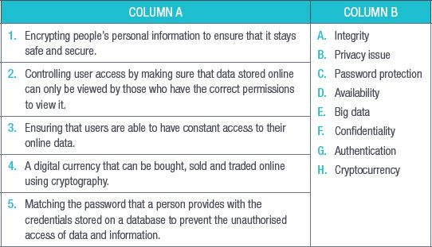
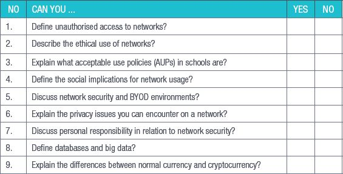

## UNIT 8.4 Normal currency vs cryptocurrency

In the past few years, cryptocurrencies such as Bitcoin and Etherium have captured the general public’s attention, but what is a cryptocurrency and how is it different from the normal currency you can get from a bank?

Simply put, cryptocurrency is a digital currency that can be bought, sold and traded online using cryptography. Cryptography takes the identifying data of the people buying and selling cryptocurrency and transforms it into something that is not readable unless it is deciphered. Cryptocurrencies are completely digital and have no physical form, unlike the money you get from the bank.

Normal currency is also usually backed by something physical that gives it value, like gold, and is usually issued and supported by a country’s central authority or bank (in South Africa, that would be the Reserve Bank and the government). Normal, or fiat, currency is usually referred to as legal tender and has a value on the world’s stock markets as well.

Cryptocurrencies are not backed by a single country’s central authority and their value is not tied to anything physical. This means that they are decentralised and global.

Cryptocurrencies, however, are finite. There is only so much of it to go around.

Something to know

Bitcoin, the most popular cryptocurrency, was created in 2008 and remained mostly unknown. A few years later, Bitcoin mining became a popular pastime for computer enthusiasts and the popularity of Bitcoin grew. The value of Bitcoin in real world currency began to grow exponentially. In January 2017, a single Bitcoin would cost you $800 (about R11 104 in 2018). By the end of 2017, however, the price had skyrocketed until one Bitcoin cost $13 000 (about R180 000 in 2018)!

 Activity 8.4

**1.**What does the term “Big data” mean?

**2.**Distinguish between normal currency and cryptocurrency.

REVISION ACTIVITY

QUESTION 1: MULTIPLE CHOICE

**1.1**Which of the following is NOT used to authenticate a user? (1)

**A.**Username

**B.**Password

**C.**PIN

**D.**BYOD

**1.2**Which of the following techniques cannot be used to authenticate user access to your smartphone? (1)

**A.**Fingerprint scanner

**B.**Identity card

**C.**Screen-lock pattern

**D.**PIN

**1.3**Which of the following scenarios will need an AUP? (1)

**A.**A person wants to sell goods online.

**B.**A person wants to open an internet café.

**C.**A person buys car insurance.

**D.**A person browses an online website.

**1.4**What does BYOD mean? (1)

**A.**Bring your own device

**B.**Buy your online device

**C.**Bring your device

**D.**Bypass online detection

**1.5**What is the purpose of a firewall? (1)

**A.**It removes malware from your computer.

**B.**It uninstalls programs from your computer.

**C.**It updates your computer’s software.

**D.**It prevents outside devices or programs from accessing your network.

QUESTION 2: TRUE OR FALSE

**2.**Write True or False next to the question number. Correct the statement if it is FALSE. Change the underlined word(s) to make the statement TRUE. (You may not simply use the word NOT to change the statement.)

**a.**Authentication is the process of working out whether something or someone is, in fact, what or who they claim to be. (1)

**b.**Using a network in an unethical manner can improve the reputation of an institution. (1)

**c.**On a network you must protect the privacy of others and yourself. (1)

**d.**Unauthorised access on a network is when someone legally gains access with another user’s password. (1)

**e.**There are two main types of unauthorised access, internal and external threats. (1)

QUESTION 3: MATCHING ITEMS

Choose a term/concept from Column B that matches a description in Column A. Write only the letter next to the question number (e.g. 1J). (5)

QUESTION 4: MEDIUM QUESTIONS

**4.1**Name three types of institutions that would benefit from AUPs. (3)

**4.2**List three AUP guidelines that should be used by schools. (3)

**4.3**Name three advantages of cryptocurrencies over normal currencies. (3)

QUESTION 5: SCENARIO-BASED QUESTIONS

Stacy has recently had a friend of hers install a network in her house. Since she has a four-year-old daughter and a 14-year-old son who will eventually have access to this network, she needs to work out what safety precautions she must implement.

**5.1**What type of network should Stacy install? Give a reason for your answer. (2)

**5.2**What three things can Stacy do to keep her network secure? (3)

**5.3**What two things can Stacy do to control what her children can access on their home’s network? (2)

**5.4**Stacy’s son has created a Facebook account. What three safety tips can Stacy give him about his use of this online platform. (3)

**5.5**Stacy’s son comes to her and tells her that he thinks that someone has hacked into his Facebook account. What three things should they do? (3)

**5.6**Give three guidelines that Stacy can use when choosing a password that will be difficult to crack. (3)

**TOTAL: [40]**

AT THE END OF THE CHAPTER

