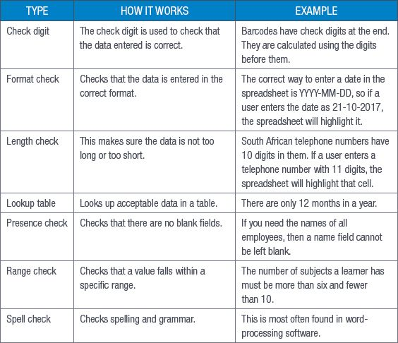

## UNIT 9.2 Verification and validation of data

### DATABASES

As you learned in Term 1, a database is a collection of a large amount of data, which is organised into files called tables.

When discussing data, you need to remember that there are many different types of data. The most common data types, and the ones you are most likely to deal with, are:

- strings
- numeric data
- boolean data
- date and time data.

### VERIFICATION AND VALIDATION

In order to get the best results with your data, you will need to make sure that it is accurate. To do this, you will need to first verify the data and then validate it.

Data verification is the process of checking that the data a user has inputted is correct. This can be largely automated, providing someone has set up the rules on the spreadsheet or database. For example, the age range of high-school students is usually 14 to 18 and the spreadsheet can be set up to only accept an age in that range. This is called a range check. This does not always mean that the data will be 100% correct though. If a student is 15 and the user types in 17, the data is still valid in the range, it is just not correct.

Data verification is mainly used when data is entered into a system manually (that is, a human has entered the data into the database or spreadsheet) and there is a possibility that there will be errors in the data.

Data validation, on the other hand, is the process of making sure that the data that has been transferred from one source to the other matches the original data. For example, if you entered the results of a survey into a spreadsheet, you will check that the results you have match the results you entered.

Data validation also checks to see that the data is complete and matches the requirements of the system in which you entered it. In Access, this is done using data validation rules and input masks.

There are several ways to validate data. These are shown in Table 9.1.

**Table 9.1:** *Data validation techniques*

