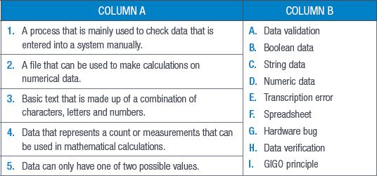
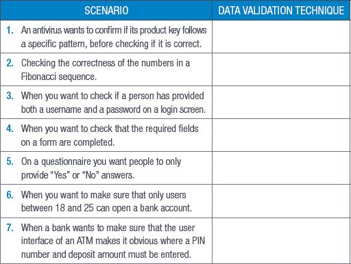
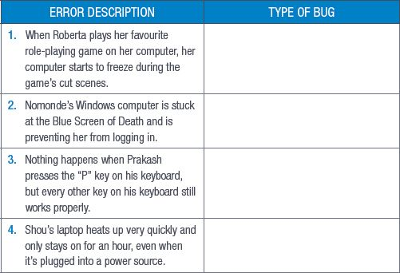
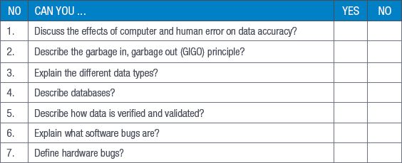

## UNIT 9.4 Hardware failures

Hardware failures are design errors in computer hardware that can cause the hardware to malfunction, fail or be damaged. Some hardware failures can also lead to security flaws in a computer’s system.

FOR ENRICHMENT

Spectre and Meltdown are two hardware failures that affect CPUs built by Intel, AMD and ARM and can allow attackers to potentially steal sensitive data such as banking details and passwords. They were discovered in 2017 by a team from Google’s Project Zero and several academic researchers from around the world.

Their results revealed that these failures had been in the hardware since about 1995 but that they had been previously undetected. They work by exploiting something called speculative execution (or the way a processor knows which task to fetch based on guessing what should happen next in the process and begins fetching instructions from where it thinks the program will go, without knowing for sure). This helps to speed up the computer’s processors.

Combined, these two failures affect nearly every modern computer, including smartphones, tablets and PCs from different vendors running different operating systems. This is because the two failures are a fault in the processors themselves and are not linked to a flaw in any software.

While at the end of 2018 hackers had not released any software that could exploit these failures, computer and smartphone manufacturers advised that users should download and install the latest security fixes as they become available.

REVISION ACTIVITY

QUESTION 1: MULTIPLE CHOICE

**1.1**Before you analyse data, you must do the following: ______. (1)

**A.**Spell check it

**B.**Review it

**C.**Verify and validate it

**D.**Organise and simplify it

**1.2**Information that is incorrectly inputted is referred to as which of the following? (1)

**A.**Human error

**B.**Transcription error

**C.**Transposition error

**D.**Troubleshooting error

**1.3**Which of the following is an example of a transposition error? (1)

**A.**Accidentally deleting an entry

**B.**Repeating an entry

**C.**Making a typo

**D.**Swapping two entries around

**1.4**Which of the following is NOT a data type? (1)

**A.**Numbers

**B.**Strings

**C.**Dates and times

**D.**Characters

**1.5**What does GIGO stand for? (1)

**A.**Generated Input Generated Output

**B.**Good Input Garbage Output

**C.**Good Input Generates Output

**D.**Garbage In, Garbage Out

QUESTION 2: TRUE OR FALSE

Write True or False next to the question number. Correct the statement if it is FALSE. Change the underlined word(s) to make the statement TRUE. (You may not simply use the word NOT to change the statement.)

**a.**When we enter data into a computer, the errors that occur are usually computer-based. (1)

**b.**Transcription errors are most common with text-based data. (1)

**c.**Human errors negatively impact the validity and accuracy of data. (1)

**d.**Entering data correctly leads to incorrect results. (1)

**e.**Binary code is similar to date and time data. (1)

QUESTION 3: MATCHING ITEMS

Choose a term/concept from Column B that matches a description in Column A. Write only the letter next to the question number (e.g. 1J). (5)

QUESTION 4: CATEGORISATION QUESTIONS

**4.1**Which data validation technique can be used to validate the data in the following scenarios? (7)

**4.2**Define a software bug. (2)

**4.3**Define a hardware bug. (2)

**4.4**Determine if the following errors are caused by software bugs or hardware bugs. (4)

QUESTION 5: SHORT AND MEDIUM QUESTIONS

**5.1**What is the main difference between data verification and data validation? (2)

**5.2**How can you automate the data verification process on a spreadsheet? (2)

**5.3**Describe the two types of data entry errors and give an example of each. (4)

**5.4**Maryn’s mouse cannot be detected by her computer when she plugs it in. Mention two things she can do to try and solve this hardware bug. (2)

**TOTAL: [40]**

AT THE END OF THE CHAPTER

