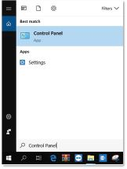
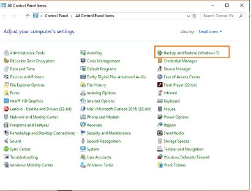
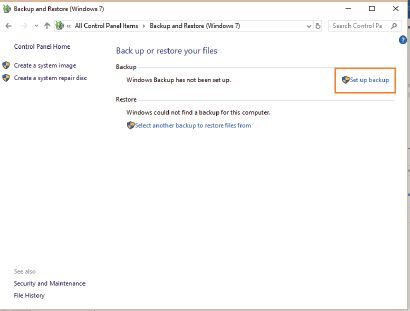

## UNIT 10.2 Data protection

It is important to back up your data regularly, since hardware can fail or accounts can be compromised. Backing up data lets you protect and store information.

CREATING A BACKUP

Because a back up is simply a copy of your computer’s data, it can be created using the *Copy* and *Paste* functions.

 Guided Activity 10.1

To do this, you should:

**1.**Start by setting up a backup schedule to work out how often you will create a backup.

**2.**Buy an external hard drive to use for the backup.

**3.**On the scheduled backup day, connect the external hard drive to your computer.

**4.**Select the files or folders you would like to back up and copy them using the *Copy* command.

**5.**Create a folder on the external hard drive with the correct date in the name.

**6.***Paste* all the copied files and folders into this folder.

**7.**Disconnect the external hard drive and store it in a safe location.

**8.**Repeat these steps on each scheduled backup day.

To recover the files from this backup, simply connect the backup hard drive to your computer and copy the damaged or missing data back onto your storage device.

The problem with using *Copy* and *Paste* to back up your data is that the backups must be done manually. As a result, it is possible to forget to create backups. These backups will also be much larger, since each backup will contain all the files and folders you copied, even if some of these folders have not changed since the previous backup.

These problems can be solved by using a backup utility such as Windows 10’s *Backup* and *Restore*.

 Guided Activity 10.2

To use *Backup* and *Restore*:

**1.**Buy an external hard drive to use for the backup and connect it to your computer.

**2.**Open the *Start* menu and enter the words *Control Panel*. This will open the window.

**3.**Click on the *Backup and Restore* (Windows 7) option to open the *Backup and Restore* window.

**4.**Click on the *Set Up Backup* option.

**5.**Select the external hard drive as the location where you would like to save the backup.

**6.**If all your files are stored in your private folders (such as the *Documents*, *Music* and *Videos* folders), use the *Let Windows Choose* option. Otherwise, select the *Let Me Choose* option and manually choose the folders that should be backed up.

**7.**Click on the *Save Settings and Run Backup* option to create a backup of all your files.

 Guided Activity 10.3

To restore files from a Windows backup:

**1.**Connect your external hard drive to your computer.

**2.**Open the *Backup and Restore* (*Windows 7*) application from the *Control Panel*.

**3.**Click on the *Restore All Users’ Files* option.

**4.**Click on the *Browse for Files or Browse for Folders* option.

**5.**Tick the *In the Original Location* box and press *Restore*.

This will restore your files to where they used to be, thus replacing all lost files.

USING CLOUD STORAGE FOR BACKUP

One of the problems with backing up your computer’s contents to an external hard drive is that your computer and the drive can be lost due to theft, flood or fire. Cloud storage puts your information on an off-site server that never goes offline and that can be accessed from anywhere through the internet.

Cloud storage, however, is not the same as cloud backup. Although they both work on a similar basis and the result is the same – storing files online – there are completely different reasons for using them.

With cloud storage, you choose which files you want to store online and you send them to your online account. When you delete a file that you stored online, it is still in your cloud storage because it is not really tied to your computer anymore. Cloud backup is when you install a program on your computer and you tell it to keep certain files backed up online. A backup service will also upload any changes that are made to those files so that the current version is always online.

A backup server works for people or businesses that have a lot of files they want to keep backed up online, so that, should one of the computers suddenly stop working, the files can still be obtained from the cloud backup server.

These are a few cloud storage providers:

- Google Drive: This works very well with Google products and you get 15 GB for free, after which you have to pay a monthly fee for more storage space.
- Apple iCloud: This service works with all Apple devices, whether a Mac, iPhone, iPad or iPod. You get 5 GB for free but have to pay for more than that.
- Dropbox: It gives users 2 GB for free and lets you access your files from the Web, your desktop or mobile devices.
- Microsoft OneDrive: Integrates well with Microsoft’s products such as SharePoint and Word. Everyone with a Microsoft account gets 5 GB free storage space, after which you need to subscribe and pay for more space.

 Activity 10.2

Answer the following in your own words.

**1.**Is it really necessary to back up the content of your computer? Why or why not?

**2.**Talk to at least two people you know who have their own computers.

**a.**Find out if they back up their information? Why or why not?

**b.**What do they back up?

**c.**How many times do they back up their information?

**d.**How do they back up their information?

**3.**What would be a practical and workable solution for you to back up your information?
