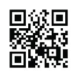

## UNIT 10.4 E-commerce and e-banking

When using online services such as online banking or shopping, you must be careful that your information is not stolen. Your banking or credit card information can be used to make multiple purchases.

Tips for safely using online banking and shopping include:

- Use proper antivirus software and make sure it is up to date.
- Do not log into online banking or shopping sites using public Wi-Fi or on public computers (like those in an internet café).
- Make sure that the operating systems on all your devices are up to date. This is important for both your phone and computer. Make sure that the banking app on your phone is also up to date.
- Change your passwords regularly and make sure they are strong.
- Do not sign into your banking account through a link in an email as this is most likely a phishing attack.
- Sign up for notifications on your bank account for when money comes in or goes out and when your account is accessed online.

You should always check that the website URL has an “https” extension whenever you are making a transaction online. The “s” stands for secure and it means that the website has something called a **Secure Sockets Layer (SSL)** certificate. This creates an encrypted link between you and the server, making the data that you and the server send and receive secure and private. This protects your data from being intercepted and stolen.

### ADVANTAGES OF E-COMMERCE

Below are some of the advantages that e-commerce holds for the consumer, which is you.

- There is a very wide range of products and services available.
- There are no geographical limitations. It is just as easy to buy something from the USA or Europe as it is to buy it in South Africa.
- It definitely saves you time, for example travel time, waiting time and searching time.
- It is available 24/7.

RISKS OF E-COMMERCE

Unfortunately, there are also certain risks related to e-commerce, such as:

- Fraud: Because transactional data is transmitted over the internet, it has become one of the target areas of cybercriminals. Financial information can be hacked or stolen, leading to purchases made by people who are not the rightful owners of that information. Customers sometimes complain that they have not received their packages and it is difficult to determine whether that is true or not.
- Online security: There are many security threats such as malware, spam mail and phishing that can cause you harm.
- Exchanging a product that does not fit the online description can be difficult.

INTERNET BANKING

Internet banking explained:

[https://www.youtube.com/watch?v=oADxUX4STjE](https://www.youtube.com/watch?v=oADxUX4STjE)

### ADVANTAGES OF E-BANKING

Below are some of the advantages of internet banking:

- It is convenient, as customers have 24-hour access to the bank, seven days a week.
- It can be done from any location where you have Internet.

RISKS OF E-BANKING

Although online banking is secure enough to use on a daily basis, you should know about these risks:

- Fraudulent transactions
- Online theft of your access ID/user ID or PIN/password could happen.
- Banking apps can be compromised.

 Activity 10.4

Answer the following in your own words.

**1.**What exactly does e-commerce mean?

**2.**What are the advantages of e-commerce?

**3.**What are the risks of e-commerce?

**4.**What can you do to make sure that you are safe when shopping online?
