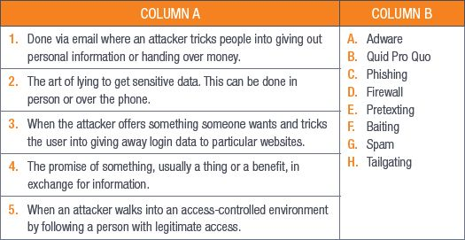
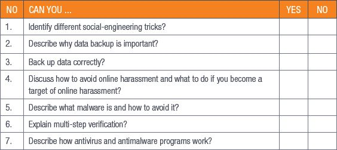

## UNIT 10.5 How antivirus programs work

Antivirus software is any computer program that is designed to scan for, isolate and delete any harmful program from your computer before it causes any damage, but you can do an active scan any time you think that your computing device has been infected with a virus.

Antivirus and antimalware programs check all the files on a computer, checking all changes and the memory for specific types of file change patterns.

### APPLICATION PERMISSIONS

When you install an app on your smartphone or tablet, you will need to give it permission to access certain functions on your device. For example, when you install a navigation app (such as Google Maps), you will first be asked for permission to access the device’s GPS location.

Using app permissions means that you can control what capabilities or information the app can access.

 Activity 10.5

**1.**Give two examples of ways to avoid online harassment.

**2.**What is malware?

**3.**How do you avoid getting a malware infection?

**4.**What is multi-step verification?

**5.**Give five tips for safe online banking.

**6.**What does the “s” in “https” mean?

**7.**Briefly describe three common types of virus detection in antivirus programs.

REVISION ACTIVITY

QUESTION 1: MULTIPLE CHOICE

**1.1**Which of the following is NOT an example of social engineering? (1)

**A.**Phishing

**B.**Malware

**C.**Tailgating

**D.**Pretexting

**1.2**If you come across fake news, what should you do? (1)

**A.**Post it and share it

**B.**Do more research on it

**C.**Delete it from the internet

**D.**Edit and try to fix it

**1.3**Which of the following institutions is used in phishing scams the most? (1)

**A.**Banks

**B.**Universities

**C.**Kindergartens

**D.**Online shops

**1.4**Which of the following scenarios do NOT use online banking? (1)

**A.**Ahmed owns an electronics store and does have a card swipe machine.

**B.**Chloe does not have a physical clothing store but she sells clothing through an online website.

**C.**Blessing only likes shopping for games online.

**D.**Hanno wants to send money to his mother overseas.

**1.5**Which of the following is NOT an antivirus program/application? (1)

**A.**Avast

**B.**Norton

**C.**Bitdefender

**D.**OneDrive

QUESTION 2: TRUE OR FALSE

Write True or False next to the question number. Correct the statement if it is FALSE. Change the underlined word(s) to make the statement TRUE. (You may not simply use the word NOT to change the statement.)

**a.**Multi-step verification can be used to keep your email password secure. (1)

**b.**A disadvantage of e-commerce is that it is hard to send physical money online. (1)

**c.**Emails from an unknown source are known as suspicious emails. (1)

**d.**If you want to prevent people from accessing your online accounts, you must use a strong password. (1)

**e.**Hackers use Quid Pro Quo to steal passwords. (1)

QUESTION 3: MATCHING ITEMS

Choose a term/concept from Column B that matches a description in Column A. Write only the letter next to the question number (e.g. 1J). (5)

QUESTION 4: MEDIUM QUESTIONS

**4.1**Briefly explain how to recover data from a backup? (2)

**4.2**What are three disadvantages of using an external hard drive to back up your computer’s data? (3)

**4.3**What is a preferable alternative to physical computer backups? (1)

**a.**Explain what this alternative backup does. (3)

**b.**Who would benefit most from this type of alternative backup? Mention three of them. (3)

**c.**What three things can you do to prevent your computer from getting infected by malware? (3)

**4.4**What is the difference between e-commerce and e-banking? (4)

**4.5**List two risks of online banking. (2)

**4.6**Explain the concept of cloud storage. (2)

**4.7**Provide two examples of cloud storage providers. (2)

**TOTAL: [40]**

AT THE END OF THE CHAPTER

