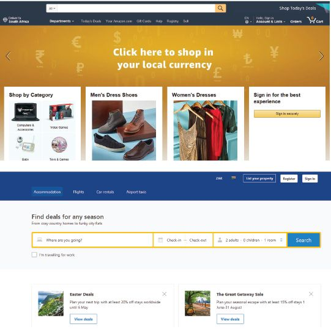

## UNIT 11.2 Online transactions

The most popular is the EFT (electronic funds transfer), which allows you to log onto a banking website (or smartphone app) and send money from your account to another account.

Another popular online transaction is shopping. Online shopping is convenient.

Most travel agencies, hotels and airlines have websites where you can book all you need for your trip. You can use the World Wide Web to search for specials. You can also use airline websites for online flight check-in before you get to the airport.

Buy tickets to see your favourite performer or sports team. It is more convenient to book online and pay well in advance. Take a look at the case study below to see how online transactions fit into our everyday lives.

SHOPPING AND MAKING BOOKINGS ONLINE

Harry wants to surprise his wife with tickets to see her favourite band perform. He checks the ticket website and sees that all the Johannesburg shows are sold out, but there are still tickets available in Cape Town. He buys the tickets and decides that they should make a short holiday of their trip. He then goes to a website that compares flight prices. Harry enters the dates for when he wants to fly down and return, and finds a result that matches his budget. He books two tickets for those flights. Then he realises they will need somewhere to stay. Harry goes to an accommodation comparison site and enters the dates to check for availability. He sees that a lovely hotel close to the concert venue is offering an early booking special, so he books a room for a week. He logs onto his banking app and transfers his booking fee and deposit to the hotel. He also takes the time to reserve a rental car for the week. Following this, Harry decides to buy his wife a birthday gift while he is online and visits some shopping websites to look for a purchase. All of this takes him an hour from the comfort of his couch.

**Figure 11.3:** *Examples of online shopping and booking sites*

 Activity 11.2

**1.**Why would a person use online banking for EFTs?

**a.**Would you use it? Why or why not?

**2.**What are some of the drawbacks of online shopping?

**a.**Have you done online shopping? Write a paragraph on your experience. Or explain why you do or do not like online shopping.

**3.**Give three examples of different online transactions (not banking or shopping).
