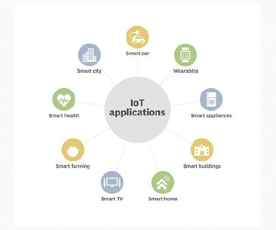

## UNIT 11.3 The Internet of Things (IoT)

### THE INTERNET OF THINGS

More and more devices are able to access the internet. Various devices like fridges and washing machines have the potential to connect to each other through the internet. This has led to the rise of something called the Internet of Things, or IoT.

Everything that can be switched on and off can be connected in the IoT, from smartphones, coffee-makers and washing machines, to headphones, lamps and wearable devices. This also applies to components of machines, for example a jet engine of an airplane or the drill of an oil rig.

INTERNET OF THINGS EXPLAINED

[https://www.youtube.com/watch?v=uEsKZGOxNKw](https://www.youtube.com/watch?v=uEsKZGOxNKw)

BENEFITS OF IoT

The IoT can be used to connect “smart homes”, where you can use your smartphone to control everything from the temperature of the air-conditioners to the music that plays when you walk in the door.

The IoT can also be used to build “smart cities”, where transportation and the movement of people can be controlled and monitored and made more efficient.

HOW IT WORKS: INTERNET OF THINGS

[https://www.youtube.com/watch?v=QSIPNhOiMoE](https://www.youtube.com/watch?v=QSIPNhOiMoE)

**Figure 11.4:** *Areas where IoT can be beneficial*

Smart buildings can reduce energy costs by using sensors that detect how many occupants are in a room. The temperature can adjust automatically – for example, turning the air conditioner on if sensors detect a conference room is full or turning the heat down if everyone in the office has gone home.

In agriculture, IoT-based smart farming systems can help monitor, for instance, light, temperature, humidity and soil moisture of crop fields using connected sensors. IoT is also instrumental in automating irrigation systems.

In a smart city, IoT sensors and deployments, such as smart streetlights and smart meters, can help alleviate traffic, conserve energy, monitor and address environmental concerns, and improve sanitation.

 Activity 11.3

Read the extract below and answer the questions that follow:

WITH SMART CITIES, YOUR EVERY STEP WILL BE RECORDED

By Sara Degli-Esposti & Siraj Ahmed Shaikh | 17 April 2018

Modern cities are brimming with objects that receive, collect and transmit data. This includes mobile phones but also objects actually embedded into our cities, such as traffic lights and air pollution stations. Even something as simple as a garbage bin can now be connected to the internet, meaning that it forms part of what is called the internet of things (IoT). A smart city collects the data from these digital objects, and uses it to create new products and services that make cities more liveable.

Although they have huge potential to make life better, the possibility of increasingly smarter cities also raises serious privacy concerns. Through sensors embedded into our cities, and the smartphones in our pockets, smart cities will have the power to constantly identify where people are, who they are meeting and even perhaps what they are doing.

Following revelations that 87 million people’s Facebook data was allegedly breached and used to influence electoral voting behaviour, it is ever more important to properly scrutinise where our data goes and how it is used. Similarly, as more and more critical infrastructure falls victim to cyber-attacks, we need to consider that our cities are not only becoming smarter, they are also becoming more vulnerable to cyber-attacks.

Extract from [https://theconversation.com/with-smart-cities-your-every-step-will-be-recorded-94527](https://theconversation.com/with-smart-cities-your-every-step-will-be-recorded-94527)

**1.**What does the term Internet of Things (IoT) refer to?

**2.**Refer to paragraph 1. Many examples of IoT are given that could improve “liveability” in a city. Elaborate on any TWO of these examples (or give your own) by describing how they would improve citizens’ lives.

**3.**How do the Internet of Things and Big data relate to each other?

**4.**Discuss two challenges a city would face when trying to implement the systems necessary to create smart cities, besides the challenge of funding such a project?

**5.**Many citizens of such smart cities say that privacy concerns are only relevant to people who have something to hide. Do you agree or disagree with this statement? Motivate your answer in a short paragraph.

**6.**Describe a scenario of the type of cyber-attack that could be launched on a smart city.
