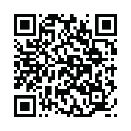

## UNIT 11.4 Fourth Industrial Revolution (4IR)

Globalisation can be defined as a process of connection, interaction and integration among people, companies, and governments. This process is driven by international trade, investment, technology and big data. This has resulted in:

- An efficient market where there is an equilibrium between what buyers are willing to pay for a good or service and what sellers are willing to sell for a good or service.
- Increased competition between companies, which improves the service and quality of goods or services delivered to the consumers.
- Security as countries’ economies are intertwined and dependant on each other.
- Wealth equality throughout the world as poorer nations have more job opportunities.

Society has gone through various stages. These are:

- The First Industrial Revolution, in the late 18th to early 19th centuries, is famous for industrialising agricultural work.
- The Second Industrial Revolution, in the late 19th and early 20th century, brought iron and steel into industry.
- The Third Industrial Revolution is the Digital Revolution with the age of the computer and the internet.
- The Fourth Industrial Revolution sees the digitisation of our society.

Globalisation and technology are intertwined as the movement of people, goods and ideas is accelerated and broadened by new forms of transport and communication. The spread of the internet and the relatively low cost of digital technology connect more people with the world. For example, small traders in shanties on the outskirts of Nairobi export across east Africa. In China, “Taobao villages” allow previously cut-off rural populations to sell goods on Alibaba’s trading platform.

Sectors which the Fourth Industrial Revolution has impacted greatly includes:

- **Agricultural sector:** AI-powered machine vision systems can measure crop populations and detect weeds or plant pests and use robotic sprayers to precisely apply herbicides.
- **Healthcare sector:** Precision medicine helps doctors analyse a patient’s genome sequence, medical history, and lifestyle, making a diagnosis more reliable.

THE FOURTH INDUSTRIAL REVOLUTION

[https://m.youtube.com/watch?v=ChbjZHW2Wwk](https://m.youtube.com/watch?v=ChbjZHW2Wwk)

 Activity 11.4

In small groups, research the influences of the Fourth Industrial Revolution on the following sectors:

- Retail
- Building
- Social
- Travel

 Activity 11.5

Answer the following questions in your own words.

**1.**Answer the following questions.

**a.**Name three types of technologies from the 3IR that you have personally come into contact with.

**b.**Name three types of technologies from the 4IR that you have personally come into contact with.

**c.**Do you think any technologies from the first three industrial revolutions can be replaced by technologies from the 4IR? Motivate your answer. Note: You can use an example to help you motivate your answer.

**2.**The internet is playing a large role in the lives of 60% of the total South African population, with 51% accessing it through their mobiles. Find out what the situation is in your school.

- How many learners have access to the internet?
- How many learners access the internet through their smartphones?
- What brands of smartphones do they have?
- How much time do they spend on their phones?
- What are they doing on their phones?
- What social media platforms are they using?
- How does this compare to the world-wide trends?

**a.**Create your own task definition using the knowledge you have gained in this section.

**b.**Share it with the rest of the class.
