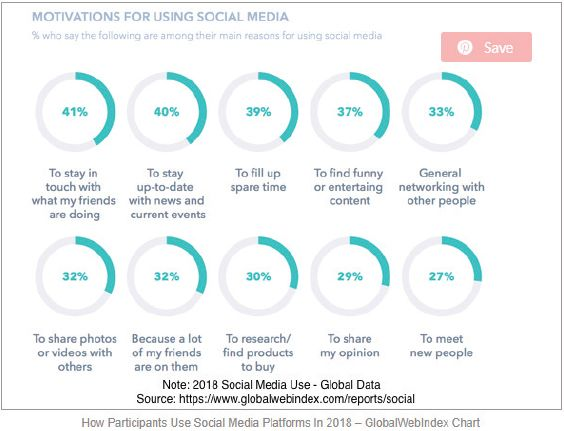

## UNIT 11.5 Social media

Social media has become a staple of our digital lives, from tweeting your thoughts on Twitter, to sharing pictures of your life on Instagram. Social media is used to market products, make announcements and stay in touch with the people who matter to you.

Something to know

Some interesting statistics on the use of social media

- There were 3,03 billion active social media users in the world in 2018.
- Facebook: 500 000 new users are added every day; that means six new profiles every second.
- Twitter: 500 million tweets are posted every day; this means 6 000 tweets every second.
- YouTube: 300 YouTube videos are uploaded every minute and 1 billion hours of videos are watched every day.
- Instagram: More than 95 million photos are uploaded every day.
- Pinterest: There are 200 million active users each month.
- Snapchat: There are 187 million active users every day.

**Figure 11.5:** *The reasons why people used social media in 2018*

This section looks at the advantages and disadvantages of social media, good practices to use on social media and what to avoid doing when you are online.

### ADVANTAGES

You can connect with anyone, anywhere in the world, staying in touch with friends who have moved away or family members who live in other countries.

Using social media keeps you up to date with what is happening in the world in real time. This is especially true of sites such as Twitter, where those on the ground at major events can tweet what is happening as it happens.

Social media platforms can be used to promote awareness and causes. Social activists use social media to inform people about issues and engage them in conversations about those issues.

Social media builds communities. Like-minded people can come together and discuss the things that interest or influence them.

### DISADVANTAGES

Something called the social media bubble draws people to communities where their views (and only their views) are supported and encouraged. This can lead to people being misinformed about the world or only getting one opinion on an issue.

There is also a psychological effect on social media users. Since most people only share the positives in their lives on social media, others may compare their lives to the digital lives of their friends and family and find them lacking in something. Studies have shown that using social media can lead to depression.

Cyberbullying is also a big problem on social media and can cause great emotional harm to victims.

Social media is also used as a platform to scam or steal from people, especially older people who are not always internet literate and are more often likely to be the victims of 419 scams.

### BEST PRACTICES

There are several good, common-sense practices you can follow when using social networking sites:

- **Manage your privacy settings:** Learn about and use the privacy and security settings on your social networking sites. They help you control who sees what you post and manage your online experience in a positive way.
- **Keep personal info personal:** Be careful how much personal information you provide on social networking sites. The more information you post, the easier it may be for someone to use that information to steal your identity, access your data, or commit other crimes such as stalking. Restrict who can have access to different types of information on your profile. Avoid publishing personal information like email addresses, home address and phone numbers.
- Think carefully about who you allow to become a “friend”.
- **Restrict the amount of time you spend on social networking sites:** Many companies and schools block social media websites as a result of the abuse of resources like bandwidth, especially by downloading and uploading large files, photographs and videos.

 Activity 11.6

Answer the following questions in your own words.

**1.**List three social media websites you use. Also explain why you use each of them.

**2.**Mention three advantages and three disadvantages of social media websites for you.

**3.**Mention three things you must do and three things you must not do when using social media. Also give the reasons why you think that.

**4.**Why should you investigate news articles before you share them?

**5.**Do you know of any examples of fake news? Discuss what you know about it and how it can affect people who read it.
