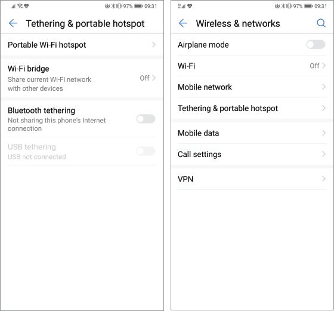

## UNIT 11.6 Internet access

Being able to access the internet allows you to access a world of information with a simple search and the click of a button. This unit will look at the limitations of fixed-line internet access and the different types of portable internet access and connections available, such as Wi-Fi hotspots, Bluetooth and mobile internet connections.

### MOBILE INTERNET ACCESS

There are many types of mobile internet access, such as cellular data signal, Wi-Fi hotspots and WiMAX. This unit will look at several different types of mobile internet access and where each one is usually used.

WI-FI HOTSPOTS

A Wi-Fi hotspot is a wireless access point that you can connect to using the wireless connectors in your computing device. When we talk about Wi-Fi hotspots, we are usually talking about the publicly accessible connection points that businesses supply (usually for free) to their customers.

You can also create a wireless hotspot in your home by using a router with a wireless connector, or on the go by using your cellular phone or other devices capable of connecting to the internet.

Wi-Fi hotspots can usually be found in coffee shops, airports and hotels. Some Wi-Fi hotspots can also be provided as a public service, for example, the city of Tshwane in Gauteng offers a service called TshWiFi.

Your wireless capable device (laptop or smartphone) can search for and connect to Wi-Fi hotspots nearby.

WiMAX

WIMax is used to connect multiple devices over a longer range than Wi-Fi could and as a replacement for the GSM connections standards for mobile devices. WiMAX can cover long distances (like a cellphone signal network) and deliver high-speed internet access (like broadband connections).

More devices have Wi-Fi connectors built in than they do WiMAX connectors and most mobile carriers choose to use Long-Term Evolution (LTE) instead of WiMAX in their networks.

MORE ON BLUETOOTH

Watch this video if you want to learn more about Bluetooth.

[https://youtu.be/jzxZUJmOu30](https://youtu.be/jzxZUJmOu30)

BLUETOOTH

Bluetooth is a wireless communication standard that allows electronic devices to connect to and interact with each other wirelessly. Bluetooth does not rely on mobile data, cellular signal or Wi-Fi to connect, as long as the devices that want to connect are within range of each other (and have each other’s pass codes), they can connect.

Bluetooth can be used for many different things, like connecting Bluetooth-enabled devices such as keyboards, mice and speakers to your computer or headphones to your smartphone. You can also use it to send documents to Bluetooth-enabled printers or connect your smartphone to your car’s Bluetooth system to make hands-free calls, listen to music or listen to text messages out loud and send them using text-to-speech input.

NFC

NFC (Near field communication) is a method of wireless data transfer that detects and then enables technology in close proximity to communicate without the need for an internet connection.

You can use NFC at a local supermarket, train station, taxi or coffee shop that supports contactless payments via your phone’s NFC chip.

MOBILE INTERNET

Mobile internet (or mobile broadband) is the term used to describe the wireless internet access you can get through cell phone towers and other digital devices that use portable modems (such as tablets and smartphones).

Mobile internet lets smartphone users connect to the internet wherever they have decent network signal. Most cellular service providers also offer mobile internet packages where you use a small modem (called a dongle) to connect to the cellular network. These dongles can either plug directly into your computer (using USB) or can be used to create a Wi-Fi hotspot.

It is also an alternative to fixed-line internet connections (such as ADSL) and is useful in areas where ADSL services are not available or for users who do not want to have a telephone line installed.

There are different types of mobile internet connections. The most common are 3G (which stands for Third Generation) and LTE or 4G. LTE is the current standard for mobile internet. It is faster than 3G and can support things like high-definition video streaming. Looking to the future, 5G promises to be even faster than 4G and will become the new standard in internet connection for mobile devices.

With mobile internet, you can use your smartphone as a modem. You can turn your smartphone into a Wi-Fi dongle to connect other devices to the internet using something called tethering. Using your smartphone as a modem gives you access to the internet in areas where there are no Wi-Fi hotspots.

MORE ON 5G

Watch this video if you want to learn more about 5G.

[https://m.youtube.com/watch?v=MC_Sfkh5-zQ](https://m.youtube.com/watch?v=MC_Sfkh5-zQ)

Figure 11.6 shows an example of the tethering screen on an Android device.

**Figure 11.6:** *Tethering settings on an Android device*

 Activity 11.7

Answer the following questions in your own words.

**1.**Briefly discuss the limitations of fixed internet access, paying particular attention to the South African context.

**2.**What is a Wi-Fi hotspot and give an example of one?

**3.**What does WiMAX stand for?

**4.**What is Bluetooth and how does it work?

**5.**List the two most common types of mobile internet connections and describe how they differ from each other.
