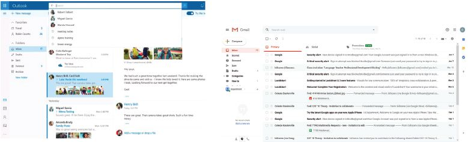

## UNIT 11.7 Browser and email software

There is a huge range of internet browsers available for you to choose from. Browsers are simply the software you use to access the websites on the World Wide Web.

Some browsers are specifically linked to a manufacturer or operating system, such as Safari for Apple devices with iOS and MacOS, or Microsoft Edge for devices with Windows OS. This is not to say that you cannot download browser software from the internet and use it instead of the browser that comes standard with your device.

### EMAIL

Email is a widely used form of communication. It consists of software for creating, sending, receiving and organising electronic mail (or email). Modern desktop email clients like Microsoft Outlook, Windows Live Mail and Mozilla Thunderbird offer advanced features for managing email, including WYSIWYG editors for composing email messages, anti-spam and anti-phishing security protection, advanced search capabilities, and rules and filters for more efficiently handling and organising messages and email folders.

A large number of online email services, called webmail, exist with features and functionality for managing email similar to their desktop email software counterparts. Some of the more popular online email services are Yahoo! Mail, Gmail, Hotmail (Windows Live Mail) and AOL Mail.

**Figure 11.7:** *The Gmail, Outlook and Apple Mail application logos*

**Figure 11.8:** *Email user interfaces*
