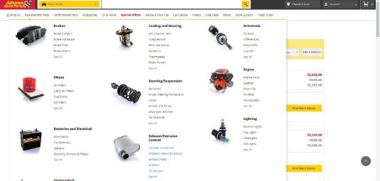
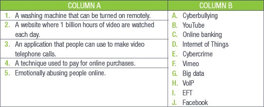
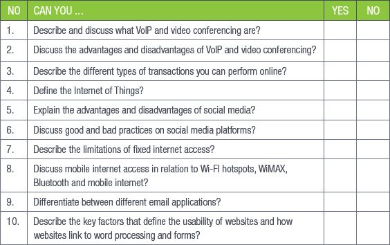

## UNIT 11.8 Usability of web pages and websites

Website usability looks at how user-friendly a website or web page is. There are five key factors that determine the usability of a site:

- **Readability:** This feature is one of the more important aspects of web design usability. Readable text affects how users process the information from the content. Poor readability scares readers away from the content. On the other hand, done correctly, readability allows users to efficiently read and process the information in the text. You want users to be able to read your content and absorb it easily.
- **Navigation:** Navigation is very important to ensure users are able to find what they are looking for easily and intuitively. The structure of the navigation should be simple and the main links (or menu system) should be easy to locate and identify. They should always appear in a consistent position on the website. Links should be short and it should be simple to figure out what the link is leading to. Web designers should ensure that no broken links occur on the site.
- **Consistency:** This feature affects both usability and readability. Consistency means, for example, that all headers of the same importance should be treated the same in terms of size, colour and font etc. For example, all <h1> headers in an article should look identical. This consistency provides users with a familiar focus point when they are scanning the text, and it helps to organise the content.
- **Layout:** Layout refers to how the various elements (text, graphics, buttons, etc.) are arranged on a web page. Pages should be designed and laid out in a way best suited to their intended audience or readers. Text and graphic objects on the page should be adapted to fit standard monitor sizes and resolutions.
- **Typography:** Typography refers to fonts and how they are put together. The font you use on your website needs to meet two specific criteria:

**1.**How easy is it to read?

**2.**Can it be rendered in HTML?

Each of these factors covers a single aspect of the website and they all need to work together to create a user-friendly website.

### LINK TO WORD PROCESSING AND FORMS

Websites can link to word processors and word-processing forms in a few ways:

**1.**It is possible to create basic web pages in some word processors (such as Microsoft Word).

**2.**You can use word processors to create content for your websites.

**3.**You can use word processors to create forms for your websites.

 Activity 11.8

Answer the following questions in your own words.

**1.**Below are two websites that sell car engines. Look at the navigation designs of these websites and answer the following questions.

**Website A**

**Website B**

**a.**Which website has the best readability? Give two reasons for your answer.

**b.**Which website has the best navigation? Give two reasons for your answer.

**c.**Which website has the best consistency? Give two reasons for your answer.

**d.**Which website has the best layout? Give two reasons for your answer.

**e.**Which website has the best typography? Give two reasons for your answer.

**2.**Based on your comparisons of the two websites, which website do you prefer. Give two reasons for your answer.

**3.**Name two things that can be done to improve the website you least prefer.

REVISION ACTIVITY

QUESTION 1: MULTIPLE CHOICE

**1.1**Which of the following cannot be done with VoIP? (1)

**A.**Voicemail

**B.**Call forwarding

**C.**Call waiting

**D.**Instant messaging

**1.2**Which of the following is not a disadvantage of video conferencing? (1)

**A.**Lagging caused by bad internet connections

**B.**Technology can fail during a call

**C.**Remote access

**D.**Bad audio quality

**1.3**What does EFT stand for? (1)

**A.**Electronic Financial Transfer

**B.**Electronic Funds Transfer

**C.**Electric Finance Transfer

**D.**Electric Fund Transfer

**1.4**Which of the following is an example of e-commerce? (1)

**A.**Online shopping

**B.**Online banking

**C.**Online government services

**D.**Online gaming

**1.5**Smart fridges use embedded ___________ to connect to the internet. (1)

**A.**Network adapters

**B.**Network cables

**C.**Wi-Fi

**D.**Interface cards

QUESTION 2: TRUE OR FALSE

Choose the answer and write True or False next to the question number. Correct the statement if it is FALSE. Change the underlined word(s) to make the statement TRUE. (You may not simply use the word NOT to change the statement.)

**a.**VoIP converts digital signals to analogue signals. (1)

**b.**VoIP can work with an unstable internet. (1)

**c.**Data packets are protected from internet attacks. (1)

**d.**The Internet of Things is a system in which everyday appliances connect to computers. (1)

QUESTION 3: MATCHING ITEMS

Choose a term/concept from Column B that matches a description in Column A. Write only the letter next to the question number (e.g. 1J). (5)

QUESTION 4: FILL IN THE MISSING WORDS

Fill in the missing word(s) in the following statements. Provide only one word for each space.

**a.**EFTs allow you to log onto a ___________ website and send money from your account to another account. (1)

**b.**If you do not have physical money on you, you can make a payment by ___________. (1)

**c.**Any object that makes use of a(n) ___________ source can connect to the Internet of Things. (1)

**d.**___________ is the most popular social network. (1)

**e.**Social media ___________ things and people together. (1)

QUESTION 5: CASE STUDY

Read the extract below and answer the questions that follow:

WITH SMART CITIES, YOUR EVERY STEP WILL BE RECORDED

By Sara Degli-Esposti & Siraj Ahmed Shaikh | 17 April 2018

Modern cities are brimming with objects that receive, collect and transmit data. This includes mobile phones but also objects actually embedded into our cities, such as traffic lights and air pollution stations. Even something as simple as a garbage bin can now be connected to the internet, meaning that it forms part of what is called the Internet of Things (IoT). A smart city collects the data from these digital objects, and uses it to create new products and services that make cities more liveable.

Although they have huge potential to make life better, the possibility of increasingly smarter cities also raises serious privacy concerns. Through sensors embedded into our cities, and the smartphones in our pockets, smart cities will have the power to constantly identify where people are, who they are meeting and even perhaps what they are doing.

Following revelations that 87 million people’s Facebook data was allegedly breached and used to influence electoral voting behaviour, it is ever more important to properly scrutinise where our data goes and how it is used. Similarly, as more and more critical infrastructure falls victim to cyber-attacks, we need to consider that our cities are not only becoming smarter, they are also becoming more vulnerable to cyber-attacks.

Extract from [https://theconversation.com/with-smart-cities-your-every-step-will-be-recorded-94527](https://theconversation.com/with-smart-cities-your-every-step-will-be-recorded-94527)

**5.1**What does the term Internet of Things (IoT) refer to? (2)

**5.2**Refer to paragraph 1. Many examples of IoT are given that could improve “liveability” in a city. Elaborate on any TWO of these examples (or give your own) by describing how they would improve citizens’ lives. (2)

**5.3**How do the Internet of Things and big data relate to each other? (2)

**5.4**Discuss two challenges a city would face when trying to implement the systems necessary to create smart cities, besides the challenge of funding such a project? (2)

**5.5**Many citizens of such smart cities say that privacy concerns are only relevant to people who have something to hide. Do you agree or disagree with this statement? Motivate your answer in a short paragraph. (2)

QUESTION 6: SCENARIO-BASED QUESTIONS

Like many of his friends, Zike likes to stay up to date with the current affairs of the world, gossip and the media. Zike’s teacher has noticed that a lot of his learners get distracted by their smartphones and as a result do not pay attention in class.

**6.1**What three dangers are the learners most vulnerable to through social media websites such as Facebook? (3)

**6.2**What four best practices should Zike’s teacher suggest to the learners to help them navigate the social media they are regularly exposed to? (4)

**6.3**Recently, Zike has started to notice that someone has been stalking him online.

**a.**Mention one thing he can do to solve the problem.

**b.**Mention one thing he should avoid to prevent the problem from getting worse. (2)

**6.4**Briefly explain why Zike needs to know what data cap is. (2)

**TOTAL: [40]**

AT THE END OF THE CHAPTER

