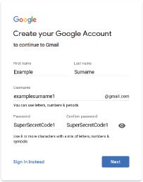
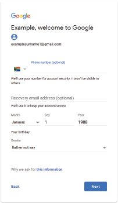
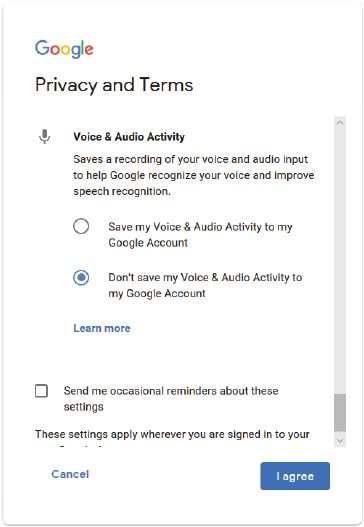
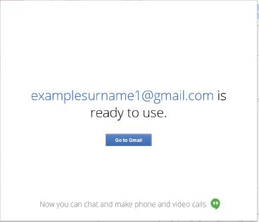

## UNIT 12.1 Register a web-based email address

Having an email address is a must in this day and age. You will use your email address for many online activities, such as signing up for a social media account or filling out online applications. Luckily, creating an email account using a web-based service is relatively easy. In this section, you will learn how to create a Gmail account.

TIPS FOR OPENING A GMAIL ACCOUNT

Learn how to create a Gmail account

[https://support.google.com/](https://support.google.com/)

 Guided Activity 12.1

**1.**Use your web browser to go to the Gmail website ([www.gmail.com](http://www.gmail.com)).

**2.**Click on the *Create an Account* button. A new page should now open.

**3.**Enter your name and surname.

**4.**Choose a username for your account.

**5.**Enter a password for your account and enter the same password in the *Confirm password* space.

**6.**Click the *Next* button.

**7.**Pay careful attention to the items on the sign-up form that are optional. You can skip these items if you want to. For Google, submitting a phone number or recovery email address allows Google to help you recover your password if you forget it.

**8.**Fill in your birthday and gender before clicking next.

**9.**Read through Google’s *Privacy and Terms* agreement.

**10.**  Read through the custom options and select which information Google is allowed to record about you.

**11.**  Once you have selected options you are comfortable with, click *I agree*.

**12.**The moment you click *I agree*, Google will create your new email account for you.

### DO’S AND DON’TS WHEN WRITING AN EMAIL

DO’S AND DONT’S FOR WRITING AN EMAIL

Learn about the Do’s and Dont’s of writing an email

[Bowvalleycollege.libguides.com](http://Bowvalleycollege.libguides.com)

There are certain “rules” to follow when you are writing an email, such as:

- Always make sure that your subject line is a clean and brief indication (summary) of what the email is about.
- Use a more professional **salutation**. If you do not know the person you are writing to, start your email with “Dear (insert name)”. If the situation is not as formal, you can use “Hi” or “Hello” instead. NEVER use any slang form of greeting such as “Yo” or “Howzit” in an email.
- Do not try to be funny when writing an email. It can easily be misunderstood and seldom works out the way you want it to. Remember, the recipient cannot see your facial expressions.
- Always proofread your message before you send it. Use your spellchecker to make sure that there are no spelling mistakes or typos. People are judged by the way their emails look.
- Do not assume that the recipient knows what you are talking about. Even if you think that they should know, make sure that your email can be read and understood without pre-knowledge. It can be very frustrating to look back through a whole string of emails to try and find something that was said previously.
- Always reply to an email. Even if you do not have the answer right away, let the recipient know that you have received their mail and will get back to them.
- Do not overuse exclamation marks. People interpret this as aggressive behaviour and seldom respond positively.
- Never send an email when you are angry. First think about what you want to say and how you want to say it. You can even save the email in the Drafts folder and go back to it after you have cooled down. Bad emails can never be retracted.
- Do not copy the whole world in your email. Send it only to the people who would really be interested in it.
- Do not play email ping-pong. If you have to reply more than twice to the same topic, rather pick up the phone and call the person.
- Do not send large attachments. Rather send a link to download the file or compress it before attaching it.

 Activity 12.1

Using a computer in class:

**1.**Create a Gmail account.

**2.**Create a distribution list.

**3.**Organise your emails by creating labels.

**4.**Set up filters in Gmail.

**5.**Apply the Gmail star system to your emails.

**6.**Prioritise your emails.

Answer the following in your own words:

**1.**Describe how you create a Gmail account.

**2.**Give five examples of good email experiences you have had. Give a reason for why you found each experience good.

**3.**Give five examples of bad email experiences you have had. Give a reason for why you found each experience bad.

**4.**Based on your experiences, make your own list of five email do’s and don’ts.
