## UNIT 12.2 Managing email

Dealing with emails is one of the most time-consuming tasks in a work environment. In 2018, it was estimated that dealing with emails was taking up almost 11 hours of the work week.

In this chapter, you will learn how to work with Gmail, but the process is the same for most other web-based email applications, such as [Outlook.com](http://Outlook.com) or [Hotmail.com](http://Hotmail.com).

### ORGANISE USING LABELS

Gmail is a label-based system where the labels are the same as folders.

Labels are a great way to organise Gmail. They are like tags you can add to emails you send or receive. Unlike folders, you can add more than one label to an email. You can also colour-code these labels to make it easier to see into which category an email falls.

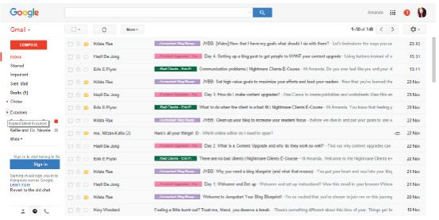

**Figure 12.1:** *Emails can be colour-coded according to their labels*

It is important to keep your system as easy and simple as possible. Do not have too many labels or categories. For example, you can create labels for:

- family
- friends
- school
- activities.

Also remember, you can add more than one label to your emails. An email coming from your school about an upcoming swimming event can be labelled both *School* and *Activities*.

 Guided Activity 12.2

**1.**Open your Gmail account.

**2.**Click the *Settings* gear icon near the top right corner of the Gmail screen.

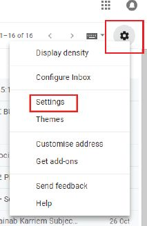

**3.**Follow the *Settings* link in the menu that comes up.

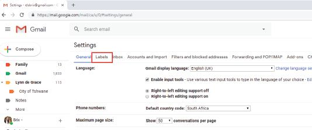

**4.**Go to the *Labels* tab shown above.

**5.**Click *Create new label* in the *Labels* section.

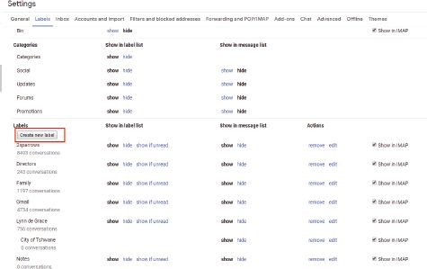

**6.**Type the new label’s desired name under *Please enter a new label name.*

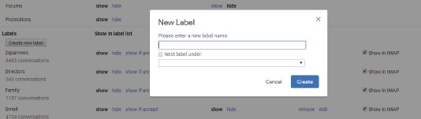

**7.**Check *Nest label under*: and select a label from the drop-down menu.

 Guided Activity 12.3

To move an existing label beneath another label:

**1.**In the section of the *Labels* tab, click *Edit* in the *Actions* column for the label you want to move.

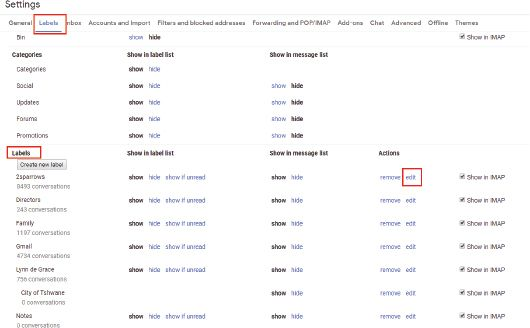

**2.**Check *Nest label under* and select a destination from the drop-down menu.

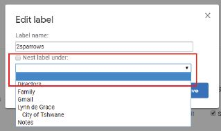

**3.**Click *Create* or *Save*.

 Guided Activity 12.4

To move a Gmail folder to the top or turn it into a subfolder:

**1.**In the section of the *Labels* tab, click *Edit* in the *Actions* column for the label you want to move.

**2.**To move the label beneath another label:

**a.**Make sure *Nest label under*: is checked.

**b.**Select the label under which you want to move the label from the drop-down menu.

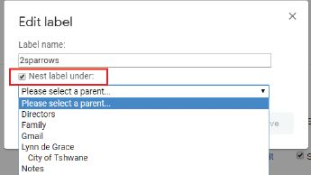

**3.**To move the label to the top, make sure *Nest label under*: is not checked.

**4.**Click *Save*.

 Guided Activity 12.5

**1.** Select each message by checking the box to the left of each message you want to label.

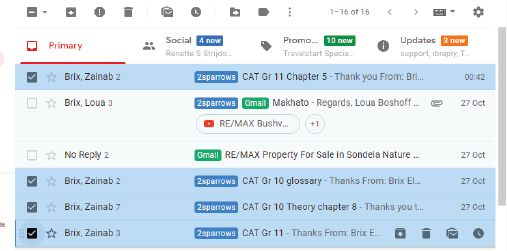

**2.**Click the *Labels* icon in the menu.

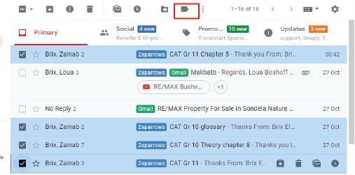

**3.**Check the boxes next to each label you want to assign to your selected messages or click *Create new* to assign a new label to the messages.

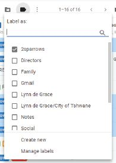

 Guided Activity 12.6

**1.**Select and open the email.

**2.**Click the X on each label you want to remove from the email.

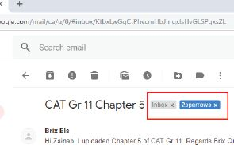

 Guided Activity 12.7

To label a message you are composing:

**1.**Click the *Menu* button in the lower right corner of the message.

**2.**Move the pointer down to *Labels*.

A slide-out menu will show you labels you have already created, if any, and give you the option of creating a new label.

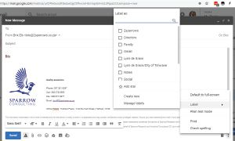

 Guided Activity 12.8

You can delete an entire label you no longer want at any time. Doing so will not delete the emails that carry that label, however. To delete a label:

**1.**Open or select any message or conversation in Gmail.

**2.**Click the *Labels* icon in the toolbar.

**3.**In the menu, click *Manage labels*.

**4.**Scroll down to the *Labels* section and under the *Actions* column, click REMOVE.

**5.**Click *Delete* to confirm the action. Gmail will delete the label and it will be removed from any messages it applies to.

 Guided Activity 12.9

All labels are coloured by dark grey text on a light grey background. To customise your label colours, you must do the following:

**1.**Move your mouse over the chosen label.

**2.**Click on the *Menu* (three vertical dots in a grey circle). The *Label colour* drop-down box will appear.

**3.**Move your mouse over the *Label colour* option and select a text and colour combination by clicking on it.

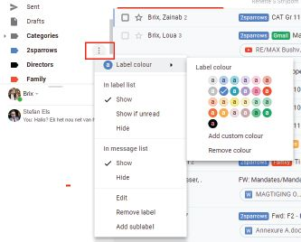

### PRIORITISING EMAILS

You can use the Gmail star system to prioritise your emails so that you can easily find the most important ones later.

By default, the Gmail stars are yellow. You can, however, change the colour as well as the type of the stars to suit your own needs.

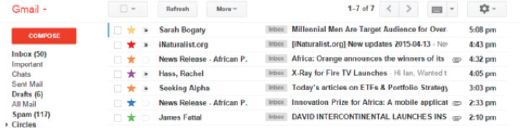

**Figure 12.2:** *Gmail’s star system*

 Guided Activity 12.10

To use the Gmail star system, set up your stars:

**1.**Click the *Settings* gear icon.

**2.**Choose *Settings*.

**3.**Click on the *General* tag.

**4.**Scroll down to *Stars*.

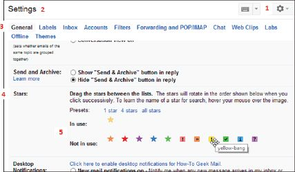

**5.**Drag icons from the *Not in use* section to the *In use* section to add different types of stars.

 Guided Activity 12.11

**1.**Add a star to a message by clicking on the star next to the email.

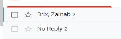

If you click it once, you will get the default yellow star. By cycling through the stars (clicking), you can choose which star to add. If you star a message while it is open, only the first star type is applied.

**2.**To find a starred message, click the Starred label on the left side of the main Gmail window.

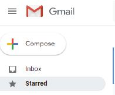

**3.**To find a message with a particular type of star, search using “has:” with the star’s name (e.g. “has:red-bang”).

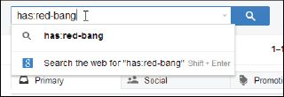

**4.**To find out what the name of the star is:

**a.**Click the *Settings* gear icon.

**b.**Choose *Settings*.

**c.**Click on the *General* tag.

**d.**Scroll down to *Stars*.

**e.**Hover your mouse over the specific type of star.

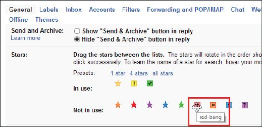

Gmail’s inbox will help you to sort out your incoming emails by setting priorities. There are five sections, namely:

**1.**Default: You can choose which emails you want to see first.

**2.**Important first: Puts all email marked important at the top of your inbox.

**3.**Unread first: Puts all unread email at the top of your inbox.

**4.**Starred first: Puts all starred email at the top of your inbox.

**5.**Priority inbox: This option lets Gmail sort and prioritise emails for you.

 Guided Activity 12.12

To decide which type of email you want to see at the top of your inbox:

**1.**Open your Gmail inbox.

**2.**Click on the down arrow on the left.

**3.**Choose an option.

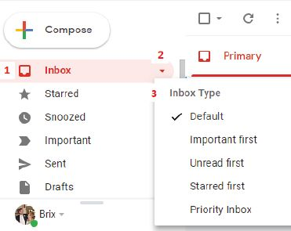

### DISTRIBUTION LISTS

A contact group (formerly called a “distribution list”) consists of a list of email addresses without having to add each name to the To, Cc, or Bcc lines of an email individually. Its main purpose is to allow a user to automatically share a message to all the recipients on the distribution list at the same time.

You can, for example, have a personal distribution list called “family” that includes the email addresses of all your relatives. Rather than typing or selecting each address, you just use the list address. A distribution list is different from an email list in that members cannot directly send emails to other members who are on it.

Something to know

This can also be done by clicking on the waffle icon (

) and then clickiang on *Contacts*. You may need to click on *More* first to see the link to your contacts.

 Guided Activity 12.13

**1.**Open the Google contacts page by typing [https://contacts.google.com/](https://contacts.google.com/) in your web browser.

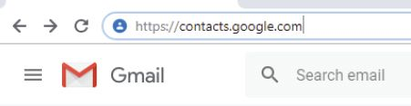

This will open a page with all your contacts’ details on it.

**2.**Select your contacts by hovering your mouse over each contact’s profile picture or placeholder.

**3.**Click the checkbox that appears below your cursor and repeat this process for each contact you want to add.

**4.**Click the *Labels* icon in the upper right corner of the page. A dropdown menu will appear.

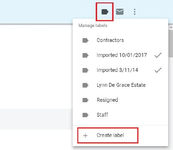

**5.**Click on *Create label*. This prompts a pop-up window.

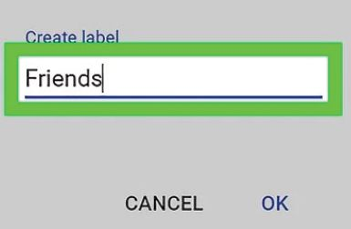

**6.**Type in the name of the distribution list, for example “Friends”. This is the name that you will use in the *To* field when you want to send an email.

**7.**Click *OK* at the bottom right corner of the pop-up window. This will save your list of contacts as a label.

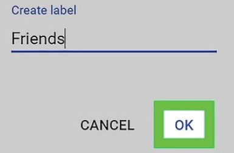

To send an email to your distribution list, you will follow the normal email procedures, typing in “Friends” in the *TO* field.

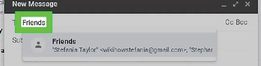

### FILTERS

Filters help you to set up rules for how Gmail should handle your incoming emails, for example it can send an email to a label, or it can archive, delete, star or automatically forward the email.

Filters are relatively easy to set up using search criteria in Gmail itself.

 Guided Activity 12.14

**1.**Click the *Settings* gear icon near the top right corner of the Gmail screen.

**2.**Follow the *Settings* link in the menu that comes up.

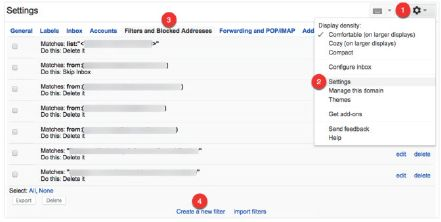

**3.**Select the *Filters* and *Blocked Addresses*.

**4.**Click the *Create a new filter* link.

**5.**Complete the filter creation form.

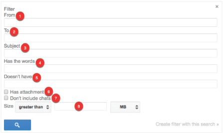

**1.***From*: Filter emails sent from a specific email address.

**2.***To*: Filter emails sent to a specific email address.

**3.***Subject*: Filter emails that use a specific subject line.

**4.***Has the words*: Filter emails that contain specified keywords.

**5.***Doesn’t have*: Filter emails that don’t contain specified keywords.

**6.***Has attachment*: Filter emails that include an attachment.

**7.***Don’t include chats*: Ignore Hangouts chats when applying filters.

**8.***Size*: Filter emails larger or smaller than a specific size.

You can also filter specific messages by opening the email, clicking the More button and selecting Filter messages like these.

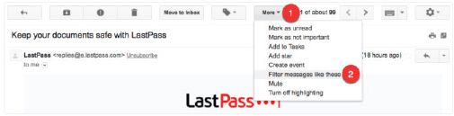

If you used this option while in a specific email, Gmail automatically fills in the “from” email address for you:

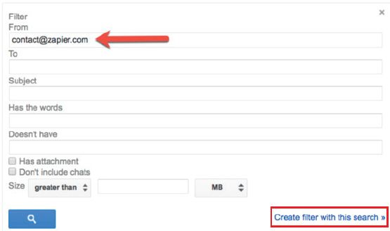

**6.**After selecting the criteria for your filter, click the *Create filter with this search* link to specify what Gmail must do with emails that match this filter.

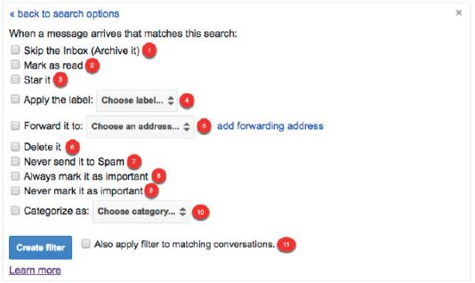

**1.***Skip the inbox*: Archive the email so that it does not appear in your inbox.

**2.***Mark as read*: Have the email appear in your inbox as an already-read item.

**3.***Star it*: Automatically star the email.

**4.***Apply the label*: Apply a specific label to the email.

**5.***Forward it to*: Automatically forward the email to a different email address.

**6.***Delete it*: Send the email to the trash.

**7.***Never send it to Spam*: Prevent Gmail from tagging the email as spam.

**8.***Always mark it as important*: Automatically tag filtered emails as important.

**9.***Never mark it as important*: Tell Gmail not to tag filtered emails as important.

**10.**  *Categorise as*: Automatically categorise filtered emails.

**11.**  *Also apply filter to matching conversations*: Automatically applies the selected conditions to every email in your account that matches the selected filter criteria.

 Guided Activity 12.15

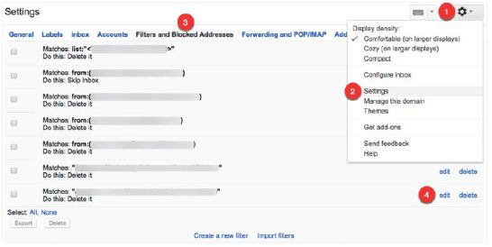

**1.**Click the *Settings* gear icon.

**2.**Choose *Settings*.

**3.**Select the *Filters* and *Blocked Addresses* tab.

Find the filter you want to edit or delete.

**4.**Click the *Edit* link to update the filter criteria and behaviour or click the *Delete* link to delete it.

 Activity 12.2

Answer the following in your own words:

**1.**Give three examples of email applications.

**2.**What are the benefits of using labels in Gmail?

**3.**Describe how you set up a filter in Gmail.

REVISION ACTIVITY

QUESTION 1: MULTIPLE CHOICE

**1.1**Which of the following is NOT electronic communication? (1)

**A.**Instant messaging

**B.**Teleconferencing

**C.**Faxing

**D.**Social networking

**1.2**Which of the following can be done with Gmail labels? (1)

**A.**Creating filters

**B.**Prioritising emails

**C.**Archiving emails

**D.**Organising emails

**1.3**What does the following process show? (1)

**Step 1:**In the section of the *Labels* tab, click *Edit* in the *Actions* column for the label you want to move.

**Step 2:**Check *Nest label under* and select a destination from the drop-down menu.

**Step 3:**Click *Create* or *Save*.

**A.**How to move a label under another label

**B.**How to filter your inbox

**C.**How to move an email under a label

**D.**How to star an email

**1.4**When would you use the Gmail star system? (1)

**A.**To highlight all your important emails

**B.**To delete an email

**C.**To organise all your emails

**D.**To find a specific email

**1.5**You and a specific group of your friends share inspirational quotes with each other every day by email. Which of the following make this process easier? (1)

**A.**Star system

**B.**Labels

**C.**Distribution list

**D.**Filters

QUESTION 2: TRUE OR FALSE

Choose the answer and write True or False next to the question number. Correct the statement if it is FALSE. Change the underlined word(s) to make the statement TRUE. (You may not simply use the word NOT to change the statement.)

**a.**When it comes to a password, try to choose a password that is short and easy to remember. (1)

**b.**Artificial intelligence is a type of electronic communication. (1)

**c.**To keep your system simple and easy add all the labels and categories you need. (1)

**d.**You can remove a label from an email by clicking on the “Remove” option on the label you do not want. (1)

**e.**All labels are coloured by a dark grey text on a light grey background. (1)

QUESTION 3: MATCHING ITEMS

Choose a term/concept from Column B that matches a description in Column A. Write only the letter next to the question number (e.g. 1A). (5)

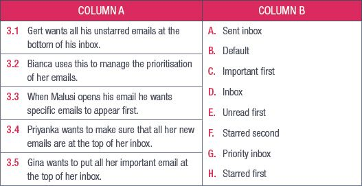

QUESTION 4: FILL IN THE MISSING WORDS

Fill in the missing word(s) in the following statements. Provide only one word for each space.

**a.**A distribution list consists of a list of email addresses in a standard email program or on a**i)** ___________ system. Its main purpose is to allow a user to automatically**ii)** ___________ a message to all the recipients on the distribution list at the same time.

**b.**When someone sends you an email, you need to **iii)** ___________ to the email, since the **iv)** ___________ will not automatically know if you received the email or not.

QUESTION 5: SCENARIO-BASED QUESTIONS

Nandini is a website designer. She has not maintained her email account for a long time. But recently a client of hers has requested that she forward them an email that shows confirmation for a bank account payment. With more than 600 emails to sift through, to find the exact email her client is looking for will take time.

**5.1**Mention one thing that Nandini can do to better manage her emails. (1)

**5.2**Nandini wants to organise and separate all her emails under the following labels:

- Clients
- Personal
- Family
- Friends

**a.**What process must Nandini follow to create a filter that will mark all her clients’ emails as important? (6)

**b.**What process must Nandini follow if she wants to create a label for all her clients’ emails? (6)

**c.**What process must Nandini follow if she wants to create a distribution list for her following clients? (8)

- [mpumi4sure@gmail.com](mailto:mpumi4sure@gmail.com)
- [Jared.masters@creativedesigns.co.za](mailto:Jared.masters@creativedesigns.co.za)

**TOTAL: [40]**

AT THE END OF THE CHAPTER

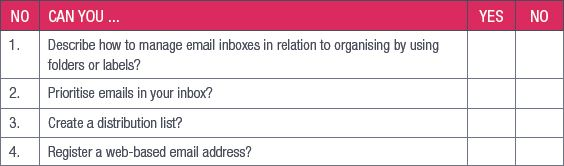
