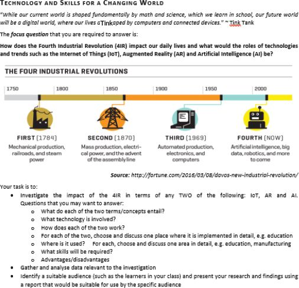

## UNIT 13.1 Defining the task

It may seem obvious but before you can successfully complete any task or investigation, you need to understand exactly what it is that you are going to do. This is why you need to carefully consider the task you have been given by breaking it down into smaller sections and describing it in your own words, called the task definition.

To understand what is expected of you, you must do the following:

**1.**Read the instructions. Does the task call for a report? How will you gather the information?

**2.**Rewrite the question in your own words. Get to the core of the question. Rewriting helps you understand exactly what you need to do so that you do not waste time looking for the wrong data. It also helps you decide what type of data you need and how to gather it.

**3.**Identify the key terms. Look for verbs or subject-specific terms in the task (verbs like “report back” give guidelines on how you should present information).

DEFINING THE TASK

Look at the image below, taken from the 2018 PAT.

Looking at the task outline, you can begin to define what you need to do. In this case, you would need to choose two technologies from the Fourth Industrial Revolution (4IR) and investigate their impact on modern life.

The task outlines various questions you can ask yourself to further refine your search for information. You are then instructed to gather the data and analyse it and, finally, to present your findings in a report. With this information, you will be able to start your research.

Something to know

Your PAT task description should be about 200 words.

To understand how important it is to make sure that you know what you are being asked to do, read through the scenario below.

UNDERSTANDING TASKS

Julia, Mbali and Shiven are on the organising committee for the Grade 12 dance. They have each been given a task to complete to better help the organisers understand what the Grade 12s want:

- Julia has been asked to find out how many Grade 12s would be interested in bringing a partner from outside the school to the dance and to give a report to the teacher supervisor, Mr Smith.
- Mbali has been asked to find out what theme the Grade 12s want for the dance so that she can let the decorating committee know what they need to buy.
- Shiven has been asked to find out about the music.

Julia begins by breaking down her task. She decides that the best way to go about gathering the information is through an online survey. She first has to design the survey and then distribute it. She decides to use Google Forms for her survey and sends the link to the Grade 12 WhatsApp group. She asks people to please fill in her survey by Friday. Once she has this information, she downloads the report that Google Forms generates and gives it to Mr Smith.

Mbali also decides to break down her task but immediately runs into a problem. She has no clear idea of what the decorating committee is willing to spend on decor and they have not given her suggestions for themes. Mbali realises that if she were to ask the Grade 12s what theme they would want, she would end up with a different response for each person.

Mbali will need to get more information before she can complete her task. She decides to ask the decorating committee the following questions:

- Are there any theme suggestions?
- Is there a budget and how does that limit the theme?

The decorating committee tells her that they have three theme ideas. Now that she has this information, she can define her task. She decides a simple survey will also help her get the information the decorating committee needs.

Shiven’s task is too vague. He will need to get more information on the following:

- Is the school willing to pay for a band or DJ? Or should he ask for a learner volunteer?
- Will there be sound equipment available or will the performers need to provide their own?
- What kind of music do the Grade 12s want at the dance?
- What kind of music will the school not allow?

Only when he has this information, will he be able to define his task and give the appropriate solution.

 Activity 13.1

Define a task definition and a focus question for the 2018PAT.
