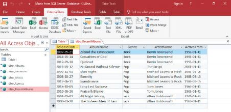

## UNIT 13.4 Spreadsheets and databases in data handling

Spreadsheets are documents that have numbered rows and lettered columns that structure data. Examples of spreadsheet software include Microsoft Excel, Google Sheets, LibreOffice Calc and iWork Numbers. You can use spreadsheets to manipulate and organise raw data before putting it in a database, as well as to:

- Do mathematical calculations (adding totals, working out averages and percentages, etc.)
- Display data using charts and graphs
- Define and refine data by breaking it down or splitting it (for example, taking a single row and column of data and splitting it into many columns using a function)

Spreadsheets can also be used as a modelling tool, that is, you can use them to predict **trends**. As an example, if a company wants to find out what would happen if it reduced the price of one of its products, it could use a spreadsheet to analyse the changes to its profit margins.

Databases, on the other hand, can do exactly what a spreadsheet can, but with more data, since spreadsheets are limited in the amount of data they can hold. Databases are also usually kept on a server, so they can use the bigger processing power of the server to do large and complex procedures and calculations with the data faster than a spreadsheet can.

**Figure 13.2:** *MS Access database*

Databases can also better analyse and connect data than spreadsheets, which makes it easier for users to search for, and extract information from, the data. Databases are also designed to connect data more easily across multiple tables.

However, other than the amount of data and the speed of processing, databases and spreadsheets are very similar. In fact, most reports are generated in a database and then exported to a spreadsheet to be displayed. Some website databases need data to be uploaded in spreadsheets saved in a special format called comma separated values (*.csv).

 Activity 13.4

Answer the following questions in your own words.

**1.**What is the main difference between a database and a spreadsheet?

**2.**When will you use a database rather than a spreadsheet?

**3.**What is data handling?

**4.**Give three examples of what you can use spreadsheets for.

**5.**What can databases do better than spreadsheets?
