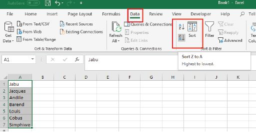
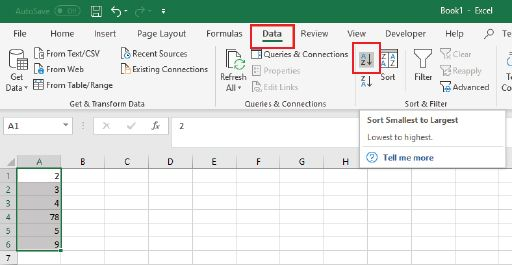
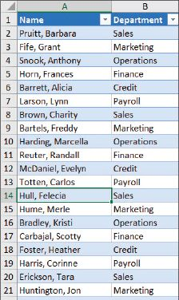
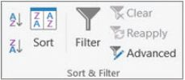
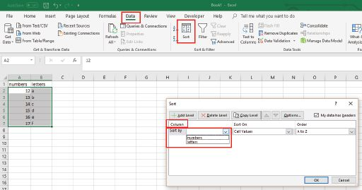
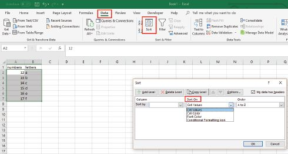
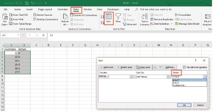
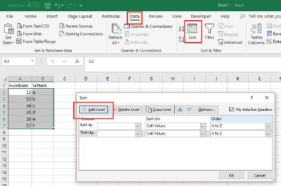
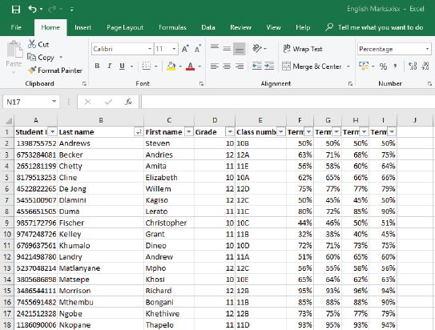

## UNIT 13.5 Processing data

You need to process data or manipulate raw data to draw information from it, that is, you need to **crawl** through and analyse the data to draw the most relevant/appropriate information from the data.

There are several techniques or tools you can use to do this. These will be discussed below.

### TOOLS AND TECHNIQUES

Manipulating data is the process of **sorting**, arranging or moving the data without changing it. To manipulate data, you should first keep the following in mind:

- You need to know the features of the programs you are using and how to use them.
- Make sure that the data is in the correct format for what you need to do. If it is not, you will need to reformat it or export it into the most appropriate format.
- You might have to use more than one tool to process the data correctly.
- The tools you can use include sorting, formulae and functions and queries. Sorting changes the order of the data. It can be done to numerical data (sorting numbers from lowest to highest) or strings (sorting text alphabetically). This is mostly done in spreadsheets.

 Guided Activity 13.1

This is an important function to use in Excel as you might want to arrange data alphabetically, from highest to lowest, or order it by colour or icon. This will help you to visualise and understand your data better.

You can, for example, sort text from A to Z or Z to A, numbers from smallest to largest or vice versa, and dates from oldest to newest, or newest to oldest. You can also sort according to your own custom list or format.

**1.**To sort text:

**a.**Select a cell in the column you want to sort.

**b.**On the *Data* tab, in the *Sort & Filter* group, do one of the following:

- To quick sort in **ascending order**, click
  
   (Sort *A* to *Z*).
- To quick sort in **descending order**, click
  
   (Sort *Z* to *A*).

**2.**To sort numbers:

**a.**Follow steps one and two above.

- To sort from low to high, click
  
   (Sort *Smallest* to *Largest*).
- To sort from high to low, click
  
   (Sort *Largest* to *Smallest*).

**3.**To sort dates and time:

**a.**Follow the same procedures as above.

**4.**To sort more than one row or column:

**a.**Select any cell in the data range.**Note**: For the best results, the range of cells that you sort should have column headings.

**b.**On the *Data* tab, in the *Sort & Filter* group, click *Sort*.

**c.**In the *Sort* dialog box, under *Column*, in the *Sort by* box, select the first column that you want to sort.

**d.**Under *Sort On*, select the type of sort. Do one of the following:

**i.**To sort by text, number, or date and time, select *Values*.

**ii.**To sort by format, select *Cell Color*, *Font Color*, or *Cell Icon*.

**e.**Under *Order*, select how you want to sort. Do one of the following:

**i.**For text values, select *A to Z* or *Z to A.*

**ii.**For number values, select *Smallest to Largest* or *Largest to Smallest*.

**iii.**For date or time values, select *Oldest to Newest* or *Newest to Oldest*.

**iv.**To sort based on a custom list, select *Custom List*.

**f.**To add another column to sort by, click *Add Level*, then repeat steps c. to e.

You can also use the various formulae and functions in a spreadsheet program (such as Microsoft Excel) to help you process data. You will have seen most of the functions in action in your practical lessons on Excel; but a list of functions is included below:

- SUM calculates the total of a range of numbers.
- AVERAGE gives the average of a range of values.
- MIN returns the minimum value in a list of values.
- MAX returns the maximum value in a list of values.
- COUNT counts the numbers in a list of values.
- COUNTIF is used for counting cells within a specified range that meet a certain condition.

Something to know

Remember, all formulas begin with an = sign in Excel.

These functions let you interpret large sets of data but are not very good for visualising the data. You can use charts and graphs to visualise data and analyse trends.

### EXTRACTING APPROPRIATE INFORMATION

Within spreadsheets and **databases**, there are various tools and commands you can use to extract information, for example, for a big data set, you can use VLOOKUP in Excel.

To see how extracting information is different using Microsoft Excel and Microsoft Access, look at the case study below.

 Case Study Extracting information

Mrs Dlamini is the administrative assistant at a school. The head of department for English has asked her to find the yearly average English mark for all Grade 11 learners for the previous year. The spreadsheet Mrs Dlamini is given contains the English marks for every assessment and assignment for every learner in Grade 10, Grade 11 and Grade 12.

So how would Mrs Dlamini find the information?

First, she will need to look at the data she has. When she does this, she sees that the columns have a learner ID number, their full names, grade, class number and terms one, two, three and four marks (as you can see in Figure 13.3).

**Figure 13.3:** *English marks for senior students*

Because this spreadsheet is sorted alphabetically, it is hard to tell which learner is in which grade. In Excel, Mrs Dlamini would need to use the filters on the columns to sort the learners by grade (column D) and then only display the Grade 11 learners. She would then have to use the *Average* function to work out each student’s average mark for the year in column J. At the bottom of the data in column J, she would then need to use the *Average* function again to work out the yearly average for Grade 11.

If this spreadsheet was in a database, with the exact same headings and information, Mrs Dlamini would only need to use a single **query** to do exactly what she did on the spreadsheet.
