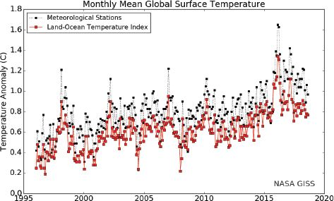
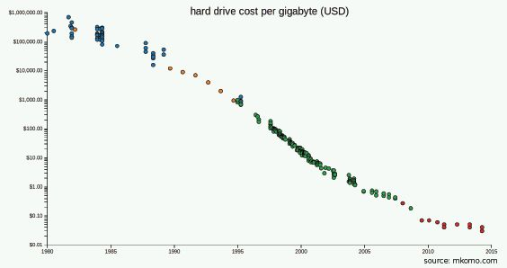
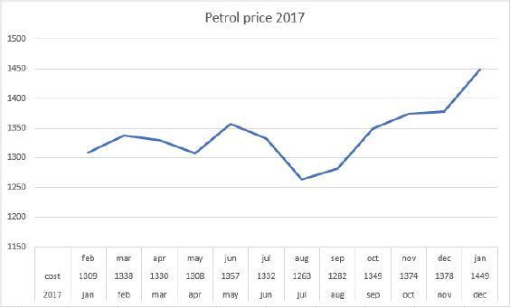
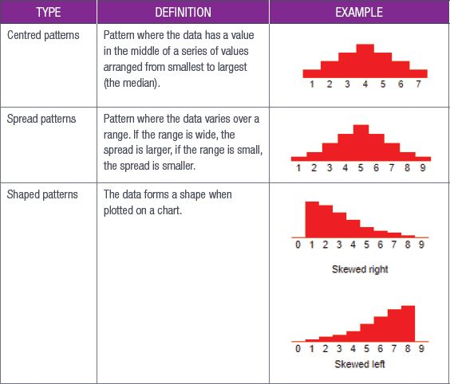
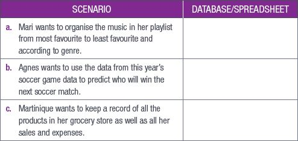
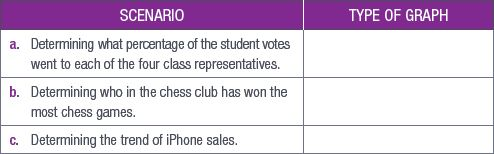
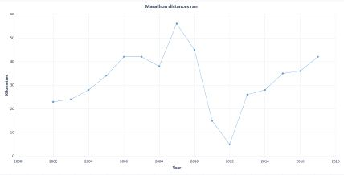
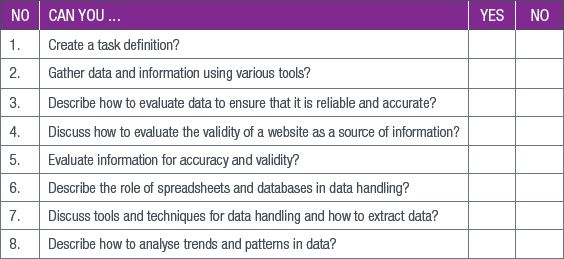

## UNIT 13.6 Analysing data and information

After you have collected your data and formatted it, you will need to analyse your results and compare them to a question. But how do you do this? The best way to support or disprove your question is to look at trends and patterns. This section looks at how to verify and validate your data, how to add data questions to your data to help analyse it and how to analyse for trends and patterns.

### ADDING DATA QUESTIONS

Once you have verified your data, you can begin to apply the data questions to it so that you can categorise and organise the data. As you learned in Grade 10, the data questions are:

- How many?
- What is most popular?
- What is least common?
- How many more than?
- What is the average?

### TRENDS AND PATTERNS

The final step in data analysis is to look for trends and patterns. While these may seem like the same thing, they are not. Trends are the general tendency of data to move in one direction over time. In a trend, the data points may vary slightly, but they all still move in the same direction.

Think of global temperatures. We all know that the temperature of the Earth is getting higher each year, in fact, scientists have been recording and comparing surface temperatures on Earth for the last 100 years. Looking at this data, we can see that while there have been some very hot and very cold days, the overall trend for global temperatures is up. You can see this in the graph in Figure 13.4.

**Figure 13.4:** *Global surface temperature graph*

This type of trend is known as an **upward trend**.

Another type of trend is known as **downward trend** or downtrend. This happens when the data points move down, for example, the cost of computers and computing technology has decreased since the start of the computer age. If you look at the cost of the first home computers in the 1980s and compare that cost over time to now, you will see that the prices have come down.

**Figure 13.5:** *The cost per gigabyte of hard drives in the United States of America*

You may also see a link between the cost of computing devices going down while their processing power and speed goes up as the technology improves over time. This is called a **correlation trend**.

Unlike upward or downward trends, which happen slowly over time, step changes show a massive increase or decrease in the trend. Think of the price of petrol, which can increase or decrease slowly or suddenly jump up or down depending on how much oil costs.

**Figure 13.6:** *Step chart showing the Inland price of 93 ULP in 2017*

Other trends include daily and seasonal cycles.

Patterns are a little different. Data does not always move up or down over time. Data can also repeat itself in a predictable way or form a shape when placed in a graph. This type of data pattern is usually described in terms of its features, like centred, spread or shape. Table 13.1 describes these patterns and gives an example of each.

**Table 13.1:** *Data pattern types*

 Activity 13.5

Answer the following questions in your own words.

**1.**What is data verification?

**2.**Why do you use data verification?

**3.**Name four data validation techniques, describe how they work and give an example of each.

**4.**What are two main types of data entry mistakes?

**5.**Give three examples of trends and how they would be displayed in a report.

**6.**When analysing data, what is a “pattern”?

**7.**Analyse the data from Activity 13.4 and determine trends and patterns if any are present. Present your findings to the class.

**8.**Write a short paragraph to interpret the graph Petro Price 2017 in Figure 13.6 and derive a conclusion from it.

REVISION ACTIVITY

QUESTION 1: MULTIPLE CHOICE

**1.1**Data handling can be used to do which of the following? (1)

**A.**Collect information

**B.**Organise data

**C.**Sort information

**D.**Analyse data

**1.2**Which information can be gathered from the following data? (1)

**A.**The price of petrol in 2018

**B.**The components of petrol

**C.**The trend of petrol prices during the year

**D.**The amount of petrol produced in 2017

**1.3**Which of the following is the last step of the information management process? (1)

**A.**Presenting information

**B.**Collecting data

**C.**Processing a database

**D.**Analysing results

**1.4**When evaluating a website, which of the following questions must not be asked? (1)

**A.**Who supports this website?

**B.**Who is this website aimed at?

**C.**Which year was the website established?

**D.**Who is the author?

**1.5**When evaluating information, which of the following must not be determined? (1)

**A.**Authority

**B.**Accuracy

**C.**Objectivity

**D.**Consistency

QUESTION 2: TRUE OR FALSE

Choose the answer and write True or False next to the question number. Correct the statement if it is FALSE. Change the underlined word(s) to make the statement TRUE. (You may not simply use the word NOT to change the statement.)

**a.**Spreadsheets store their data on a server. (1)

**b.**Databases are able to perform complex calculations on small amounts of data. (1)

**c.**Analysis is the first step of the information management process. (1)

**d.**Surveys and questionnaires can be electronic. (1)

**e.**If a website does not have the name of the author, it is a good website. (1)

QUESTION 3: CATEGORISATION QUESTIONS

**3.1**Which of the following situations would use a database or spreadsheet? (3)

**3.2**Which of the following types of graph would best represent the following scenario? (3)

**A.**Bar graph

**B.**Line graph

**C.**Histogram

**D.**Pie chart

QUESTION 4: SHORT QUESTIONS

**4.1**List two tools you can use to gather data. (2)

**4.2**What is the difference between a trend and a pattern? (2)

**4.3**Why should you avoid questions that start with “Why”? Also mention how you can prevent this. (2)

QUESTION 5: SCENARIO-BASED QUESTIONS

In order to lose weight and become healthier, Greg decided to start jogging so that he could run in different marathons. Each year Greg recorded how many kilometres he ran. Look at the following graph and answer the questions that follow.

**5.1**What type of graph is this? (1)

**5.2**Does this graph represent data or information? Give an explanation for your answer. (2)

**5.3**According to this graph, when did Greg run the longest distance? (1)

**5.4**What is the trend from 2002 to 2009? (1)

**5.5**Mention two things that this trend indicates about Greg’s health. (2)

**5.6**Greg badly injured his ankle during a marathon and was advised by the doctor not to run for the next year. According to this graph, in which year did this injury occur? (1)

Nomfundo had to do research on the different phone brands on sale at the Innovation Tech store. While doing this she found that they sold the following brands:

- Samsung
- Apple
- Nokia
- Blackberry
- Huawei
- LG

Now Nomfundo wants to use this information to figure out what the most popular phone brands are at her school so she can know if it would be a good idea to promote this store at her school.

**5.7**Based on this scenario, identify the two problems Nomfundo must solve. (2)

**5.8**What information-gathering method Nomfundo can use to solve this problem? Give a reason for why she should use this method, and a reason for why she cannot use the other two methods. (4)

**5.9**What two tips would you give Nomfundo about creating questions? (2)

**5.10** Create two questions that Nomfundo can ask her school peers to find the information she needs. (2)

**TOTAL: [40]**

AT THE END OF THE CHAPTER

